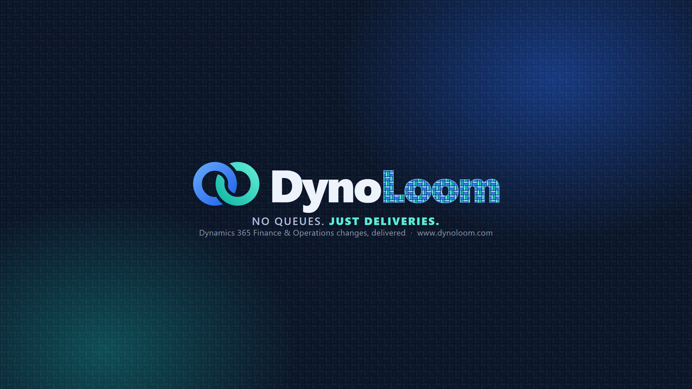

<p align="center"></p>

# DynoLoom — AI-built Dynamics 365 F&O extensions, in the open

DynoLoom turns a **Dynamics 365 Finance & Operations requirement document** into a **technical design**, then into
**compiled X++ code** delivered to the client's own model. This repository publishes real requirements that went
through the platform, end to end, so you can judge the output for yourself: the input, the design, every line of
generated metadata, and the test evidence.

Nothing here has been edited for show. The code in each `3-code` folder is exactly what the platform delivered.

🌐 [www.dynoloom.com](https://www.dynoloom.com) · ✉️ [info@dynoloom.com](mailto:info@dynoloom.com) ·
▶ Walkthrough videos: [youtube.com/@Dynoloom](https://www.youtube.com/@Dynoloom), one per requirement, linked in the table below

> **About the `DYLO` prefix.** Every object in this repository is named `DYLO_…`, in a model called `DYLOExtensions`:
> that is the object prefix of the demonstration workspace these requirements were raised in. DynoLoom builds each
> client's changes with the client's own prefix and in the client's own model.

---

## Delivered requirements

<!-- requirements:start -->
| # | Requirement | What it exercises | Files | Test plan | Tested in F&O | Video |
|---|---|---|---:|---:|---|---|
| 1 | [REQ-INV-105 — PO reference & delivery instructions on invoices](requirements/REQ-INV-105-sales-invoice/) | Field flow order → posted invoice, redesigned invoice report, Print management | 12 | 10 | ✅ 8 passed · ◐ 1 partly · ❌ 1 failed | [🎬 Watch](https://youtu.be/TOsRhbpmtW0) |
| 2 | [REQ-DMF-602 — Customer data entity extension](requirements/REQ-DMF-602-customer-data-entity-extension/) | Table, form and data entity extensions, DMF/OData defaulting and validation | 10 | 9 | ✅ 7 passed | [🎬 Watch](https://youtu.be/nBB0X_uTIaA) |
| 3 | [REQ-AR-410 — Open backorders & fulfilment risk report](requirements/REQ-AR-410-open-backorders-report/) | SSRS report: RDP class, contract, UI builder, temp tables, KPI cards | 15 | 17 | ✅ 12 passed · ◐ 4 partly | [🎬 Watch](https://youtu.be/71MgQTBagi0) |
| 4 | [REQ-COL-715 — Overdue invoice batch & notification log](requirements/REQ-COL-715-overdue-invoice-batch/) | SysOperation batch, e-mail, log table, inquiry form, resend and purge | 27 | 17 | ✅ 7 passed · ◐ 2 partly · ❌ 1 failed | [🎬 Watch](https://youtu.be/js8i84g-rlU) |
| 5 | [REQ-PRC-901 — Batch mass price update](requirements/REQ-PRC-901-batch-mass-price-update/) | SysOperation batch split into parallel tasks, trade agreement journals, rounding rules, run log | 20 | 12 | ✅ 10 passed · ◐ 1 partly | [🎬 Watch](https://youtu.be/1T1H5YXfSs0) |
| 6 | [REQ-PIM-903 — Merchandising tree hierarchy](requirements/REQ-PIM-903-merchandising-tree-hierarchy/) | Tree form, re-parenting with cycle check, margin inheritance, product assignment | 24 | 16 | ✅ 11 passed · ◐ 1 partly | [🎬 Watch](https://youtu.be/unI3t9J5ORs) |
| 7 | [REQ-AR-804 — Credit limit change workflow](requirements/REQ-AR-804-credit-limit-workflow/) | Custom workflow type with conditional approval, locked credit limit, request form, roles | 42 | 17 | ✅ 1 passed | [🎬 Watch](https://youtu.be/IAsy3jDSc8o) |
| 8 | [REQ-GL-902 — Warranty provision ledger posting](requirements/REQ-GL-902-warranty-ledger-voucher-posting/) | Invoice posting extension, entries in the invoice voucher, setup form, credit-note reversal | 18 | 13 | ✅ 12 passed | [🎬 Watch](https://youtu.be/wHyLtTcY0UM) |
| 9 | [REQ-INT-508 — Inbound sales order API with tracing](requirements/REQ-INT-508-sales-order-api/) | Custom JSON service, idempotency, trace log, reprocessing form, security roles | 42 | 18 | ✅ 13 passed · ◐ 2 partly | [🎬 Watch](https://youtu.be/c-qsxyWWLUw) |
<!-- requirements:end -->

**Files** counts the files delivered (classes, tables, forms, extensions, security, menus and labels).
**Test plan** is the number of test scenarios in the approved design. **Tested in F&O** counts the scenarios we ran
ourselves in Finance & Operations on the Contoso demo data, with a screenshot for each result: passed, partly
passed, or failed. Failures are published as they are, on each requirement's `4-testing` page, and are fixed under the
delivery's warranty. All nine compiled with **0 errors** on delivery.

They are ordered from the simplest change to the most technical one, the order the walkthrough videos follow.

More requirements are added here as they are delivered.

## How to read a requirement folder

Each folder follows the same four steps the platform does:

```
requirements/REQ-XXX-nnn-name/
├── README.md              Summary, status and the list of every object delivered
├── 1-requirement/         The client's FRD (.docx as submitted) and a Markdown copy
├── 2-design/              The generated Technical Design Document the client approved
│                          (and the readiness questions it asked, when it asked any)
├── 3-code/                The X++ metadata exactly as delivered, plus the full diff (changes.patch)
└── 4-testing/             Test scenarios from the TDD, results, and screenshot evidence

```

A good place to start is a requirement's **README**, then its **TDD**, then the code it links to.

## Documentation

- [How DynoLoom works](docs/how-it-works.md) — from requirement to delivered code
- [Code standards](docs/code-standards.md) — the rules every generated object follows, and how to check them
- [Reviewer's guide](docs/reviewers-guide.md) — what to look at, and how to load the code on a dev box
- [Build verification](docs/build-verification.md) — the nine requirements recompiled independently, in delivery order: 0 errors

## About the data

All requirements were written for, and tested on, the standard **Contoso demo data** (for example legal entity USMF).
Names, customers, items and amounts in documents and screenshots are Microsoft demo data, not client data.

## License

Published for evaluation. You may read, clone and study this repository; see [LICENSE](LICENSE) for terms.
