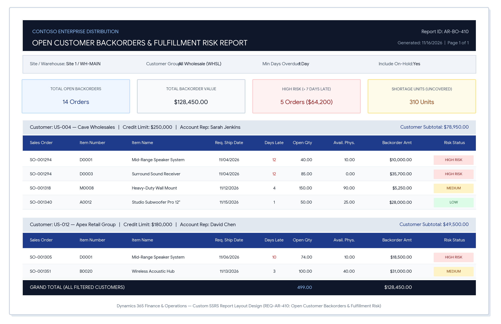

> Original document: [REQ-AR-410-FRD.docx](REQ-AR-410-FRD.docx). This page is a Markdown copy for reading on GitHub.

_MICROSOFT DYNAMICS 365 FINANCE & OPERATIONS  |  CUSTOM REPORT SPECIFICATION_

# Functional Requirement Document — REQ-AR-410

| Requirement ID: | REQ-AR-410 |
|---|---|
| Report Title: | Open Customer Backorders & Fulfillment Risk Summary Report |
| Module & Menu Path: | Accounts Receivable > Inquiries and Reports > Orders > Open Backorder Risk Summary |
| Report Type: | New Custom SSRS Report (From Scratch — Contract, UI Builder, DP Class, Precision Design) |
| Target Audience: | Customer Service Managers, Supply Chain Planners, Credit Controllers |

## 1. Business Context & Objective

Customer service and supply chain teams currently lack a unified, single-page view of open customer sales order lines that have passed their requested shipping date without full delivery. Users must manually cross-reference open sales orders against on-hand inventory balances to identify fulfillment bottlenecks. This requirement defines a brand-new SSRS report built from scratch to highlight overdue backorders, quantify uncovered stock shortages, and categorize delivery delay severity by customer.

## 2. Report Dialog Parameters

| Parameter Label | Data Type | Mandatory | Functional Behavior |
|---|---|---|---|
| Site / Warehouse | Lookup (Site / WH) | No | Filters open sales order lines by shipping Site and Warehouse. Defaults to all warehouses if left blank. |
| Customer Group | Lookup (CustGroup) | No | Allows filtering the report to a specific customer segment (e.g., Wholesale, Retail). |
| Customer Account | Multi-select Lookup | No | Allows running the report for one or multiple specific customer accounts. |
| Min Days Overdue | Integer | Yes | Minimum number of days past Requested Ship Date to include (Default = 1 day). |
| Include Credit-Hold Orders | Check Box (Yes/No) | Yes | Determines whether open orders currently blocked on credit hold are included (Default = Yes). |

## 3. Business Logic & Calculation Rules

- **Eligible Order Lines:** Include open Sales Order lines where Sales Status is 'Open order', Remain Sales Physical quantity > 0, and Requested Ship Date is earlier than the report execution date by at least the 'Min Days Overdue' parameter.
- **Days Late Calculation:** Calculated as (Report Execution Date minus Line Requested Ship Date).
- **Available Physical Inventory:** Displays the current Available Physical on-hand stock for the item in the line's specified Warehouse so planners immediately see whether stock exists to fulfill the backorder.
- **Backorder Amount:** Calculated as (Remain Sales Physical Quantity × Line Net Unit Price) converted to the company accounting currency.
- **Fulfillment Risk Classification:** Automatically assigns a visual risk status badge per line based on delay duration: HIGH RISK (> 7 days late), MEDIUM (3 to 7 days late), and LOW (1 to 2 days late).

## 4. Report Layout & Visual Design Mockup

The SSRS precision design must follow the layout structure shown below, featuring an executive KPI summary bar at the top, customer-grouped line item tables with color-coded risk badges, customer subtotals, and a grand total footer:

Figure 1: Target SSRS Report Design — Open Customer Backorders & Fulfillment Risk Summary (REQ-AR-410)

## 5. Business Acceptance Criteria

| AC # | Test Scenario | Expected Result |
|---|---|---|
| AC-01 | Menu Navigation & Dialog | Users can open the report from Accounts Receivable > Inquiries and Reports > Orders and filter by Warehouse, Customer Group, and Min Days Overdue. |
| AC-02 | KPI Summary Accuracy | The four top KPI cards accurately sum total backorder count, total backorder currency value, high-risk (>7 days) totals, and uncovered shortage units. |
| AC-03 | Customer Grouping & Totals | Lines are grouped cleanly by Customer Account showing Credit Limit and Account Rep in the group header, with accurate Customer Subtotals and Grand Total. |
| AC-04 | Risk Status & Export | Risk status badges render with appropriate color coding on screen and export cleanly to PDF and Excel without column truncation. |
