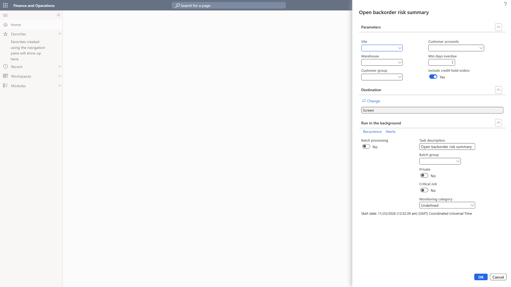
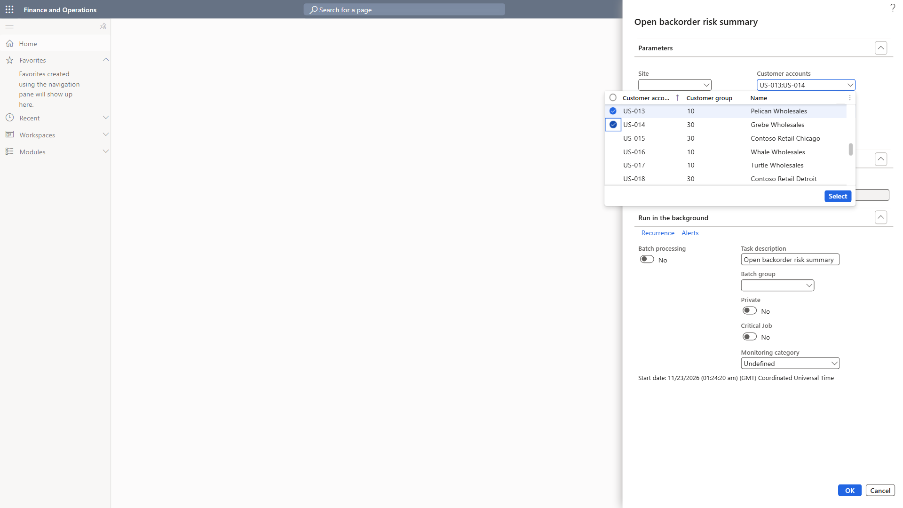
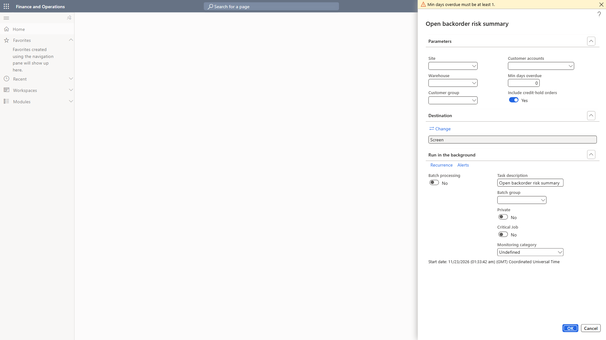
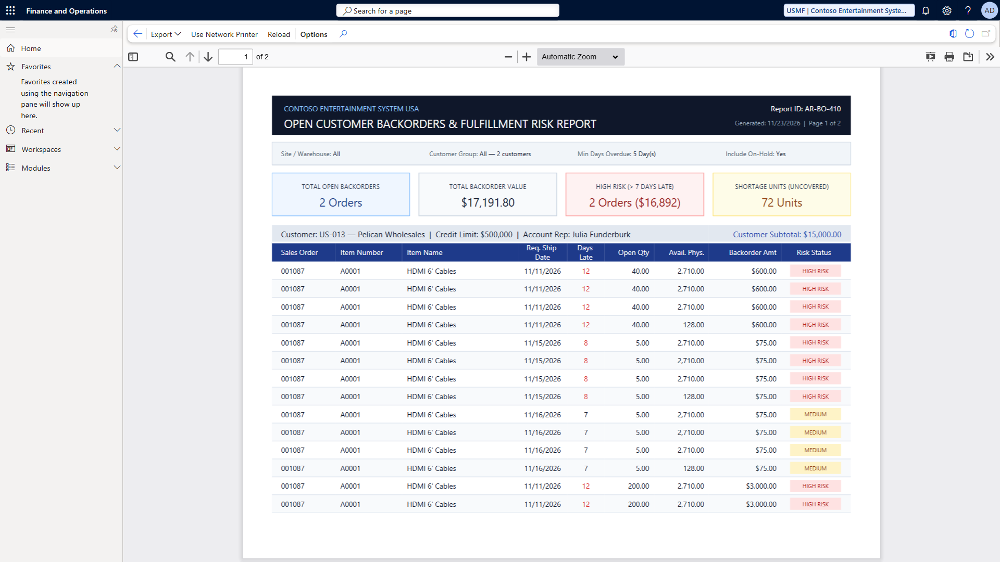
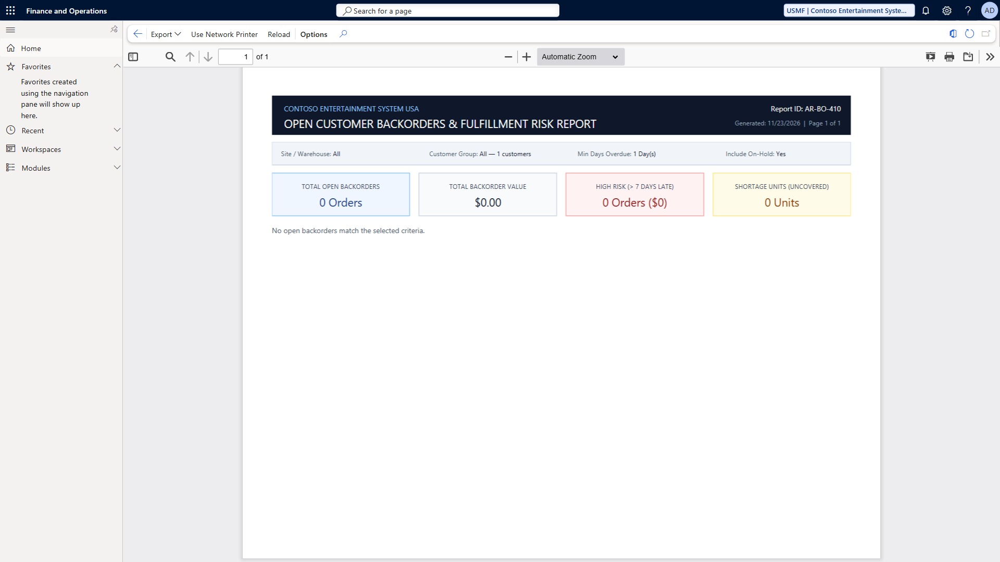
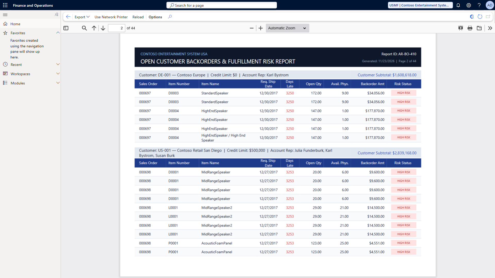
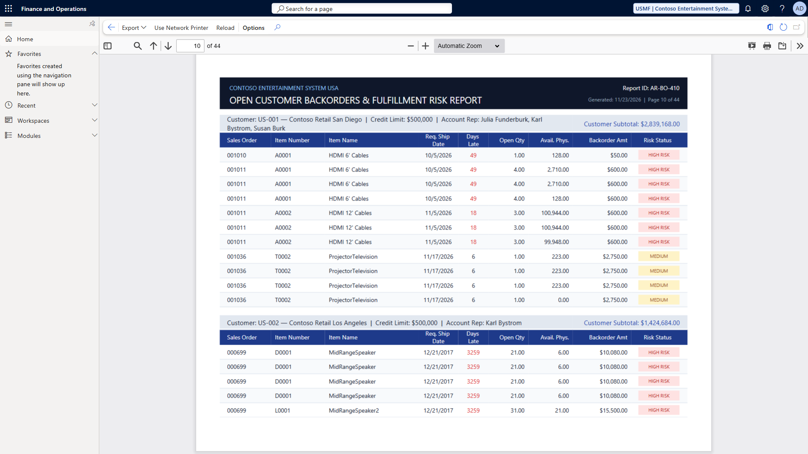
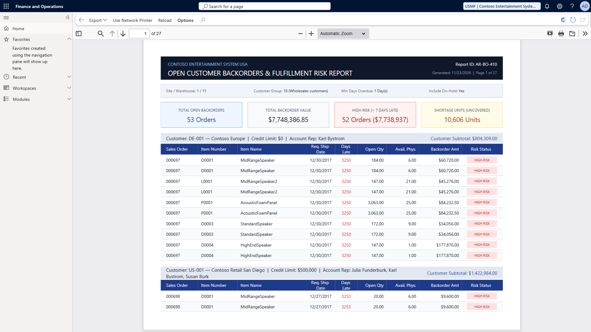
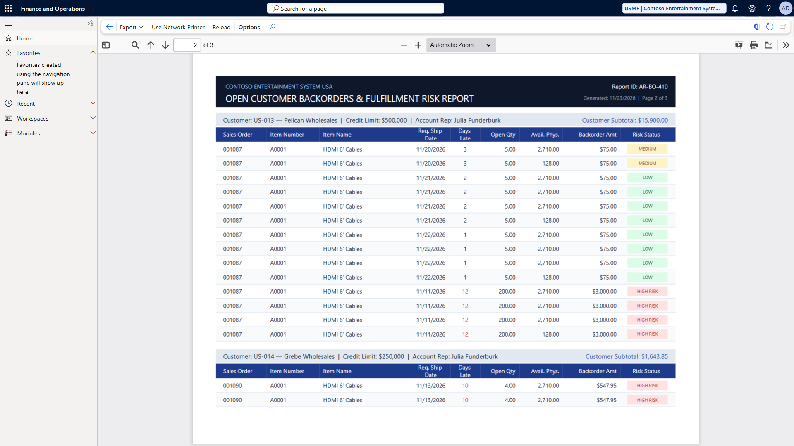

# Test cases — REQ-AR-410

The scenarios below are the test plan from the approved TDD (section 6), unchanged. The **Result** column records only what is backed by evidence in this folder; a scenario without evidence is marked *Not yet recorded* rather than assumed to pass.

## Build verification

| Check | Result |
|---|---|
| Compile (X++ compiler, model DYLOExtensions) | ✅ 0 errors |
| Delivered | 2026-11-22 |

## Functional scenarios

Tested in Dynamics 365 Finance & Operations 10.0.48 on the Contoso demo data, legal entity USMF.

| # | Scenario | Expected result | Result | Evidence |
|---|---|---|---|---|
| T1 (AC-01) | Open Accounts receivable > Inquiries and reports > Orders > Open backorder risk summary | Dialog shows Site, Warehouse, Customer group, Customer accounts (tick list), Min days overdue = 1, Include credit-hold orders = Yes | ✅ Passed | [a_menu_ar_orders.png](evidence/a_menu_ar_orders.png) · [b_dialog_defaults.png](evidence/b_dialog_defaults.png) · [c_dialog_customer_ticklist.png](evidence/c_dialog_customer_ticklist.png) |
| T2 | Enter Min days overdue = 0 | Dialog refuses with an error; report does not run | ✅ Passed | [d_min_days_0_refused.png](evidence/d_min_days_0_refused.png) |
| T3 | Order line, open order, remaining 40, requested ship date 12 days ago | Line printed, Days late 12 in red, badge HIGH RISK (red) | ◐ Partly evidenced Days Late 12 in red and the HIGH RISK badge are right, but the line is printed 4 times (defect 1). | [g_report_two_customers_p1.png](evidence/g_report_two_customers_p1.png) |
| T4 | Lines 3, 7 and 8 days late; lines 1 and 2 days late | 3 and 7 → MEDIUM; 8 → HIGH; 1 and 2 → LOW | ◐ Partly evidenced The badges are right (8 days HIGH RISK; 7 and 3 days MEDIUM; 2 and 1 days LOW), but each line is printed 4 times (defect 1). | [g_report_two_customers_p1.png](evidence/g_report_two_customers_p1.png) · [h_report_two_customers_p2.png](evidence/h_report_two_customers_p2.png) |
| T5 | Min days overdue = 5 | Lines 1–4 days late are not printed | ◐ Partly evidenced With Min days overdue = 5 the lines 3, 2 and 1 days late are left out as designed, but each printed line appears 4 times (defect 1). | [j_min_days_5.png](evidence/j_min_days_5.png) |
| T6 | Line fully delivered, invoiced, cancelled, or a return order | Not printed | ❌ Failed The two open lines of an item-requirement order, which is not a sales order, are printed 3 times each (defect 3). Its invoiced line is correctly left out. Return and cancelled orders were not tried. | [m_FAILED_item_requirement_printed.png](evidence/m_FAILED_item_requirement_printed.png) |
| T7 | Item stock: 10 available in WH-MAIN and 100 in another warehouse; line for 40 in WH-MAIN | Avail. Phys. 10.00; shortage 30 | ❌ Failed Line of 200.00 in warehouse 11, where 128 are in stock (2,710 over all warehouses): three of the four printed copies show Avail. Phys. 2,710.00, one shows 128.00. The shortage card shows 72 Units (200 - 128), which is right for this line. | [h_report_two_customers_p2.png](evidence/h_report_two_customers_p2.png) |
| T8 | Available physical stock ≥ open quantity | Shortage 0 for that line | — Not yet recorded |  |
| T9 | Order in EUR, accounting currency USD, line 10 × 100 EUR with 10% discount, 4 remaining | Backorder amount = 4 × 90 EUR converted at today's rate | — Not yet recorded |  |
| T10 (AC-02) | Run with a known data set | Card 1 = distinct orders, card 2 = sum of amounts, card 3 = distinct orders with a HIGH line (sum of HIGH line amounts), card 4 = sum of line shortages; match a manual check | ❌ Failed Cards show 53 Orders and $14,058,945.80; the manual check gives 52 sales orders, 187 lines and $3,513,836.45. The value is 4 times the real sum plus 3 x $1,200 of an item-requirement order, which is also counted as an order. | [e_report_all_p1.png](evidence/e_report_all_p1.png) |
| T11 (AC-03) | Two customers, orders with different sales responsibles | Grouped by customer; header shows credit limit and the distinct rep names; subtotals and grand total add up | ❌ Failed Grouping by customer, the credit limit and the distinct rep names are right. The subtotals and the grand total are 4 times the real amounts: customer DE-001 shows $1,608,618.00 where its 5 real lines total $402,154.50. | [f_report_all_p2_customer_groups.png](evidence/f_report_all_p2_customer_groups.png) |
| T12 | Choose 2 customer accounts; then choose none | Only those 2 customers; then all customers | ✅ Passed The customer selection works: two ticked gives only those two customers, none ticked gives all. The report pages used as evidence show the duplicated lines of defect 1. | [c_dialog_customer_ticklist.png](evidence/c_dialog_customer_ticklist.png) · [g_report_two_customers_p1.png](evidence/g_report_two_customers_p1.png) · [e_report_all_p1.png](evidence/e_report_all_p1.png) |
| T13 | Customer group WHSL, site 1, warehouse WH-MAIN | Only lines of WHSL customers shipping from WH-MAIN; parameter strip shows the values | ❌ Failed Run with customer group 10, site 1, warehouse 11 (USMF has no group WHSL or warehouse WH-MAIN). The strip shows the values, but customers of every group are printed: 53 orders on 27 pages. The filters only reduce the copies per line from 4 to 2. | [l_FAILED_filter_group_site_warehouse.png](evidence/l_FAILED_filter_group_site_warehouse.png) |
| T14 | Order in credit management hold; another customer blocked "All"; Include credit-hold = No, then Yes | No: both left out. Yes: both printed | ❌ Failed Blocked-customer part only: with Include credit-hold orders = No the order of a customer on hold "All" is still printed (3 copies, subtotal $1,643.85); with Yes it prints 4 copies. An order in credit-management hold was not tested. | [n_FAILED_credit_hold_no_p1.png](evidence/n_FAILED_credit_hold_no_p1.png) · [o_FAILED_credit_hold_no_p2.png](evidence/o_FAILED_credit_hold_no_p2.png) |
| T15 | No line matches | Banner, parameters and zero KPI cards print, plus the "No open backorders…" message | ✅ Passed | [k_no_match.png](evidence/k_no_match.png) |
| T16 (AC-04) | Export a 3-page result to PDF and to Excel | Banner and page numbers on every page, column headers repeat, badges coloured, no truncated columns | ❌ Failed The Excel export failed: the 9 report columns are spread over 36 Excel columns with 6,306 merged cells; there is no screenshot of the Excel file. The PDF part passed on a 44-page run (banner and page number on every page, headers repeat, badges coloured, no truncated column); the screenshot shows that part. | [f_report_all_p2_customer_groups.png](evidence/f_report_all_p2_customer_groups.png) |
| T17 | User with only a role that lacks the duty | Menu item not visible | — Not yet recorded |  |

### a_menu_ar_orders.png

The Accounts receivable menu: Open backorder risk summary is listed under Inquiries and reports > Orders.

### b_dialog_defaults.png

The report dialog as first opened: Site, Warehouse, Customer group and Customer accounts are empty, Min days overdue is 1 and Include credit-hold orders is Yes.

### c_dialog_customer_ticklist.png

The Customer accounts tick list with US-013 Pelican Wholesales and US-014 Grebe Wholesales ticked; the field shows "US-013;US-014".

### d_min_days_0_refused.png

With Min days overdue = 0 the dialog stays open and shows "Min days overdue must be at least 1."

### g_report_two_customers_p1.png

Page 1 of 3 for the two ticked customers: 12 and 8 days late are HIGH RISK with the days in red, 7 and 3 days are MEDIUM. Shows a defect: every line is printed 4 times, so the subtotal and the value cards are too high.

### h_report_two_customers_p2.png

Page 2 of 3 of the same run: 3 days MEDIUM, 2 and 1 days LOW, and the line of 200.00 at 12 days HIGH RISK. Shows defects: every line is printed 4 times, and three of the four copies of the 200.00 line show Avail. Phys. 2,710.00 (all warehouses) where warehouse 11 holds 128.00.

### j_min_days_5.png

The same two customers with Min days overdue = 5: the strip reads "Min Days Overdue: 5 Day(s)" and only lines 12, 8 and 7 days late are printed. Shows a defect: every line is printed 4 times.

### k_no_match.png

A customer with no open backorders: banner, parameter strip, four zero cards and "No open backorders match the selected criteria."

### e_report_all_p1.png

Shows a defect. Page 1 of 44 for all customers: the cards read 53 Orders and $14,058,945.80 where the manual check gives 52 orders and $3,513,836.45, and each line of order 000697 is printed 4 times.

### f_report_all_p2_customer_groups.png

Page 2 of 44: the banner, customer header and column headers repeat, and customer US-001 shows its credit limit and three distinct rep names. Shows a defect: every line is printed 4 times and the customer subtotals are 4 times the real amounts.

### m_FAILED_item_requirement_printed.png

Shows a defect. Page 10 of 44: the two open lines of item-requirement order 001011, which is not a sales order, are printed 3 times each.

### l_FAILED_filter_group_site_warehouse.png

Shows a defect. The strip reads "Site / Warehouse: 1 / 11" and "Customer Group: 10 (Wholesales customers)", yet the report still has 53 orders and starts with customers DE-001 (group 90) and US-001 (group 30), each line printed twice.

### n_FAILED_credit_hold_no_p1.png

Shows a defect, first page of the run: the strip reads "Include On-Hold: No" for customers US-013 and US-014, and the cards still count 2 Orders and $17,543.85.

### o_FAILED_credit_hold_no_p2.png

Shows a defect, page 2 of the same run: customer US-014, on hold "All", is still printed with order 001090 and a subtotal of $1,643.85.

## Notes

Tested on 23 November 2026 (the report's run date) in USMF demo data on the dev box, against section 6 of the approved design, with the delivered code unchanged. Two sales orders were created for the test: 001087 for customer US-013 (seven lines of item A0001 in site 1 / warehouse 11 at 15.00 USD, requested ship dates 1 to 12 days before the run date) and 001090 for customer US-014 (4 x 100.00 EUR).

**Summary:** the report opens, renders and follows the designed layout, but its figures are wrong. Every report screenshot on this page shows duplicated lines; none of them is a picture of a correct report. The defects below are reported for a fix under warranty.

**Defects found:**
1. **Every line is printed four times and the totals are multiplied.** Sales order lines print 4 times (item-requirement lines 3 times). Customer subtotals, the grand total, the Total backorder value card and the high-risk value are inflated accordingly. All customers: the cards show 53 Orders and $14,058,945.80; a manual check of the same data (sales orders only) gives 52 orders, 187 lines and $3,513,836.45. The printed value is 4 times the real sum plus 3 x $1,200 of an item-requirement order. Customer DE-001 shows a subtotal of $1,608,618.00; its 5 real lines total $402,154.50. Only one of the copies carries the line's own site and warehouse; the others show the item's stock over all warehouses in Avail. Phys. (2,710.00 where warehouse 11 holds 128.00). The Shortage units card for the test line was right (72 Units = 200 - 128).
2. **Filters on customer group, site, warehouse and credit hold do not exclude lines.** With customer group 10, site 1 and warehouse 11 the strip shows the values but customers of every group are printed (53 orders, 27 pages); the filters only reduce the copies per line from 4 to 2. With Include credit-hold orders = No, the order of a customer on hold "All" is still printed (3 copies instead of 4). The Customer accounts filter and Min days overdue do work.
3. **Orders that are not sales orders are printed.** Item-requirement order 001011 appears in the report and is counted in the Total open backorders card (53 instead of 52).
4. **The Excel export is not one column per report column.** The 9 report columns are spread over 36 Excel columns with 6,306 merged cells. The PDF export of the same 44-page run was correct in layout.

**Partly passed:** T3, T4 and T5. Days late, the red figure above 7 days, the three risk badges and the Min days overdue cut-off are right, but each line is printed 4 times (defect 1).

**Failed:** T6 (defect 3), T7 (defect 1: wrong Avail. Phys. on three of four copies), T10 and T11 (defect 1: cards, subtotals and grand total), T13 and T14 (defect 2), T16 (defect 4).

**Not run:**
- T8 (shortage 0 when stock covers the line): the report prints no shortage per line, so it cannot be shown on screen.
- T9 (EUR order with a 10 % discount and a partial delivery): not run as specified. The discount could not be entered on the test line and no partial delivery was posted. A variant was run instead: 4 x 100.00 EUR, no discount, nothing delivered, printed as $547.95, which is 400 EUR at the demo data's default exchange rate. That shows the conversion only.
- T14, the part with an order in credit-management hold: no such order was set up.
- T17 (a user without the duty): only an administrator session was available.
- T6, the parts with a return order and a cancelled order.

**Observations, not counted as failures:**
- The menu entry sits after "Order lines not invoiced report", not directly after "Backorder lines" as the design says.
- The parameter strip reads "1 customers" when a single customer is selected.
- The "Req. Ship Date" and "Days Late" column headers wrap to two lines.
- T13 was run with customer group 10 and warehouse 11 because USMF demo data has no group WHSL or warehouse WH-MAIN.
