# Test cases — REQ-AR-410

The scenarios below are the test plan from the approved TDD (section 6), unchanged. The **Result** column records only what is backed by evidence in this folder; a scenario without evidence is marked *Not yet recorded* rather than assumed to pass.

## Build verification

| Check | Result |
|---|---|
| Compile (X++ compiler, model DYLOExtensions) | ✅ 0 errors |
| Delivered | 2026-11-22 |

## Functional scenarios

Tested in Dynamics 365 Finance & Operations 10.0.48 on the Contoso demo data, legal entity USMF.

| # | Scenario | Expected result | Result | Evidence |
|---|---|---|---|---|
| T1 (AC-01) | Open Accounts receivable > Inquiries and reports > Orders > Open backorder risk summary | Dialog shows Site, Warehouse, Customer group, Customer accounts (tick list), Min days overdue = 1, Include credit-hold orders = Yes | ✅ Passed | [s_menu_ar_orders.png](evidence/s_menu_ar_orders.png) · [t_dialog_defaults.png](evidence/t_dialog_defaults.png) · [u_dialog_customer_ticklist.png](evidence/u_dialog_customer_ticklist.png) |
| T2 | Enter Min days overdue = 0 | Dialog refuses with an error; report does not run | ✅ Passed | [v_min_days_0_refused.png](evidence/v_min_days_0_refused.png) |
| T3 | Order line, open order, remaining 40, requested ship date 12 days ago | Line printed, Days late 12 in red, badge HIGH RISK (red) | ✅ Passed | [w_report_two_customers.png](evidence/w_report_two_customers.png) |
| T4 | Lines 3, 7 and 8 days late; lines 1 and 2 days late | 3 and 7 → MEDIUM; 8 → HIGH; 1 and 2 → LOW | ✅ Passed | [w_report_two_customers.png](evidence/w_report_two_customers.png) |
| T5 | Min days overdue = 5 | Lines 1–4 days late are not printed | ✅ Passed | [za_min_days_5.png](evidence/za_min_days_5.png) |
| T6 | Line fully delivered, invoiced, cancelled, or a return order | Not printed | ◐ Partly evidenced Item-requirement order no longer printed; return, cancelled and fully delivered orders were not set up as separate cases. | [y_report_all_p3.png](evidence/y_report_all_p3.png) |
| T7 | Item stock: 10 available in WH-MAIN and 100 in another warehouse; line for 40 in WH-MAIN | Avail. Phys. 10.00; shortage 30 | ✅ Passed Run with demo-data quantities: 128 available in the line's warehouse, 2,710 over all warehouses, line of 200. | [w_report_two_customers.png](evidence/w_report_two_customers.png) |
| T8 | Available physical stock ≥ open quantity | Shortage 0 for that line | ✅ Passed Shown through the shortage card; the report has no per-line shortage column. | [w_report_two_customers.png](evidence/w_report_two_customers.png) |
| T9 | Order in EUR, accounting currency USD, line 10 × 100 EUR with 10% discount, 4 remaining | Backorder amount = 4 × 90 EUR converted at today's rate | ◐ Partly evidenced Currency conversion only; the 10% discount and the partial delivery were not exercised. | [w_report_two_customers.png](evidence/w_report_two_customers.png) |
| T10 (AC-02) | Run with a known data set | Card 1 = distinct orders, card 2 = sum of amounts, card 3 = distinct orders with a HIGH line (sum of HIGH line amounts), card 4 = sum of line shortages; match a manual check | ✅ Passed | [x_report_all_p1.png](evidence/x_report_all_p1.png) · [z_report_all_p14_grand_total.png](evidence/z_report_all_p14_grand_total.png) |
| T11 (AC-03) | Two customers, orders with different sales responsibles | Grouped by customer; header shows credit limit and the distinct rep names; subtotals and grand total add up | ✅ Passed | [x_report_all_p1.png](evidence/x_report_all_p1.png) · [y_report_all_p3.png](evidence/y_report_all_p3.png) · [z_report_all_p14_grand_total.png](evidence/z_report_all_p14_grand_total.png) |
| T12 | Choose 2 customer accounts; then choose none | Only those 2 customers; then all customers | ✅ Passed | [u_dialog_customer_ticklist.png](evidence/u_dialog_customer_ticklist.png) · [w_report_two_customers.png](evidence/w_report_two_customers.png) · [x_report_all_p1.png](evidence/x_report_all_p1.png) |
| T13 | Customer group WHSL, site 1, warehouse WH-MAIN | Only lines of WHSL customers shipping from WH-MAIN; parameter strip shows the values | ✅ Passed Run with customer group 10, site 1, warehouse 11 of the demo data. | [zc_filter_group_site_warehouse.png](evidence/zc_filter_group_site_warehouse.png) · [zb_filter_customer_group_10.png](evidence/zb_filter_customer_group_10.png) |
| T14 | Order in credit management hold; another customer blocked "All"; Include credit-hold = No, then Yes | No: both left out. Yes: both printed | ◐ Partly evidenced Blocked customer only; an order in credit-management hold was not set up. | [zd_credit_hold_no.png](evidence/zd_credit_hold_no.png) · [ze_credit_hold_yes.png](evidence/ze_credit_hold_yes.png) |
| T15 | No line matches | Banner, parameters and zero KPI cards print, plus the "No open backorders…" message | ✅ Passed | [zf_no_match.png](evidence/zf_no_match.png) |
| T16 (AC-04) | Export a 3-page result to PDF and to Excel | Banner and page numbers on every page, column headers repeat, badges coloured, no truncated columns | ◐ Partly evidenced PDF shown on screen; the Excel export was checked by opening the file (9 columns), not by screenshot. | [x_report_all_p1.png](evidence/x_report_all_p1.png) · [y_report_all_p3.png](evidence/y_report_all_p3.png) · [z_report_all_p14_grand_total.png](evidence/z_report_all_p14_grand_total.png) |
| T17 | User with only a role that lacks the duty | Menu item not visible | — Not yet recorded |  |

### s_menu_ar_orders.png

The new entry Open backorder risk summary under Accounts receivable > Inquiries and reports > Orders.

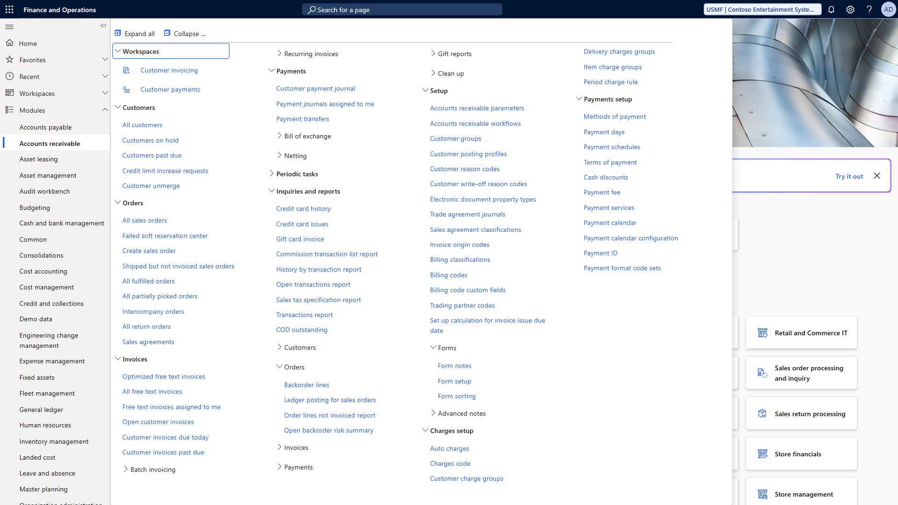

### t_dialog_defaults.png

The report dialog with Site, Warehouse, Customer group and Customer accounts empty, Min days overdue 1 and Include credit-hold orders Yes.

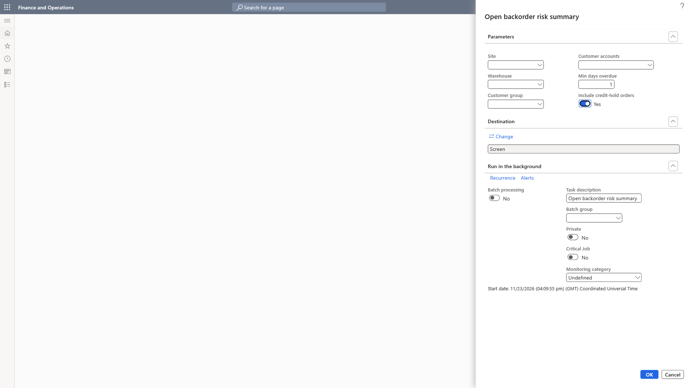

### u_dialog_customer_ticklist.png

The Customer accounts tick list with customers US-013 and US-014 ticked.

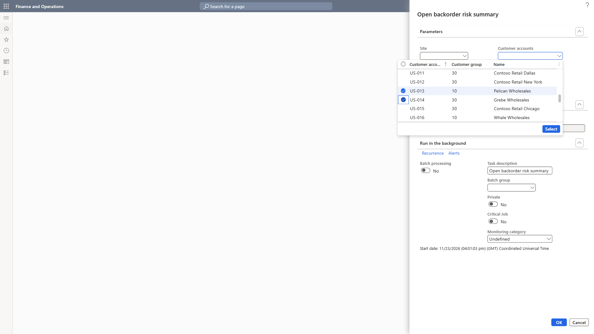

### v_min_days_0_refused.png

Min days overdue 0 is refused with the message "Min days overdue must be at least 1."

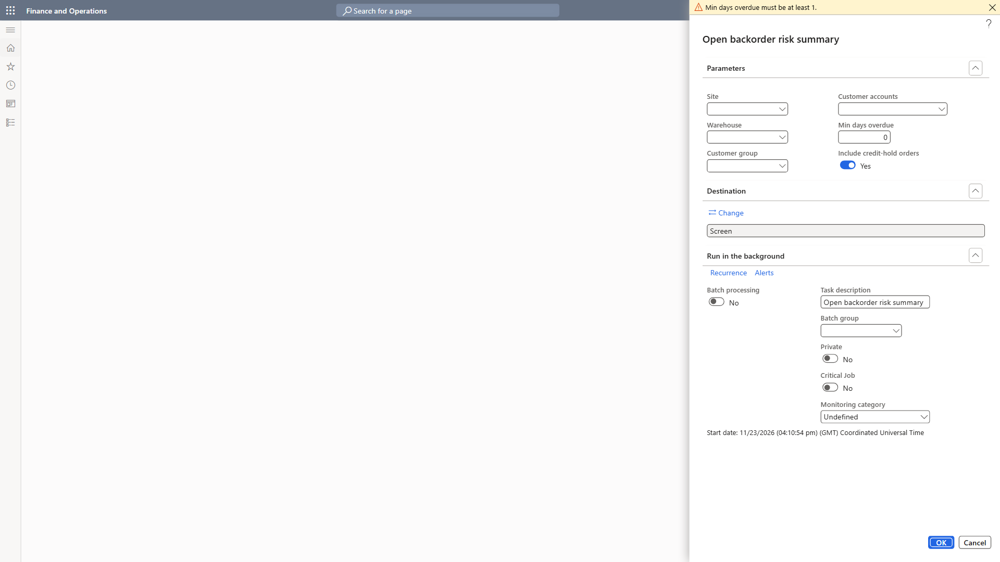

### w_report_two_customers.png

The whole report for two customers on one page: banner, parameter strip, four cards, order 001087 with lines 12, 8, 7, 3, 2 and 1 days late badged HIGH RISK, MEDIUM and LOW, order 001090 converted from EUR, subtotals and grand total $4,522.95.

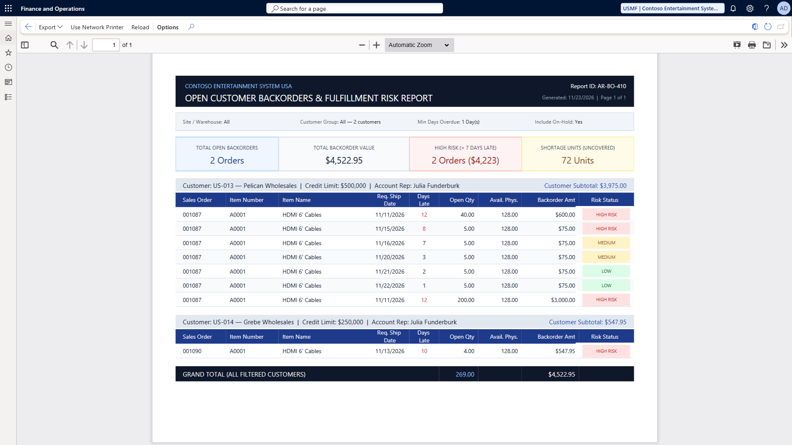

### x_report_all_p1.png

All customers, page 1 of 14: cards show 52 Orders, $3,513,836.45, 51 Orders ($3,510,786) and 8,079 Units, matching a manual check of the data; customer DE-001 with subtotal $402,154.50.

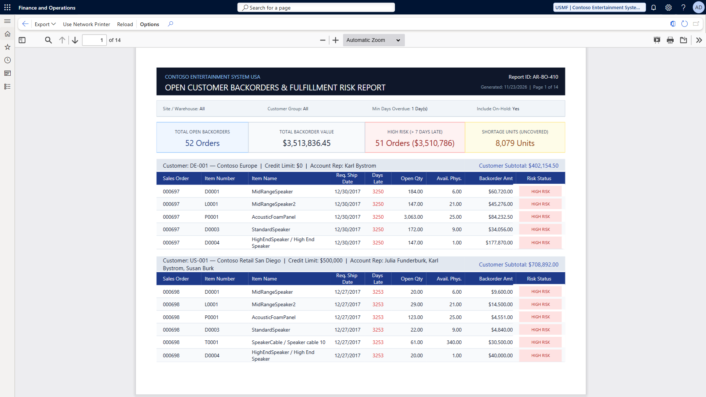

### y_report_all_p3.png

Page 3 of 14: banner, customer header and column headers repeat; customer US-001 lists order 001010 and then 001036, with the item-requirement order 001011 left out.

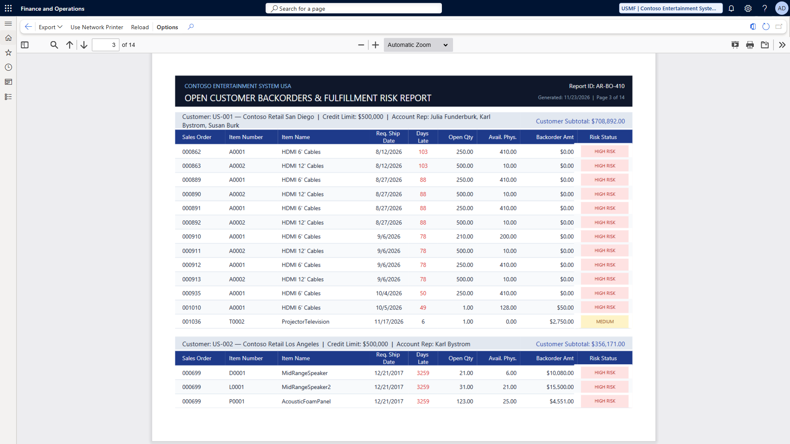

### z_report_all_p14_grand_total.png

Last page, 14 of 14: grand total 12,551.00 open quantity and $3,513,836.45.

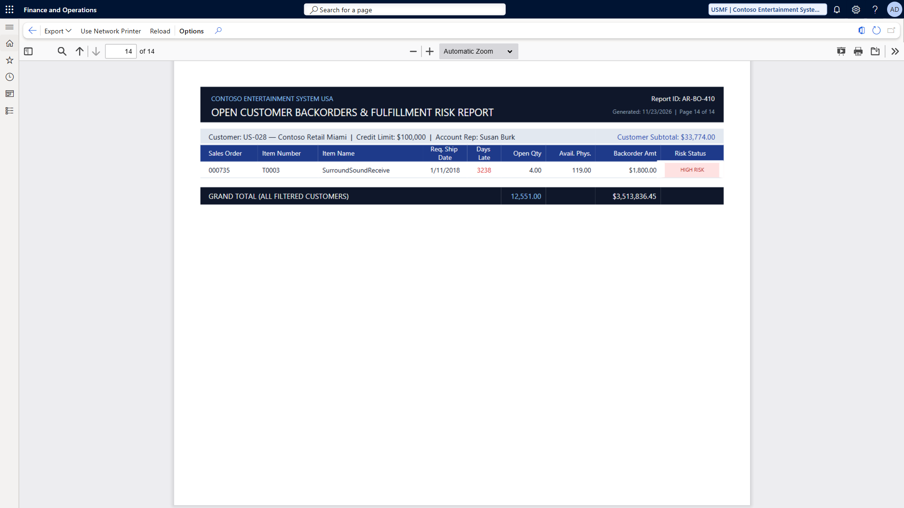

### za_min_days_5.png

Min days overdue 5: only the lines 12, 8, 7 and 10 days late remain; the 3, 2 and 1 day lines are gone.

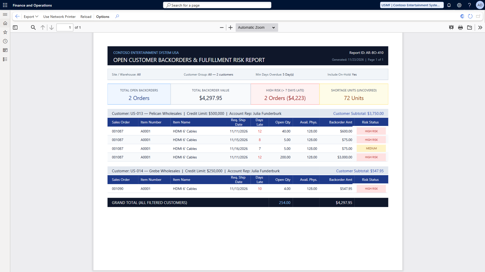

### zb_filter_customer_group_10.png

Customer group 10 only: 15 Orders, $710,991.00 and 504 Units, matching the data for that group.

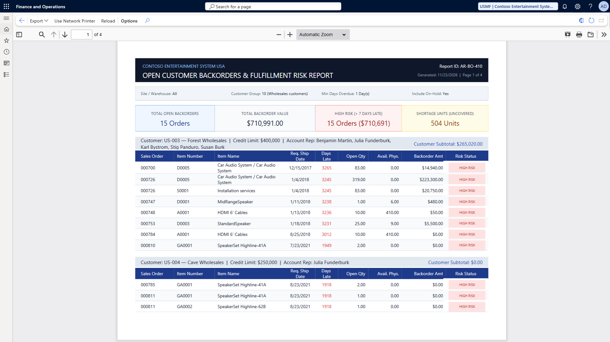

### zc_filter_group_site_warehouse.png

Customer group 10, site 1, warehouse 11: the strip shows the values and only customers US-003, US-004 and US-013 are printed (4 Orders, $3,975.00).

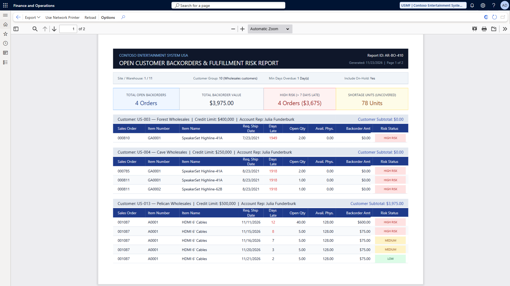

### zd_credit_hold_no.png

Include credit-hold orders No with customer US-014 on hold: only US-013 is printed, 1 Orders, $3,975.00.

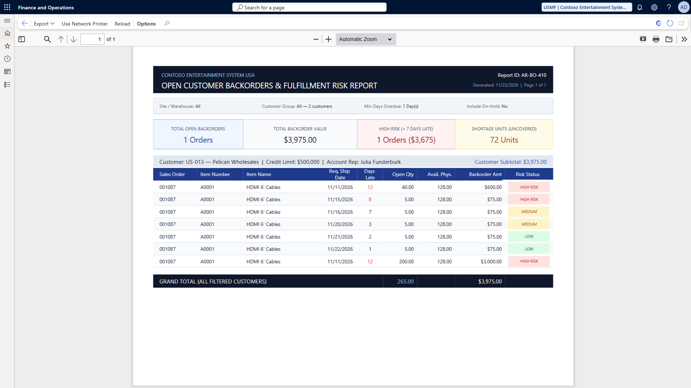

### ze_credit_hold_yes.png

Include credit-hold orders Yes with the same selection: the on-hold customer US-014 and its order 001090 are printed again.

### zf_no_match.png

No matching lines: the cards show zero and the report prints "No open backorders match the selected criteria."

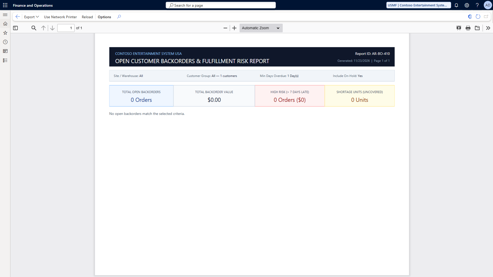

## Notes

Tested on 23 November 2026 (the report's run date) in USMF demo data on the dev box, against section 6 of the approved design. Two sales orders were created for the test: 001087 for customer US-013 (seven lines of item A0001 in site 1 / warehouse 11 at 15.00 USD, requested ship dates 1 to 12 days before the run date) and 001090 for customer US-014 (4 x 100.00 EUR).

**Summary:** the report prints every line once, its figures match the data, and the filters work. All customers: 52 orders, $3,513,836.45, 12,551.00 open quantity and 8,079 shortage units, the same as a manual check of the data. Customer group 10: 15 orders, 8 customers, $710,991.00 and 504 shortage units, also the same.

**History — fixed under warranty.** The first delivery, tested earlier the same day, printed every eligible line four times, so subtotals, the grand total and the value cards were about four times too high (53 Orders and $14,058,945.80 against 52 orders and $3,513,836.45 in the data). It also ignored the Customer group, Site, Warehouse and Include credit-hold orders = No filters, printed an item-requirement order, and its Excel export spread 9 columns over 36. A retest after a full database sync and recompile showed the same behaviour. The data provider and the report were then corrected under warranty, and every result on this page is for the corrected version. No defect was found in it.

**Partly passed:**
- T6: the item-requirement order is no longer printed; return, cancelled and fully delivered orders were not set up as separate cases.
- T9: only the currency conversion was checked (400 EUR printed as $547.95). The 10% line discount could not be entered on the test order and no partial delivery was posted.
- T14: checked with a customer on hold; an order in credit-management hold was not set up.
- T16: the PDF is shown on screen (banner and page numbers on every page, repeated headers, coloured badges). The Excel export was checked by opening the file: 9 columns, one per report column.

**Not run:** T17 (a user without the duty), because only one user session was available.

**Small remarks:** the four cards touch each other and have different widths, where the design has four equal cards with gaps; the strip reads "1 customers" and a card "1 Orders" in the singular case; the Req. Ship Date and Days Late column headers wrap to two lines; the menu entry sits after Order lines not invoiced report rather than directly after Backorder lines.
