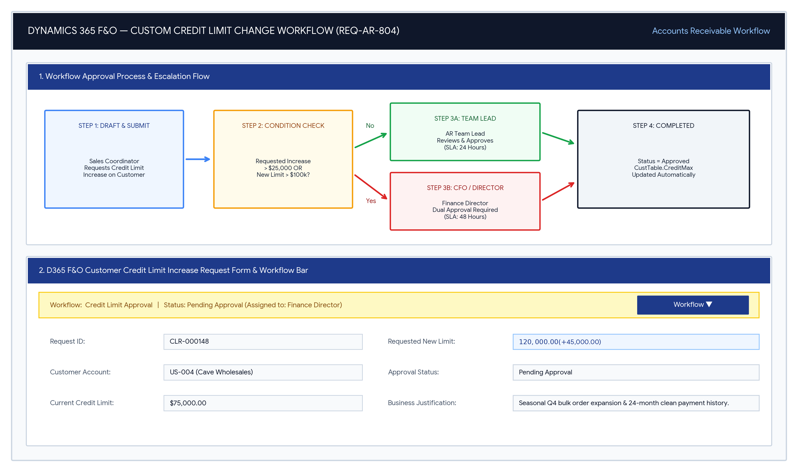

> Original document: [REQ-AR-804-FRD.docx](REQ-AR-804-FRD.docx). This page is a Markdown copy for reading on GitHub.

_MICROSOFT DYNAMICS 365 FINANCE & OPERATIONS  |  WORKFLOW & APPROVAL SPECIFICATION_

# Functional Requirement Document — REQ-AR-804

| Requirement ID: | REQ-AR-804 |
|---|---|
| Title: | Customer Credit Limit Increase Request & Multi-Tier Approval Workflow |
| Module & Menu Path: | Accounts receivable > Customers > Credit limit increase requests |
| Workflow Type: | Custom D365 F&O Workflow Type (Category: CustWorkflowCategory) with Conditional Hierarchy & Escalation |
| Target Users: | Sales Coordinators, AR Team Leads, Credit Managers, Finance Director |

## 1. Business Context & Objective

Currently, any user with edit access to the Customer master screen can directly modify a customer's Credit Limit without formal financial review or audit trail. To enforce internal credit risk controls, direct manual editing of the Credit Limit field on the Customer master must be restricted, and a dedicated Credit Limit Increase Request form backed by a multi-tier D365 F&O Workflow must be introduced.

## 2. Functional & Workflow Requirements

- **Lock Direct Credit Limit Editing:** Make the standard Credit Limit field on the Customer master form read-only for standard sales and AR users so all limit changes must go through the formal approval workflow.
- **Credit Limit Increase Request Form:** Provide a new form displaying Request ID, Customer Account, Customer Name, Current Credit Limit (auto-populated), Requested New Credit Limit, Net Increase Amount (calculated), Business Justification (mandatory text), Requested By, and Workflow Approval Status (Draft, Submitted, Pending Approval, Approved, Rejected, Canceled).
- **Workflow Submission & Validation:** Users can submit a request via the standard D365 F&O Workflow action bar only when Requested New Credit Limit > Current Credit Limit and Business Justification is populated. While in 'Submitted' or 'Pending Approval' status, all fields on the request record become locked against editing.
- **Conditional Routing & Approval Hierarchy:** Configure conditional routing inside the workflow designer: (a) If Net Increase <= $25,000 AND New Limit <= $100,000, route to the AR Team Lead security role for single-step approval; (b) If Net Increase > $25,000 OR New Limit > $100,000, require sequential two-step approval by both the AR Team Lead and the Finance Director.
- **Automated Limit Update Upon Final Approval:** When the workflow completes with 'Approved' status, the system automatically updates the Customer master Credit Limit to the Requested New Credit Limit and stamps the Approval Date and Final Approver ID.
- **Rejection, Request Change & Escalation:** If rejected, the workflow status changes to 'Rejected' without altering the customer's existing credit limit. If 'Request Change' is selected by an approver, the record returns to the submitter for revision. Unactioned approval work items automatically escalate after 48 hours.

## 3. Workflow Routing & Form UI Design Mockup

The visual diagram below illustrates the conditional two-tier workflow approval routing alongside the D365 F&O Credit Limit Increase Request form and workflow toolbar:

Figure 1: Customer Credit Limit Increase Workflow Architecture & D365 F&O Form UI (REQ-AR-804)

## 4. Business Acceptance Criteria

| AC # | Test Scenario | Expected Result |
|---|---|---|
| AC-01 | Submission Validation | Submitting a request with blank justification or a requested limit lower than the current limit is blocked with a clear validation message. |
| AC-02 | Record Locking During Review | Once submitted into workflow, the request record becomes read-only until it is either approved, rejected, or returned via Request Change. |
| AC-03 | Conditional Tier Routing | Requests <= $25,000 increase route only to AR Team Lead; requests > $25,000 increase require sequential approval from AR Team Lead and Finance Director. |
| AC-04 | Automated Customer Update | Upon final workflow approval, the Customer master Credit Limit immediately updates to the approved amount without manual intervention. |
| AC-05 | Workflow Rejection Handling | Rejecting a request sets status to Rejected, logs the approver comment in workflow history, and leaves the customer's original credit limit unchanged. |
