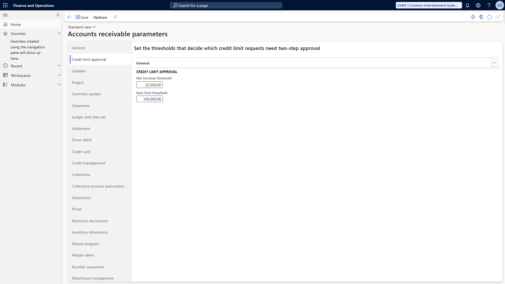
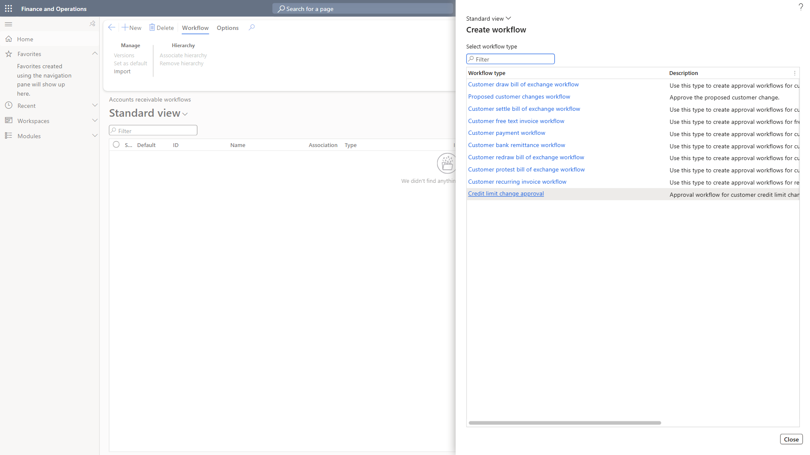
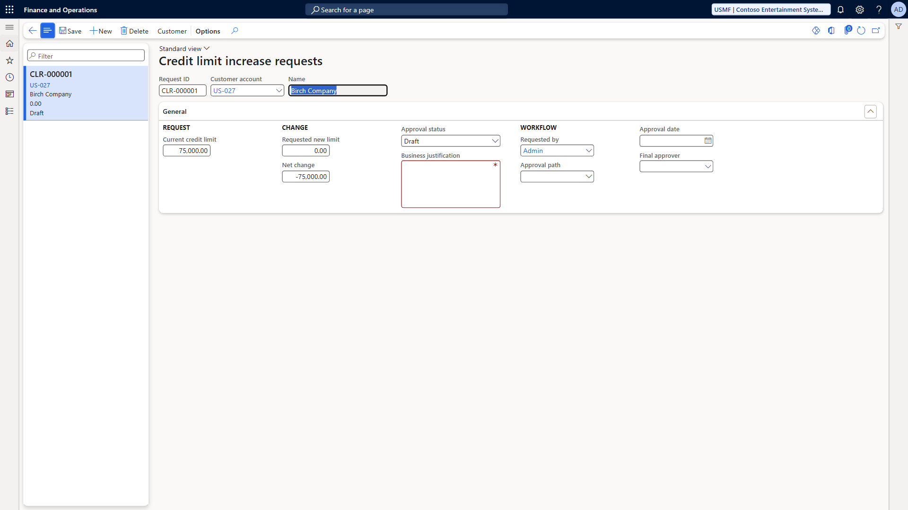
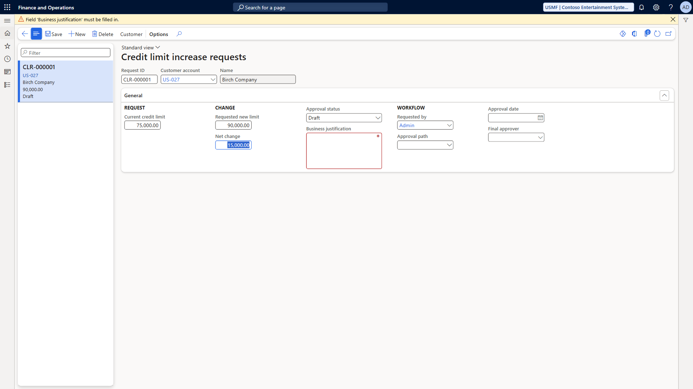
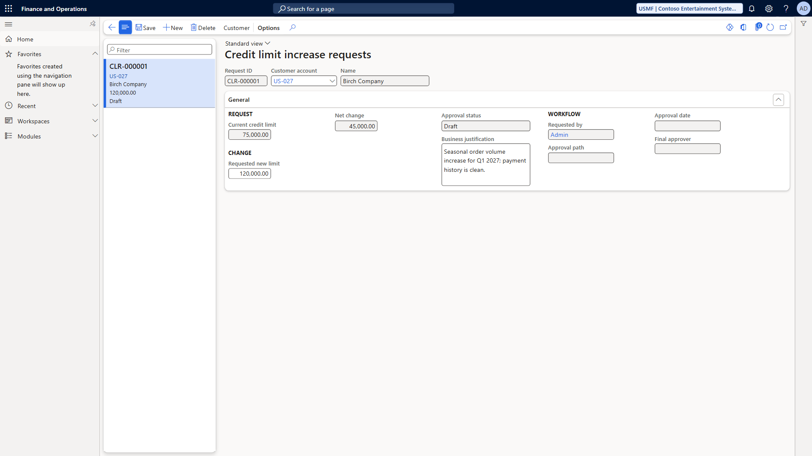
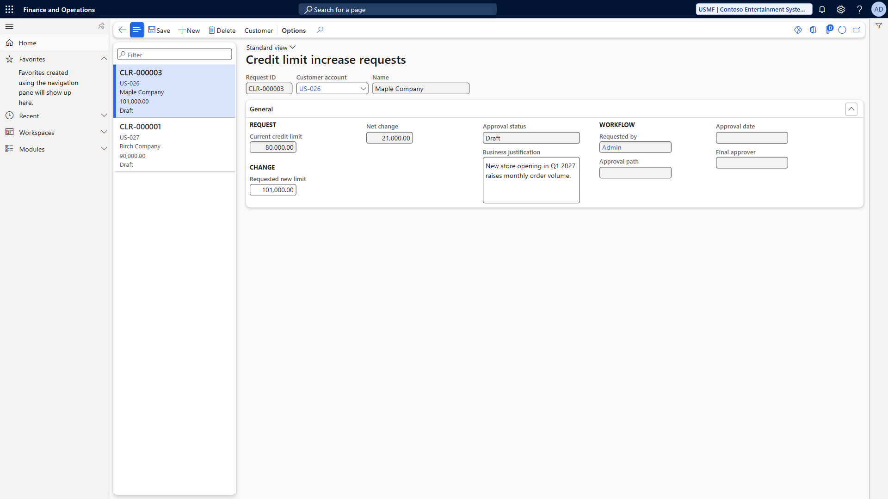
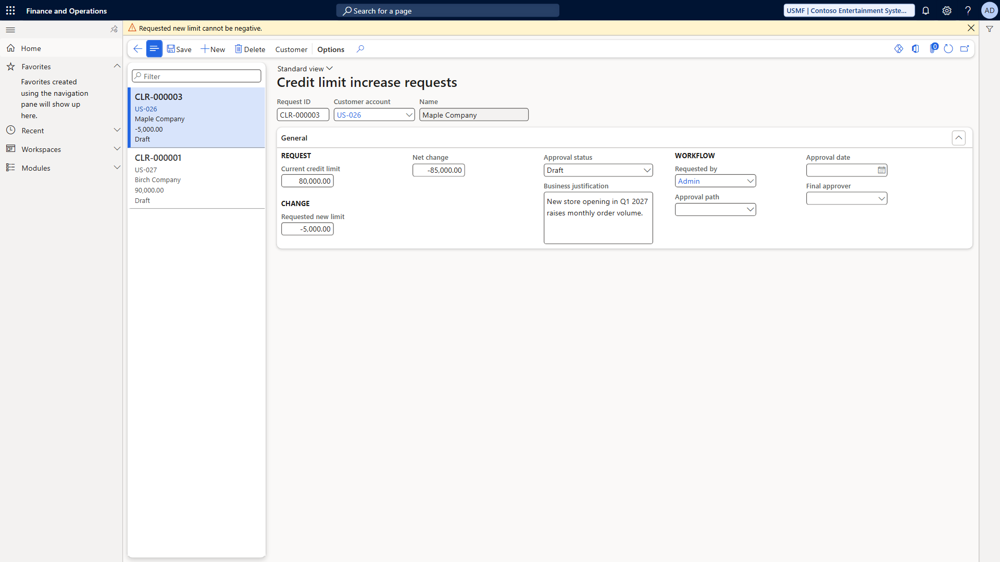

# Test cases — REQ-AR-804

The scenarios below are the test plan from the approved TDD (section 6), unchanged. The **Result** column records only what is backed by evidence in this folder; a scenario without evidence is marked *Not yet recorded* rather than assumed to pass.

## Build verification

| Check | Result |
|---|---|
| Compile (X++ compiler, model DYLOExtensions) | ✅ 0 errors |
| Delivered | 2026-11-22 |

## Functional scenarios

Tested in Dynamics 365 Finance & Operations 10.0.48 on the Contoso demo data, legal entity USMF.

| # | Scenario | Expected | Result | Evidence |
|---|---|---|---|---|
| T1 | A user without DYLO Finance Director opens a customer | Credit limit is read-only | — Not yet recorded |  |
| T2 | A Finance Director opens an existing customer and changes the credit limit | Saved | — Not yet recorded |  |
| T3 | Any user creates a new customer | Credit limit is read-only; an import with credit limit 5,000 for a new customer fails | — Not yet recorded |  |
| T4 | A user without the privilege changes the credit limit through Open in Excel or the data entity | Save fails with the lock message | — Not yet recorded |  |
| T5 (AC-01) | Submit with a blank justification; submit with requested = current | Blocked with a clear message | — Not yet recorded |  |
| T6 | Second request for a customer with an open request | Blocked | ✅ Passed Refused when the second request is saved; the first request was still a draft. | [j_second_open_request_refused.png](evidence/j_second_open_request_refused.png) |
| T7 (AC-02) | Submit a request | Status Submitted, then Pending approval; all fields read-only; Delete disabled | — Not yet recorded |  |
| T8 (AC-03) | Thresholds 25,000 / 100,000. Current 75,000, requested 90,000 | Path Single-step; only the AR Team Lead approves; customer becomes 90,000 | — Not yet recorded |  |
| T9 (AC-03) | Current 75,000, requested 120,000 (+45,000) | Path Two-step; AR Team Lead, then Finance Director; then the customer becomes 120,000 | — Not yet recorded |  |
| T10 | Current 80,000, requested 101,000 (+21,000) | Two-step (new limit above 100,000) | — Not yet recorded |  |
| T11 (AC-04) | Final approval | Customer limit updated immediately; Approval date and Final approver set; status Approved | — Not yet recorded |  |
| T12 (AC-05) | Approver rejects with a comment | Status Rejected; comment in workflow history; customer limit unchanged | — Not yet recorded |  |
| T13 | Approver chooses Request change | Status Draft; submitter edits and resubmits; path recalculated | — Not yet recorded |  |
| T14 | Decrease 75,000 to 50,000 | Path Decrease; approved automatically; customer becomes 50,000 | — Not yet recorded |  |
| T15 | Submitter recalls | Status Canceled; customer unchanged | — Not yet recorded |  |
| T16 | Work item not actioned within the time limit | Escalated as configured in the editor (standard) | — Not yet recorded |  |
| T17 | A second legal entity with other thresholds | Path follows that entity's thresholds | — Not yet recorded |  |

### a_parameters_thresholds.png

Accounts receivable parameters has the new Credit limit approval tab, with Net increase threshold 25,000.00 and New limit threshold 100,000.00 set for USMF.

### c_workflow_type_in_new_workflow_list.png

Accounts receivable workflows > New lists the delivered workflow type, Credit limit change approval; no workflow was built from it.

### e_request_new_current_limit_filled.png

A new request gets Request ID CLR-000001 from the number sequence, and choosing customer US-027 fills in the current credit limit, 75,000.00; this shot also shows a defect, the read-only fields appear as editable boxes before the first save.

### f_blank_justification_refused.png

Saving a request with no business justification is refused with "Field 'Business justification' must be filled in."

### g_request_75000_to_90000.png

The saved draft request: current credit limit 75,000.00, requested new limit 90,000.00, net change 15,000.00 calculated; the approval path stays empty until the request is submitted.

### h_request_75000_to_120000.png

The same draft changed to a requested new limit of 120,000.00: net change recalculated to 45,000.00.

### i_request_decrease_75000_to_50000.png

A decrease is accepted as a draft: requested new limit 50,000.00, net change -25,000.00.

### j_second_open_request_refused.png

A second request for US-027 while CLR-000001 is open is refused with "Customer US-027 already has an open credit limit request (CLR-000001)."

### k_request_80000_to_101000.png

A draft request for customer US-026: current credit limit 80,000.00, requested new limit 101,000.00, net change 21,000.00.

### l_negative_limit_refused.png

A negative requested limit is refused with "Requested new limit cannot be negative."

## Notes

Tested on the dev box with USMF demo data, signed in as a system administrator.

**The approval workflow was not exercised.** The delivered workflow type is offered in Accounts receivable workflows > New, but building a workflow opens the desktop workflow editor, which the automated test could not run. No workflow was active, the request form therefore showed no Submit action, and nothing could be submitted. One of the 17 scenarios is evidenced (T6).

**Not run:**
- T1, T4: need a user without the *Edit customer credit limit* privilege; the test ran as a system administrator, who holds every privilege.
- T2 (not run, partly shown): the administrator changed and saved a credit limit on an existing customer, which shows only that a holder of the privilege can edit it. It was not tested with the DYLO Finance Director role, and it is not evidence of the lock.
- T3: no customer was created and no import was run.
- T5 (not run, partly shown): a blank business justification is refused when the request is saved. The submit-time checks (blank justification at submit, requested limit equal to the current limit) need the Submit action.
- T7, T11, T12, T13, T15, T16: need an active workflow.
- T8, T9, T10, T14: need an active workflow. Only the data part is shown: the request holds the current limit, the requested limit and the calculated net change as a draft (75,000 to 90,000; 75,000 to 120,000; 80,000 to 101,000; a decrease from 75,000 to 50,000). The approval path is only set at submit, so the routing is not shown.
- T17: the approval path is only set at submit.

Also shown, outside the numbered scenarios: the thresholds tab on the parameters page, the Request ID number sequence reference, the workflow type in the New workflow list, a new request numbered from the sequence with the current limit filled in from the customer, and a negative requested limit refused.

**Defects and observations:**
1. Read-only fields are editable until the first save. On a new request, Request ID, Current credit limit, Net change, Approval status, Requested by, Approval path, Approval date and Final approver accept input; after the first save they are read-only. The design says they are always read-only.
2. Until a number sequence is assigned, New fails with a missing number sequence reference message and leaves an empty record, and the reference only appears on the parameters page after that first failed New. Expected on a fresh install, but it needs a setup note.
3. The number sequence reference is listed as "Request ID", not "Credit limit request ID" as in the design; the longer wording appears only in the Description column.
4. The form layout differs from the design: with the navigation pane open, Net change wraps into its own column instead of sitting beside Requested new limit, and the fields spread over five columns.
5. Without an active workflow the request form shows no Workflow button and no message explaining why.
6. The security roles were not checked in the user interface.

The number sequence screenshot is not published: the parameters page on the dev box also shows an invalid reference row left over from an earlier version of the model, which is an environment issue and not part of this delivery.
