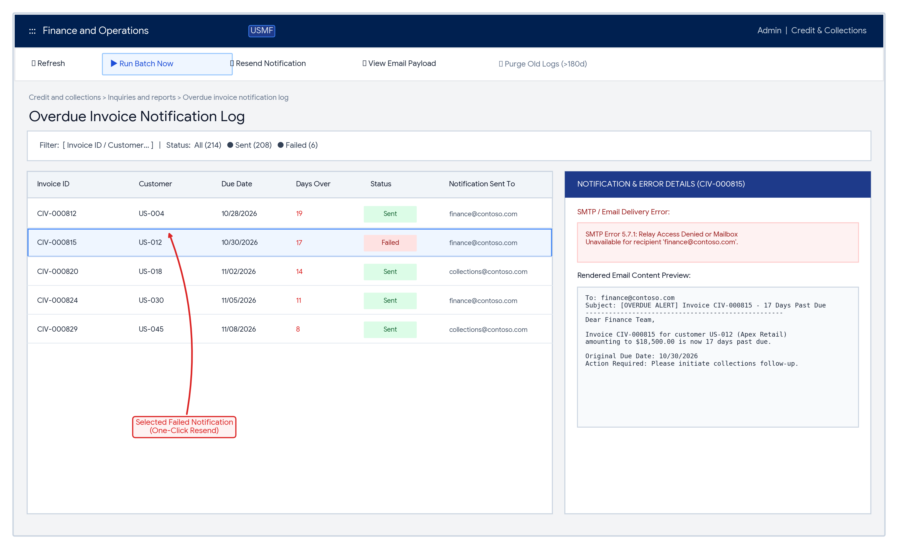

> Original document: [REQ-COL-715-FRD.docx](REQ-COL-715-FRD.docx). This page is a Markdown copy for reading on GitHub.

_MICROSOFT DYNAMICS 365 FINANCE & OPERATIONS  |  CREDIT & COLLECTIONS SPECIFICATION_

# Functional Requirement Document — REQ-COL-715

| Requirement ID: | REQ-COL-715 |
|---|---|
| Title: | Automated Overdue Invoice Batch Job & Notification Log Workspace |
| Module & Menu Path: | Credit and collections > Inquiries and reports > Overdue invoice notification log |
| Technical Pattern: | SysOperation Framework Batch Job + Email API (SysMailer / Outlook) + Custom Audit Table & Form |
| Target Users: | Finance Team, Credit Controllers, Accounts Receivable Managers |

## 1. Business Context & Objective

Accounts receivable and finance teams need proactive alerts when customer invoices pass their due date without settlement. Currently, tracking overdue invoices requires manual report generation inside Accounts Receivable. This requirement defines an automated SysOperation batch job that runs daily, evaluates posted customer invoices against configured due-date thresholds, sends automated email notifications to the finance team, and logs every notification attempt into a dedicated D365 F&O audit and monitoring workspace.

## 2. Automated Batch Job Specifications (SysOperation)

- **Execution Schedule:** Configured as a recurring batch job via the SysOperation framework to run automatically every day (e.g., at 06:00 AM).
- **Batch Contract Parameters:** Includes parameters for 'Grace Period Days' (integer, default = 0 days past due), 'Customer Group Filter' (optional), and 'Recipient Email Address' (e.g., finance@contoso.com or collections team DL).
- **Invoice Selection Logic:** Queries posted customer invoices (`CustInvoiceJour`) where Settlement Status is Open/Unsettled, Invoice Date + Payment Terms due date is strictly earlier than execution date minus Grace Period Days, and no successful notification has been sent for this invoice within the current overdue cycle.
- **Duplicate Alert Prevention:** To prevent email spamming, the system checks the audit log and sends at most one notification per invoice per aging tier (e.g., at 15 days, 30 days, 60 days overdue).

## 3. Overdue Invoice Notification Log Form (D365 F&O UI)

- **Transaction Grid (Left Pane):** Displays a chronological audit trail of all email notifications sent by the batch job, including Invoice ID, Customer Account, Original Due Date, Days Overdue, Delivery Status (Sent / Failed), and Recipient Email.
- **Email Preview & Error Inspector (Right Pane):** Selecting any record in the grid renders the exact email subject and body text that was sent, along with detailed SMTP delivery error logs if transmission failed.
- **One-Click Resend Action:** Provides an action button ('Resend Notification') enabled for failed or manually selected records, allowing finance users to re-trigger email delivery instantly.
- **Log Maintenance Utility:** Includes a toolbar action to purge historical audit records older than 180 days.

## 4. Notification Log Form UI Design Mockup

The custom D365 F&O log workspace follows the split-pane layout illustrated below, presenting the audit history grid on the left and the rendered email preview and error inspector on the right:

Figure 1: Target D365 F&O UI Design — Overdue Invoice Notification Log Workspace (REQ-COL-715)

## 5. Business Acceptance Criteria

| AC # | Test Scenario | Expected Result |
|---|---|---|
| AC-01 | Batch Job Execution | Running the SysOperation batch job correctly identifies all unsettled invoices past their due date and generates email notifications. |
| AC-02 | Audit Logging | Every notification attempt (successful or failed) writes a complete audit record to the Overdue Invoice Notification Log form with correct metadata. |
| AC-03 | Email Content Accuracy | The generated email contains the correct Invoice ID, Customer Name, Outstanding Amount, Original Due Date, and Days Overdue. |
| AC-04 | Manual Resend Workflow | Selecting a failed notification record in the log form and clicking 'Resend Notification' successfully re-delivers the email and updates status to 'Sent'. |
