# Test cases — REQ-COL-715

The scenarios below are the test plan from the approved TDD (section 6), unchanged. The **Result** column records only what is backed by evidence in this folder; a scenario without evidence is marked *Not yet recorded* rather than assumed to pass.

## Build verification

| Check | Result |
|---|---|
| Compile (X++ compiler, model DYLOExtensions) | ✅ 0 errors |
| Delivered | 2026-11-22 |

## Functional scenarios

Tested in Dynamics 365 Finance & Operations 10.0.48 on the Contoso demo data, legal entity USMF.

| # | Scenario | Expected | Result | Evidence |
|---|---|---|---|---|
| T1 (AC-01) | Tiers 15/30/60; invoices 10, 16, 31 and 65 days overdue; run job | Alerts for the 16 (tier 15), 31 (tier 30) and 65 (tier 60) day invoices; none for 10 days | ✅ Passed The test invoices were 64, 30, 15, 9 and 2 days overdue on the run date; tiers 60, 30 and 15 were reached, and the 9 and 2 day invoices got no line. | [f_run1_result.png](evidence/f_run1_result.png) · [h_log_tier15_details.png](evidence/h_log_tier15_details.png) · [y_us016_all_tiers.png](evidence/y_us016_all_tiers.png) |
| T2 | Run again the same day / next day | No new emails for those invoices and tiers | — Not yet recorded |  |
| T3 | Invoice moves from 29 to 30 days overdue | Second alert, tier 30; new log line | — Not yet recorded |  |
| T4 | Grace period 5; invoice 3 days overdue with tier 1 | Not selected | ✅ Passed The invoice inside the grace period was 2 days overdue. | [p_setup_tier1_added.png](evidence/p_setup_tier1_added.png) · [r_grace5_run_summary.png](evidence/r_grace5_run_summary.png) · [t_grace0_run_summary.png](evidence/t_grace0_run_summary.png) |
| T5 | Partly paid invoice (1 000 invoiced, 400 paid) | Email shows original 1 000 and outstanding 600 | ✅ Passed Invoice of 2,656.25 with 400.00 paid: outstanding 2,256.25. | [s_partly_paid_line.png](evidence/s_partly_paid_line.png) |
| T6 | Free text invoice overdue | Included | ✅ Passed | [f_run1_result.png](evidence/f_run1_result.png) · [x_log_after_batch_group30.png](evidence/x_log_after_batch_group30.png) |
| T7 | Fully settled invoice / credit note | Not included | — Not yet recorded |  |
| T8 | Customer group filter = group A | Only group A invoices | ✅ Passed The customer group of each logged customer was checked in the customer table; it is not shown on the log form. | [e_batch_dialog.png](evidence/e_batch_dialog.png) · [f_run1_result.png](evidence/f_run1_result.png) · [v_dialog_batch_group30.png](evidence/v_dialog_batch_group30.png) · [x_log_after_batch_group30.png](evidence/x_log_after_batch_group30.png) |
| T9 (AC-02) | Wrong SMTP configuration → run | Log line Failed with error text; Sent lines complete with subject and body | ◐ Partly evidenced The Failed half is proven: status Failed with the error text, and recipient, subject and body kept on the line. The Sent half was not exercised, because no e-mail could be delivered on the dev box. | [f_run1_result.png](evidence/f_run1_result.png) · [h_log_tier15_details.png](evidence/h_log_tier15_details.png) |
| T10 (AC-03) | Open a log line | Body has invoice ID, customer name, outstanding and original amount, original due date, days overdue | ✅ Passed | [h_log_tier15_details.png](evidence/h_log_tier15_details.png) |
| T11 (AC-04) | Fix SMTP, select the failed line, Resend notification | Email delivered; status Sent; attempt count 2; error cleared | — Not yet recorded |  |
| T12 | Resend on a Sent line | Confirmation asked, then sent again | — Not yet recorded |  |
| T13 | Purge with lines older than 180 days | Only those lines deleted; counts refreshed | — Not yet recorded |  |
| T14 | Status filter Failed; quick filter on customer | Grid filtered; counts line correct | ◐ Partly evidenced The status filter and the quick filter work. The counts line is cut off, so the Failed count cannot be read. | [k_filter_failed.png](evidence/k_filter_failed.png) · [m_quickfilter_customer.png](evidence/m_quickfilter_customer.png) |
| T15 | User with Inquire duty only | Sees the log; Resend, Purge and Run not available | — Not yet recorded |  |
| T16 | Run batch now from the log form | Batch dialog opens; the run creates log lines | ✅ Passed The button is captioned "Send overdue invoice notifications"; the design names it "Run batch now". | [e_batch_dialog.png](evidence/e_batch_dialog.png) · [f_run1_result.png](evidence/f_run1_result.png) |
| T17 | Look of the log screen | Standard D365 style; Sent cells green, Failed cells red, days overdue red; no View Email Payload button | ❌ Failed Failed cells are red and there is no View Email Payload button, but Days overdue is not shown in red. Green Sent cells could not be seen, because no line was Sent. | [x_log_after_batch_group30.png](evidence/x_log_after_batch_group30.png) |

### c_setup_tiers.png

The setup form's Overdue tiers tab with three active tiers: 15 First reminder, 30 Second reminder, 60 Escalation to collections.

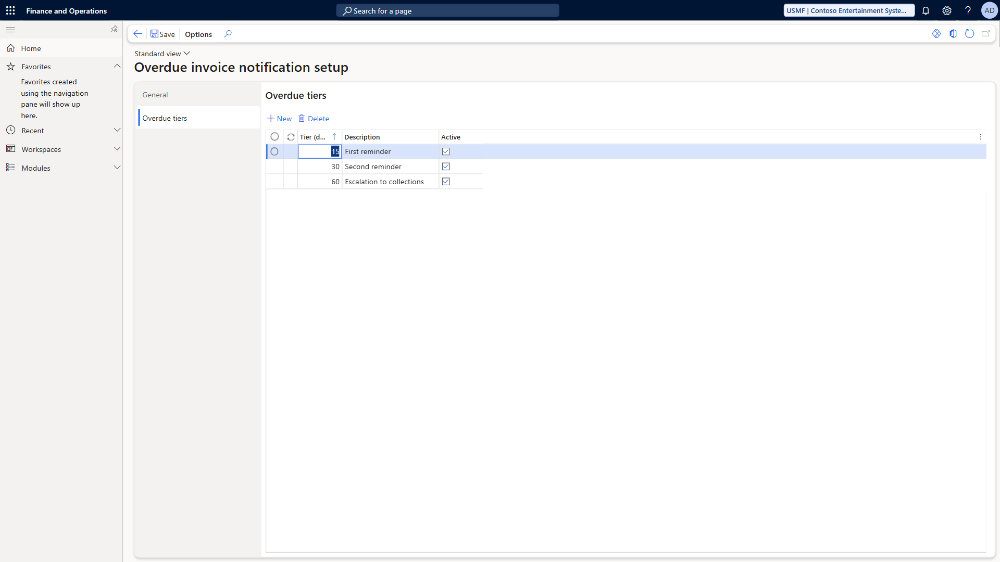

### e_batch_dialog.png

The batch dialog opened from the log form: Grace period days 0, Customer group 10, a recipient e-mail address, and the standard batch options.

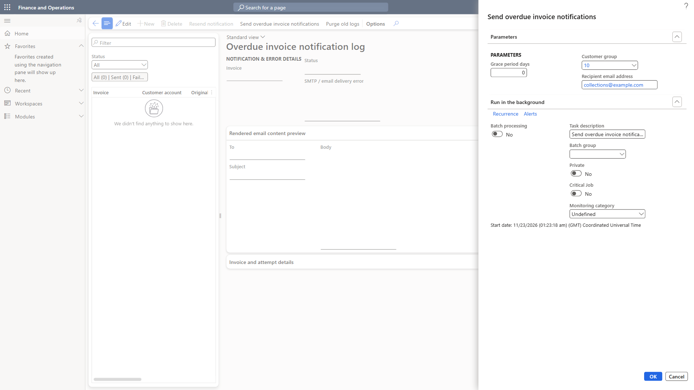

### f_run1_result.png

The log form as delivered, after the first run: 8 lines, the message "Invoices skipped: 2", and the selected line with status Failed, the delivery error text, recipient, subject and body.

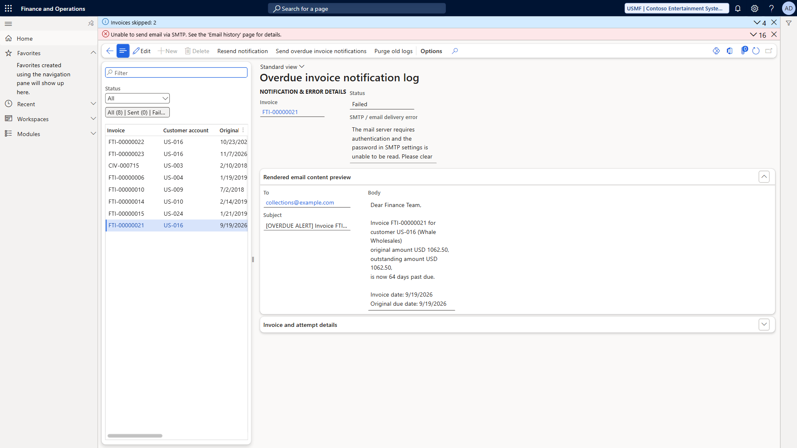

### h_log_tier15_details.png

A log line for a free text invoice 15 days overdue: tier 15, status Failed with the error text, and the generated e-mail body with invoice, customer, original and outstanding amount, days past due, invoice date and original due date.

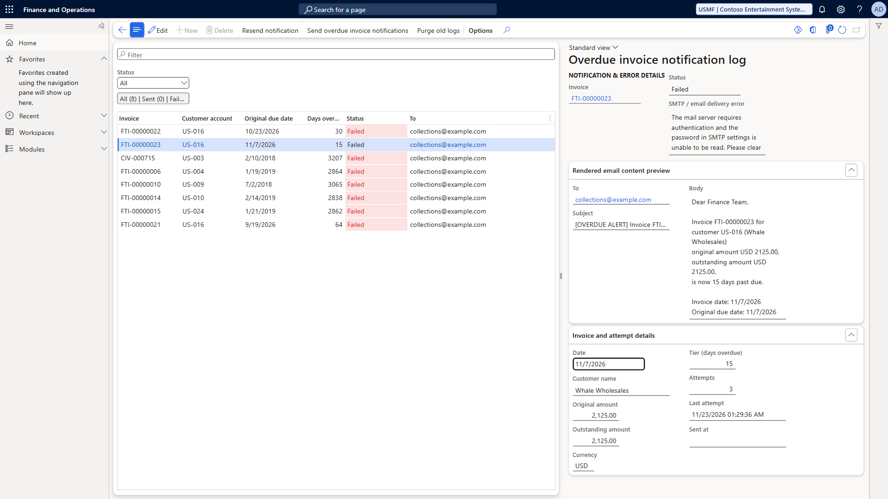

### p_setup_tier1_added.png

A 1-day tier added to the tiers for the grace period test.

### r_grace5_run_summary.png

Run with a grace period of 5 days: "Invoices checked: 9", a new line for the invoice 9 days overdue, and no line for the invoice 2 days overdue.

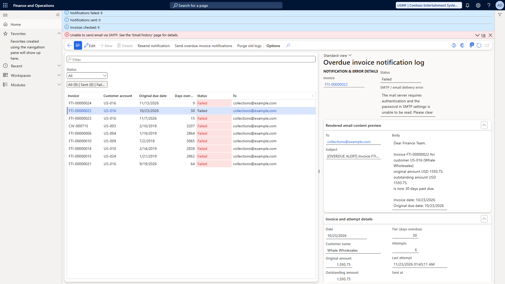

### s_partly_paid_line.png

The partly paid invoice: the e-mail body and the log line show original amount 2,656.25 and outstanding amount 2,256.25.

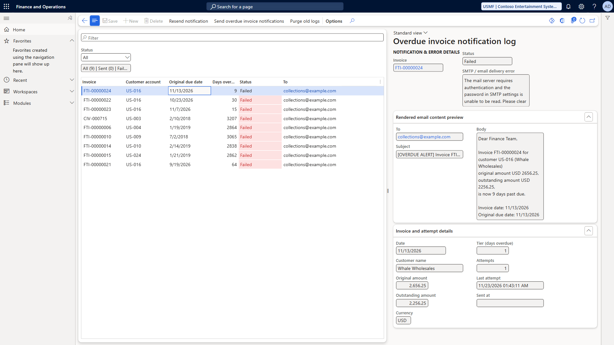

### t_grace0_run_summary.png

Run with a grace period of 0 days: "Invoices checked: 10", and the invoice 2 days overdue now has a line.

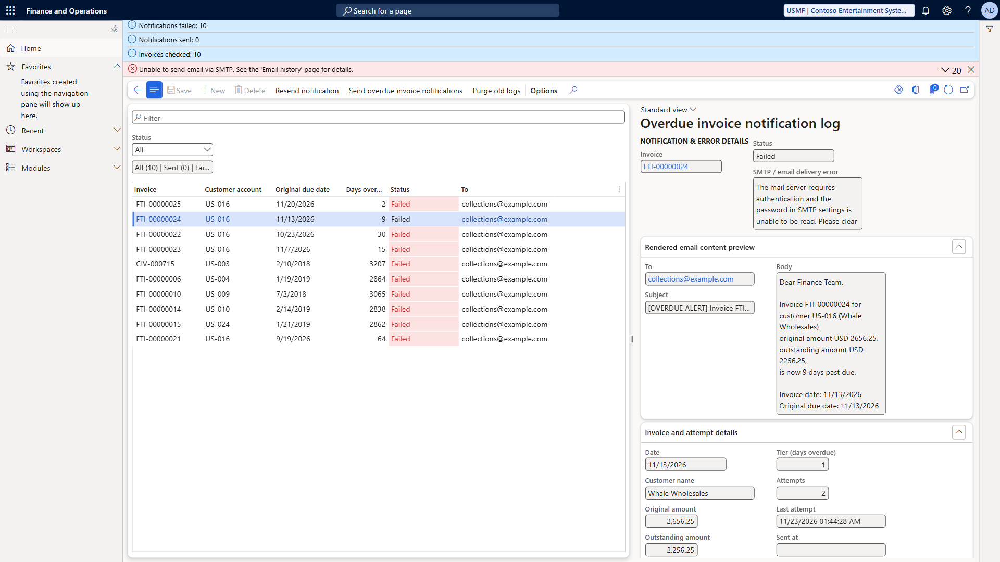

### y_us016_all_tiers.png

The five test invoices of one customer in the log, 2, 9, 15, 30 and 64 days overdue; the selected 64-day line shows tier 60.

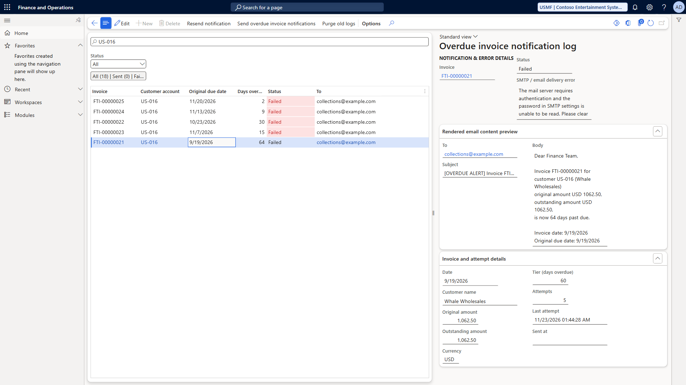

### k_filter_failed.png

Status filter set to Failed: 8 lines, all Failed.

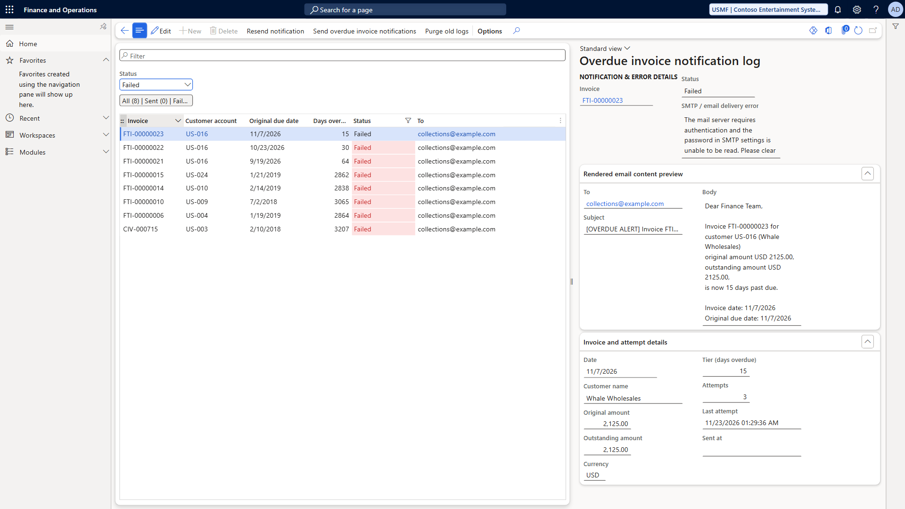

### m_quickfilter_customer.png

Quick filter on Customer account: only the three lines of customer US-016 are listed.

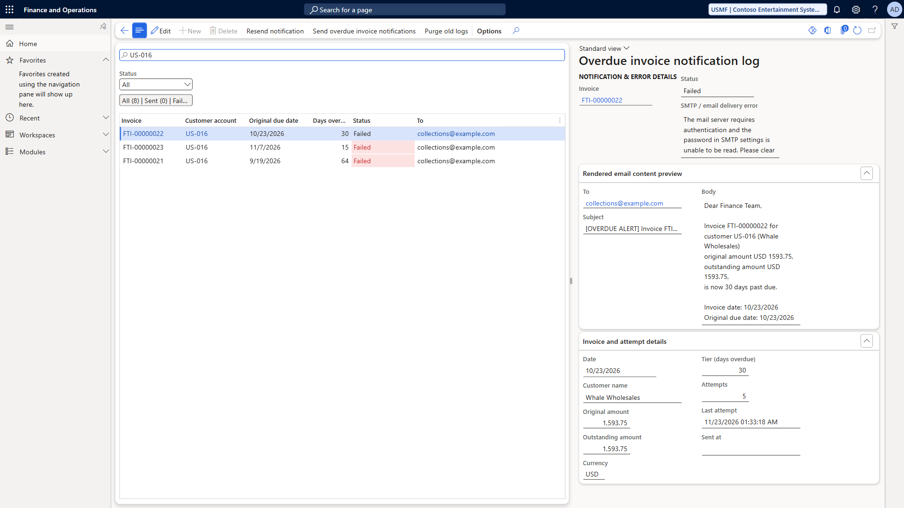

### v_dialog_batch_group30.png

The batch dialog with Customer group 30 and Batch processing set to Yes; the log behind it holds 10 lines, all for customers of group 10.

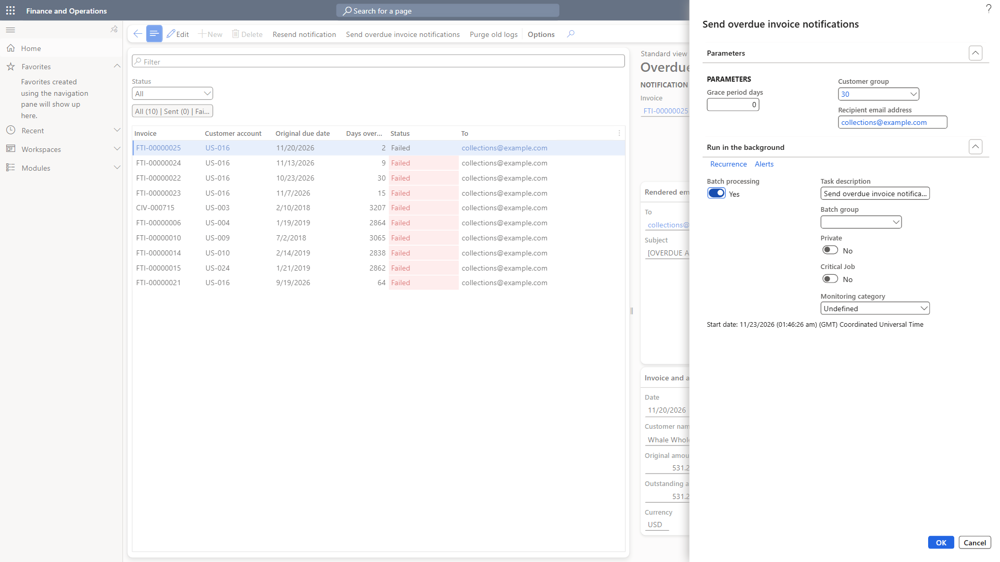

### w_batch_job_ended.png

The Batch jobs form: the "Send overdue invoice notifications" job with status Ended.

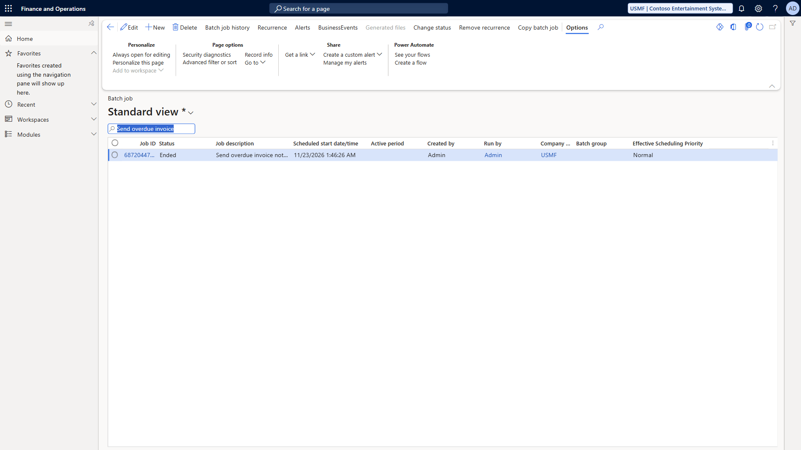

### x_log_after_batch_group30.png

The log after the batch run: 18 lines, 8 of them new for customers of group 30, sales and free text invoices side by side. It also shows a defect: Days overdue is in the normal text colour, not red.

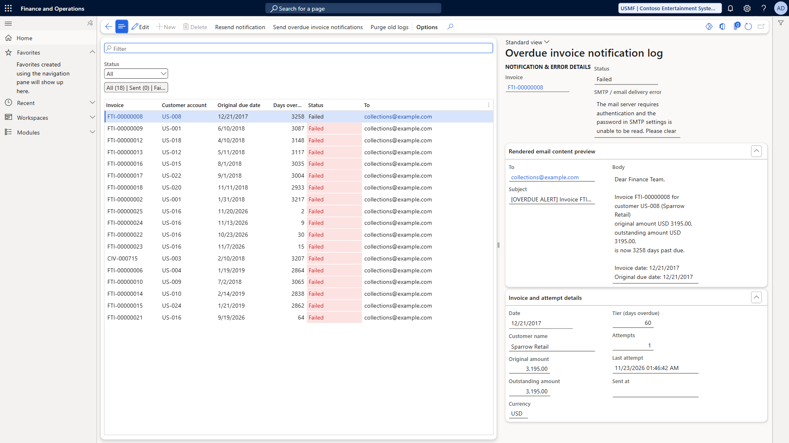

## Notes

**E-mail delivery was not tested.** The dev box's e-mail provider could not send (its stored password cannot be read), and the test did not change that setting. Every notification was therefore logged as Failed with the provider's error text, which is the designed behaviour for a failed send, and no Sent line exists. Scenarios that need a delivered e-mail are not covered.

**Not run**
- T2 (run again): not run as written, because no line was Sent, so the "Sent line is skipped" path could not be exercised. What was seen: a second run creates no new line; each Failed line is retried on the same line and its attempt count goes up.
- T3 (invoice moves from 29 to 30 days): needs a day to pass.
- T7 (fully settled invoice / credit note): no suitable overdue credit note in USMF demo data.
- T11 (resend after fixing the mail settings): blocked. Resend was run on a Failed line: message "0 notifications sent, 1 failed.", attempts went from 4 to 5, the status stayed Failed.
- T12 (resend on a Sent line): no Sent line exists.
- T13 (purge lines older than 180 days): no line was that old. The action ran: it asked for confirmation with the cut-off date, then reported "0 notification log lines were deleted." and the lines stayed.
- T15 (user with the Inquire duty only): needs a second sign-in.

**Defects and deviations from the design**
- D1: Days overdue is not shown in red; only the Status cell is coloured.
- D2: the counts line is cut off ("All (8) | Sent (0) | Fail…"), so the Failed count is never readable.
- D3: the list pane opens about 300 px wide, not about 62 % of the form; Days overdue, Status and To need a horizontal scroll or a wider pane. Later screenshots were taken with the pane widened.
- D4: the log form button reads "Send overdue invoice notifications"; the design names it "Run batch now".
- D5: the e-mail preview is narrow: the subject is cut and the body wraps, so its last lines need scrolling.
- D6: after Resend the form shows in edit mode and the "Invoice and attempt details" tab collapses; the fields stay read-only.
- Not tested, seen in the form definition only: the grid does not allow multiple selection, while the design asks for Resend on several selected lines.

**Dates.** The job takes the run date from the company time zone, which was one day behind UTC during the test, so the test invoices show 64 / 30 / 15 / 9 / 2 days overdue instead of the planned 65 / 31 / 16 / 10 / 3. The tiers reached are the same.
