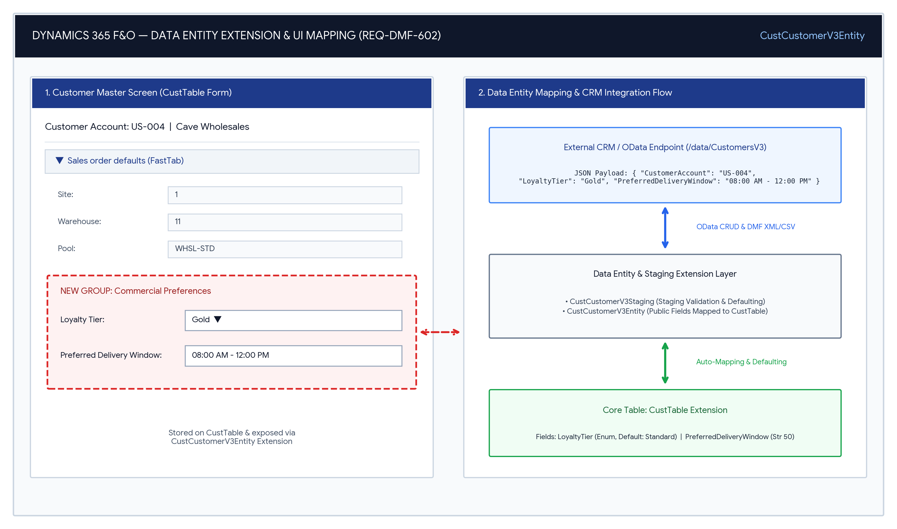

> Original document: [REQ-DMF-602-FRD.docx](REQ-DMF-602-FRD.docx). This page is a Markdown copy for reading on GitHub.

_MICROSOFT DYNAMICS 365 FINANCE & OPERATIONS  |  DATA MANAGEMENT & ODATA SPECIFICATION_

# Functional Requirement Document — REQ-DMF-602

| Requirement ID: | REQ-DMF-602 |
|---|---|
| Title: | Extend Customer Master Data Entity (CustCustomerV3Entity) with Loyalty Tier & Preferred Delivery Window |
| Module & Workspace: | Accounts Receivable / Data Management Framework (DMF) & OData Services |
| Target Data Entity: | Customers V3 (CustCustomerV3Entity & CustCustomerV3Staging) |
| Target Users: | CRM Integration Team, Sales Operations Coordinators, Data Migration Specialists |

## 1. Business Overview

The company integrates customer master records between its external CRM platform and Microsoft Dynamics 365 Finance & Operations using the standard Customers V3 (CustCustomerV3Entity) data entity via Data Management (DMF) and OData. Currently, customer loyalty classifications and preferred delivery time windows captured in the CRM are not synchronized into D365 F&O, forcing sales coordinators to update them manually. This requirement extends the Customer master table, Customer form, and the standard CustCustomerV3Entity data entity to support seamless bi-directional import/export and OData integration.

## 2. Functional Requirements

- **New Customer Master Fields (CustTable):** Add Loyalty Tier (Selection list: Standard, Silver, Gold, Platinum; default: Standard) and Preferred Delivery Window (Text field, up to 50 characters, e.g., '08:00 AM - 12:00 PM') to the Customer master table.
- **Customer Master Screen Placement (CustTable Form):** Display both Loyalty Tier and Preferred Delivery Window under a new group titled 'Commercial Preferences' inside the 'Sales order defaults' fast tab on the Customer details screen so sales and customer service users can view or maintain them directly.
- **Data Entity & Staging Extension (CustCustomerV3Entity):** Expose LoyaltyTier and PreferredDeliveryWindow on the standard Customers V3 data entity and its staging table (CustCustomerV3Staging), ensuring automatic mapping for Data Management (DMF) import/export packages (CSV, Excel, XML) and real-time OData API CRUD operations (GET, POST, PATCH).
- **Defaulting & Validation Rules:** During DMF import or OData record creation, if Loyalty Tier is omitted or blank, automatically default it to 'Standard'. If an unrecognized Loyalty Tier value is provided, reject the staging row with a clear validation error message without corrupting existing customer records.

## 3. UI Placement & Data Entity Mapping Architecture

The visual diagram below illustrates the placement of the new fields on the Customer details screen alongside the end-to-end Data Management and OData mapping flow through CustCustomerV3Entity:

Figure 1: Customer Master UI Placement & CustCustomerV3Entity Integration Flow (REQ-DMF-602)

## 4. Business Acceptance Criteria

| AC # | Test Scenario | Expected Result |
|---|---|---|
| AC-01 | UI Display & Manual Entry | Users can view and edit Loyalty Tier and Preferred Delivery Window under the Sales order defaults fast tab on the Customer master screen. |
| AC-02 | DMF Export | Exporting customers via Data Management using the Customers V3 entity includes accurate values for both new fields in the exported file. |
| AC-03 | DMF Import & Defaulting | Importing a customer file updates Loyalty Tier and Preferred Delivery Window on CustTable, and defaults blank Loyalty Tier values to Standard. |
| AC-04 | OData API Integration | Querying or updating /data/CustomersV3 via OData reads and persists both new fields accurately without breaking existing CRM payload integrations. |
| AC-05 | Invalid Value Handling | Importing an unrecognized Loyalty Tier value flags the row as an error in the Data Management execution history with a descriptive message. |
