# Test cases — REQ-DMF-602

The scenarios below are the test plan from the approved TDD (section 6), unchanged. The **Result** column records only what is backed by evidence in this folder; a scenario without evidence is marked *Not yet recorded* rather than assumed to pass.

## Build verification

| Check | Result |
|---|---|
| Compile (X++ compiler, model DYLOExtensions) | ✅ 0 errors |
| Delivered | 2026-11-22 |

## Functional scenarios

Tested in Dynamics 365 Finance & Operations 10.0.48 on the Contoso demo data, legal entity USMF.

| # | Scenario (AC) | Steps | Expected result | Result | Evidence |
|---|---|---|---|---|---|
| T1 | UI display and entry (AC-01) | Open a customer and go to the Sales order defaults FastTab. Set Loyalty Tier = Gold and Preferred Delivery Window = `08:00 AM - 12:00 PM`. Save and reopen. | The Commercial Preferences group appears after Site, Warehouse and Pool. The values are saved and shown. | ✅ Passed | [a_T1_1_form_before_US-004.png](evidence/a_T1_1_form_before_US-004.png) · [a_T1_2_form_dropdown_values.png](evidence/a_T1_2_form_dropdown_values.png) · [a_T1_3_form_saved_reopened_US-004_Gold.png](evidence/a_T1_3_form_saved_reopened_US-004_Gold.png) |
| T2 | New customer default | Create a new customer on the form without touching Loyalty Tier. | Loyalty Tier = Standard. | ✅ Passed | [b_T2_2_new_customer_LT-001_defaults_Standard.png](evidence/b_T2_2_new_customer_LT-001_defaults_Standard.png) |
| T3 | DMF export (AC-02) | Export Customers V3 to CSV, Excel and XML. | Both columns are present. T1's customer shows `Gold` and the window. Other customers show `Standard`. | ❌ Failed The CSV export job ended Canceled: 36 rows with errors, 0 exported. Excel and XML were not run. Only the field mapping is proven. See the notes for the cause. | [e_T3_1_export_mapping_LOYALTYTIER.png](evidence/e_T3_1_export_mapping_LOYALTYTIER.png) |
| T4 | DMF import and defaulting (AC-03) | Import a file with: one new customer with `silver`; one new customer with a blank tier; one existing Gold customer with a blank tier; one existing customer with `Platinum` and a new window. | The results are Silver, Standard, Standard (A2), and Platinum with the new window. | — Not yet recorded |  |
| T5 | Invalid value, DMF (AC-05) | Import a row with Loyalty Tier `Diamond` and a changed window for an existing customer whose tier is Gold. | The row is an error in the execution log with the message "Loyalty Tier value 'Diamond' is not valid…". The customer is still Gold, with the old window. The other rows import. | — Not yet recorded |  |
| T6 | OData (AC-04) | (a) GET `/data/CustomersV3?$select=CustomerAccount,LoyaltyTier,PreferredDeliveryWindow`. (b) POST a new customer without LoyaltyTier. (c) POST a new customer with `"LoyaltyTier":""`. (d) PATCH a Silver customer with `"LoyaltyTier":"Gold"`. (e) PATCH a Gold customer with `"LoyaltyTier":""`. (f) PATCH a Gold customer with only `PreferredDeliveryWindow`. (g) PATCH with `"LoyaltyTier":"Diamond"`. (h) Send an existing CRM payload without the new properties. | (a) The text values are returned. (b) and (c) The customers are created as Standard. (d) Gold. (e) Standard. (f) Still Gold, with the new window. (g) An error with our message, and the customer is unchanged. (h) Works as before and leaves the fields unchanged. | ✅ Passed Parts (a) to (h), each with its own screenshot. | [c_T6a_2_odata_GET_request_response.png](evidence/c_T6a_2_odata_GET_request_response.png) · [d_T6b_odata_POST_without_tier_Standard.png](evidence/d_T6b_odata_POST_without_tier_Standard.png) · [d_T6c_odata_POST_empty_tier_Standard.png](evidence/d_T6c_odata_POST_empty_tier_Standard.png) · [d_T6d_odata_PATCH_Silver_to_Gold.png](evidence/d_T6d_odata_PATCH_Silver_to_Gold.png) · [d_T6e_1_odata_PATCH_empty_tier_Standard.png](evidence/d_T6e_1_odata_PATCH_empty_tier_Standard.png) · [d_T6f_odata_PATCH_window_only_keeps_Gold.png](evidence/d_T6f_odata_PATCH_window_only_keeps_Gold.png) · [d_T6g_odata_PATCH_Diamond_refused.png](evidence/d_T6g_odata_PATCH_Diamond_refused.png) · [d_T6h_odata_PATCH_without_new_properties.png](evidence/d_T6h_odata_PATCH_without_new_properties.png) |
| T7 | Security | As a user with only the Accounts receivable clerk role, open a customer. As a user with only view rights, open a customer. | The clerk can edit both fields. The viewer sees them read-only. | — Not yet recorded |  |
| T8 | Length | Import a window of 60 characters. | It is stored cut to 50 characters (A6). | — Not yet recorded |  |
| T9 | Converter | Call `fromText` with `" Gold "`, `"PLATINUM"`, `""` and `"X"`; call `toText` for each enum value. | The results are Gold, Platinum, Standard and an error. `toText` returns the four names. | — Not yet recorded |  |

### a_T1_1_form_before_US-004.png

Customer US-004 Cave Wholesales before the test: the new Commercial preferences group on the Sales order defaults FastTab, directly after the Sales order group, with Loyalty tier Standard and an empty Preferred delivery window.

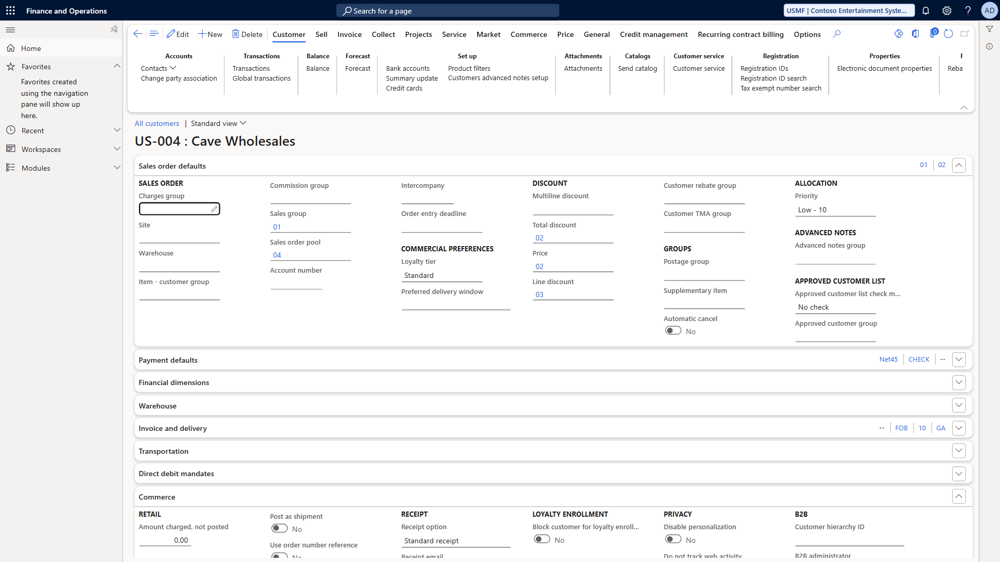

### a_T1_2_form_dropdown_values.png

The same customer in edit mode with the Loyalty tier drop-down open, showing the four values Standard, Silver, Gold and Platinum.

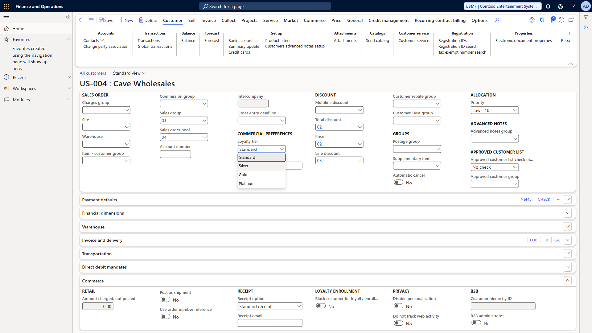

### a_T1_3_form_saved_reopened_US-004_Gold.png

US-004 reopened after saving: Loyalty tier is Gold and Preferred delivery window is 08:00 AM - 12:00 PM.

### b_T2_2_new_customer_LT-001_defaults_Standard.png

A customer just created on the form, LT-001, shows Loyalty tier Standard and an empty Preferred delivery window.

### c_T6a_2_odata_GET_request_response.png

OData GET on CustomersV3 returns both new fields as text for four customers; US-004 carries Gold and 08:00 AM - 12:00 PM, the others Standard.

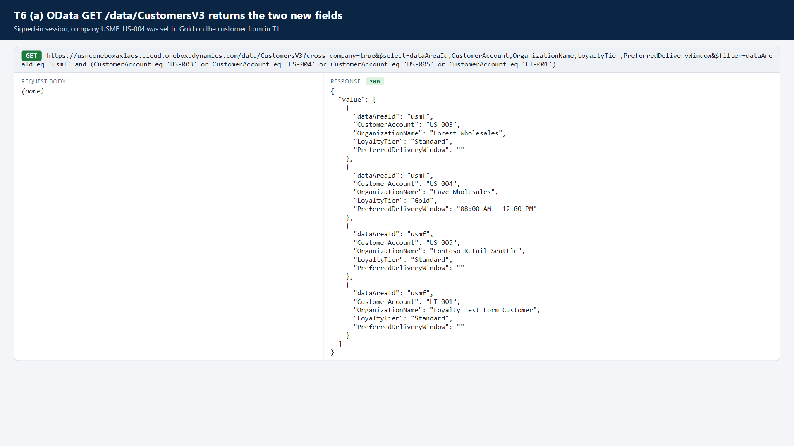

### d_T6b_odata_POST_without_tier_Standard.png

OData POST that creates a customer without the LoyaltyTier property returns 201, and the customer is Standard.

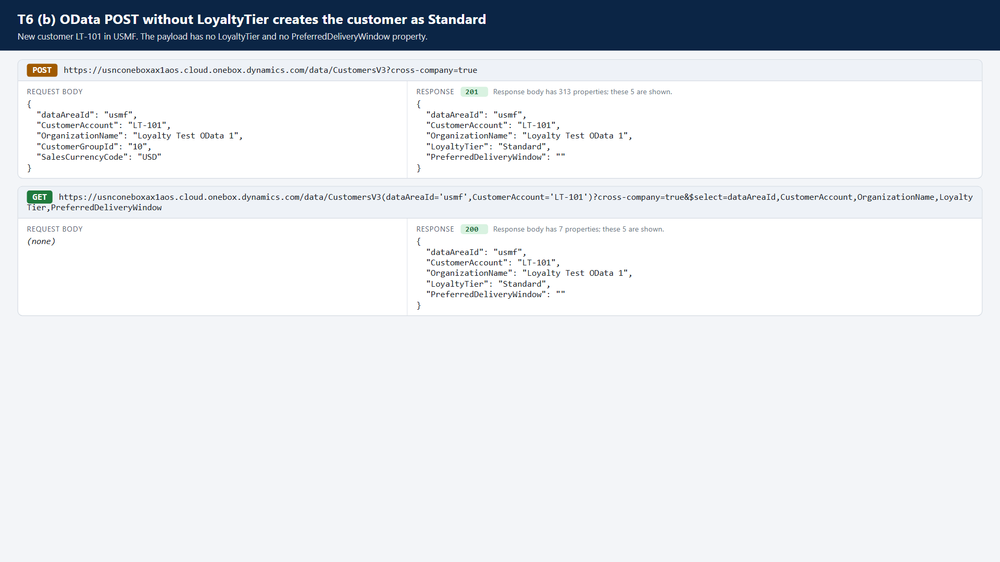

### d_T6c_odata_POST_empty_tier_Standard.png

OData POST with an empty LoyaltyTier returns 201, and the GET that follows returns Standard.

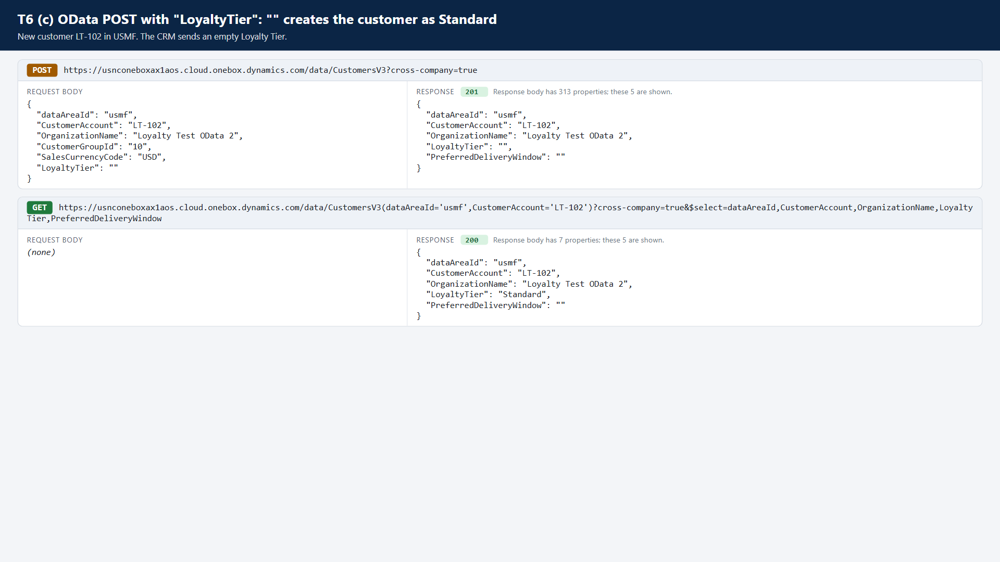

### d_T6d_odata_PATCH_Silver_to_Gold.png

OData PATCH sets a customer to Silver and then to Gold; each GET that follows returns the new tier.

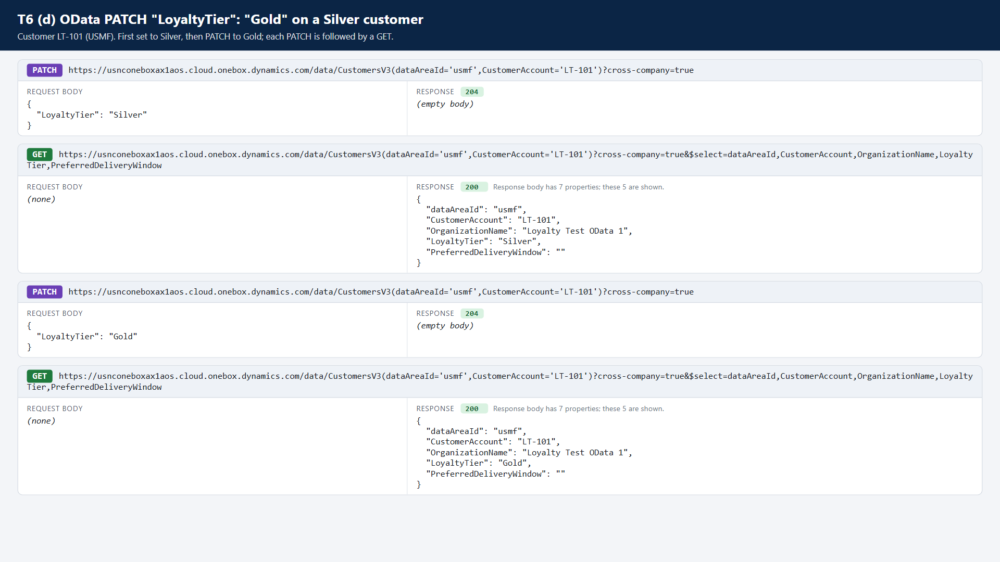

### d_T6e_1_odata_PATCH_empty_tier_Standard.png

OData PATCH with an empty LoyaltyTier on a Gold customer returns 204, and the GET that follows returns Standard.

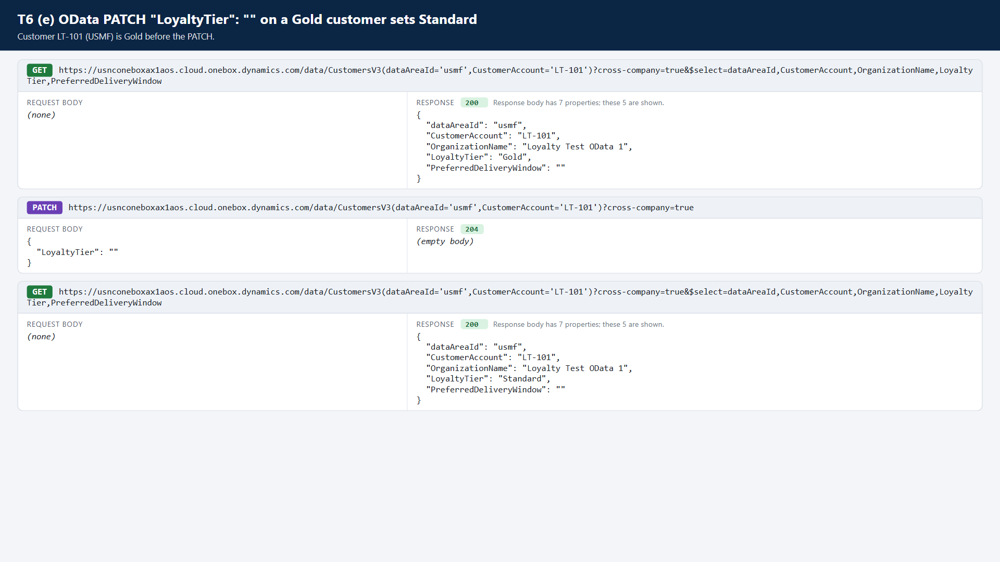

### d_T6f_odata_PATCH_window_only_keeps_Gold.png

OData PATCH with only PreferredDeliveryWindow changes the window to 01:00 PM - 05:00 PM and leaves the tier at Gold.

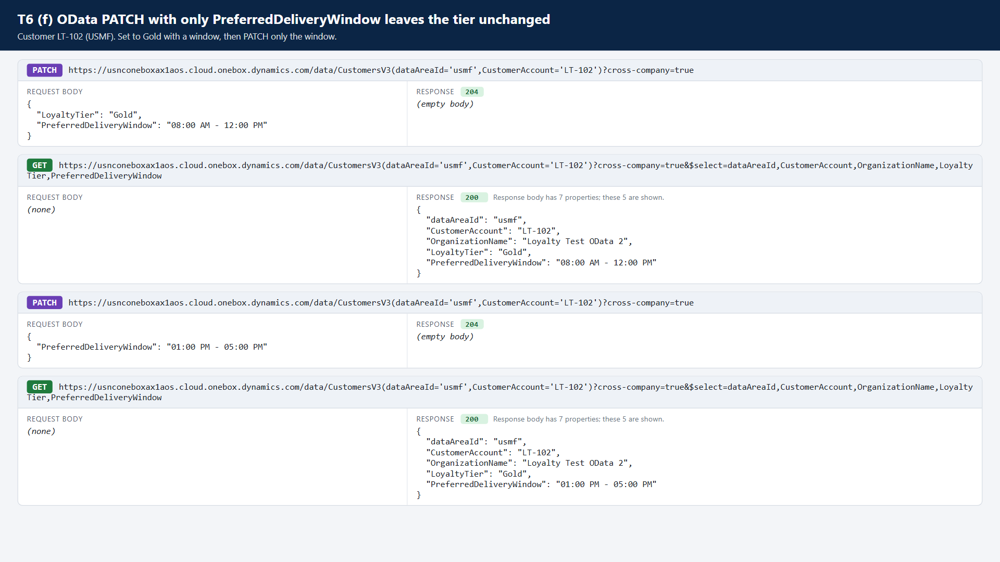

### d_T6g_odata_PATCH_Diamond_refused.png

OData PATCH with LoyaltyTier Diamond returns 400 with the message that the value is not valid and lists Standard, Silver, Gold and Platinum; the GET that follows shows the customer unchanged.

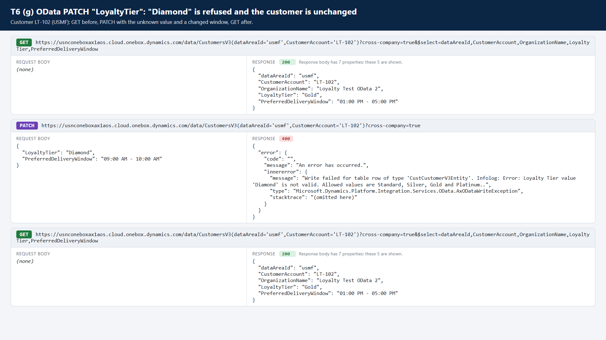

### d_T6h_odata_PATCH_without_new_properties.png

OData PATCH that sends only the credit limit returns 204 and leaves Loyalty tier and Preferred delivery window unchanged.

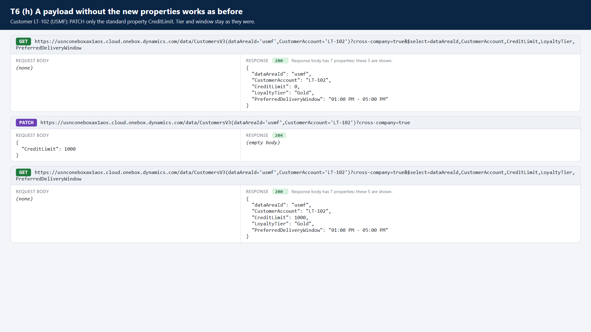

### e_T3_1_export_mapping_LOYALTYTIER.png

Data management export project for Customers V3: the mapping holds the field LOYALTYTIER, source to target.

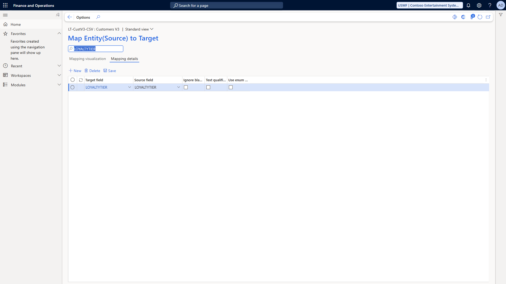

### x_defect1_odata_PATCH_null_tier_stays_Gold.png

Defect: an OData PATCH that sends LoyaltyTier as null returns 204 but the customer stays Gold, where the design expects Standard.

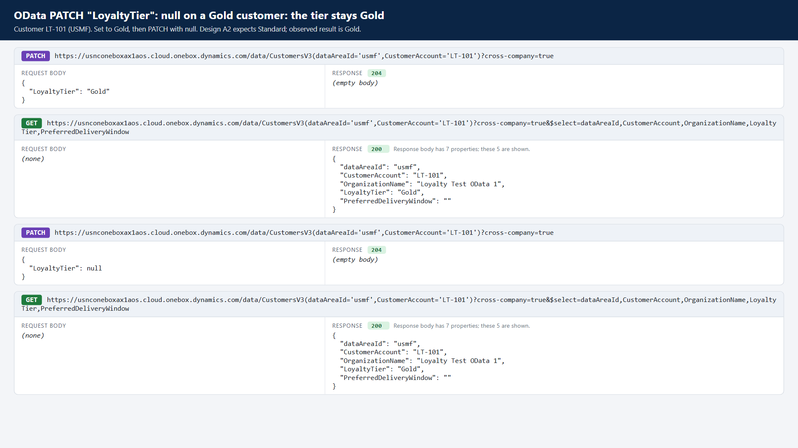

## Notes

Tested in USMF demo data on the dev box against section 6 of the approved design.

**Passed:** the customer form (T1, T2) and every OData case (T6 a to h).

**Data management export (T3) failed in this test, and the cause is the test environment.** The export job for Customers V3 ended Canceled with 36 rows in error and nothing exported. The dev box's database still held the Loyalty Tier staging column from an earlier version of this same demo, with a different (numeric) type, and the database sync for this delivery did not convert it to the text type that the delivered staging extension defines. The text value could therefore not be written to staging. The delivered metadata defines the field as text, and the field mapping for both new fields is present in the export project. Excel and XML export were not run because they use the same staging step.

**Not run:**
- T4, T5, T8 (Data management import, defaulting, the unknown value, the 60-character window): blocked by the same staging column, and the Data management import service on the dev box was stopped.
- T7 (security): only a system administrator session was available.
- T9 (converter): not called directly. The same inputs were sent through OData, which calls the converter: " Gold " gave Gold, "PLATINUM" gave Platinum, an empty text gave Standard, and "X" was refused with the error message.

The Data management scenarios may be retested once the staging column on the dev box matches the delivery.

**Deviations from the design found in OData:**
1. A PATCH that sends `"LoyaltyTier": null` does not set Standard: it returns 204 and the customer keeps its tier. An empty text `""` works as designed. POST with `null` was not tried.
2. A Preferred delivery window longer than 50 characters is accepted and stored cut to 50 characters; the design says OData rejects it.

Observation, not counted as a failure: an OData POST with an empty LoyaltyTier returns 201 and echoes the empty text in its response; a GET immediately after returns Standard.
