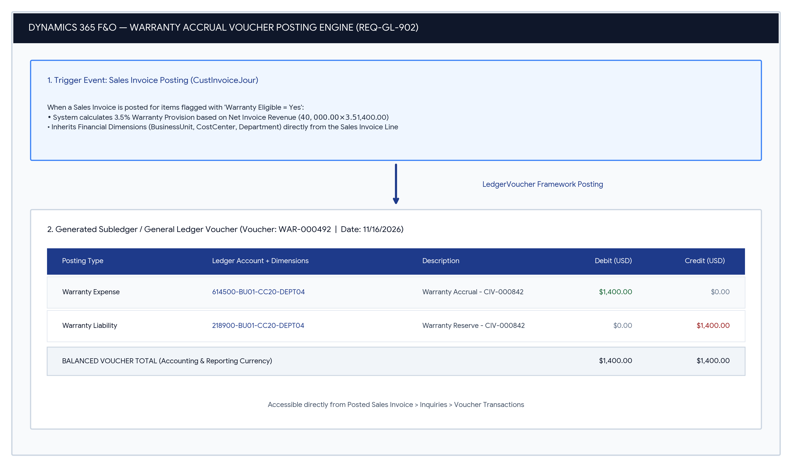

> Original document: [REQ-GL-902-FRD.docx](REQ-GL-902-FRD.docx). This page is a Markdown copy for reading on GitHub.

_MICROSOFT DYNAMICS 365 FINANCE & OPERATIONS  |  GENERAL LEDGER & SUBLEDGER POSTING SPECIFICATION_

# Functional Requirement Document — REQ-GL-902

| Requirement ID: | REQ-GL-902 |
|---|---|
| Title: | Automated Product Warranty Provision Subledger & General Ledger Voucher Posting |
| Module & Menu Path: | General ledger > Posting setup > Warranty posting profiles  &  Sales Invoice Posting |
| Technical Pattern: | LedgerVoucher / LedgerVoucherObject / LedgerVoucherTransObject Posting Engine |
| Target Users: | Financial Controllers, General Ledger Accountants, External Auditors |

## 1. Business Overview

Under IFRS 15 / ASC 606 revenue recognition standards, the company must automatically accrue a 3.5% warranty liability reserve whenever eligible finished goods are invoiced to customers. Currently, accountants calculate this provision manually via month-end spreadsheets. This requirement introduces a custom Warranty Posting Setup table and extends Sales Invoice posting to generate balanced Debit/Credit General Ledger voucher entries inheriting full financial dimensions from each invoice line.

## 2. Functional & Accounting Rules

- **Item Eligibility Flag:** Add a 'Warranty Eligible' checkbox on Released Products (`InventTable`) and a default Provision % field (default = 3.50%).
- **Warranty Posting Setup Form:** Provide a setup table mapping Item Group to Warranty Expense Main Account (Debit) and Warranty Provision Liability Main Account (Credit).
- **Automated Voucher Generation:** During Sales Invoice posting, for each eligible line, generate balanced LedgerVoucher transactions debiting Warranty Expense and crediting Warranty Liability.
- **Dimension Inheritance & Currency Conversion:** Merge main accounts with the invoice line's Default Financial Dimensions (`DefaultDimension`) and calculate both Accounting Currency and Reporting Currency amounts using the invoice exchange rate.
- **Credit Note Reversal:** When a Sales Credit Note is posted against a warranted item, automatically post the exact reverse accounting entry (Debit Liability / Credit Expense).

## 3. Accounting Flow & Voucher Architecture Diagram

## 4. Business Acceptance Criteria

| AC # | Test Scenario | Expected Result |
|---|---|---|
| AC-01 | Balanced Voucher Creation | Posting a $40,000 invoice for a warranty-eligible item creates a balanced $1,400 Debit/Credit voucher linked to the invoice. |
| AC-02 | Financial Dimension Inheritance | Generated GL entries inherit Business Unit, Cost Center, and Department dimensions from the originating sales order line. |
| AC-03 | Missing Account Validation | If Warranty Posting Setup is missing for an eligible item group, invoice posting aborts cleanly with an accounting setup error. |
| AC-04 | Credit Note Reversal | Posting a return/credit note reverses the warranty expense and liability balances accurately. |
