# Test cases — REQ-GL-902

The scenarios below are the test plan from the approved TDD (section 6), unchanged. The **Result** column records only what is backed by evidence in this folder; a scenario without evidence is marked *Not yet recorded* rather than assumed to pass.

## Build verification

| Check | Result |
|---|---|
| Compile (X++ compiler, model DYLOExtensions) | ✅ 0 errors |
| Delivered | 2026-11-22 |

## Functional scenarios

Tested in Dynamics 365 Finance & Operations 10.0.48 on the Contoso demo data, legal entity USMF.

| # | Scenario | Expected | Result | Evidence |
|---|---|---|---|---|
| T1 (AC-01) | Invoice a USD 40,000.00 line for an eligible item, 3.50%, setup present | The invoice voucher, under the invoice's voucher number, contains Dr expense 1,400.00 / Cr provision 1,400.00. The voucher is balanced, there is no separate warranty voucher, and the lines show in posted invoice > Voucher transactions. A log record is written with the invoice's voucher. | ✅ Passed Warranty lines and amounts are correct; defect D1 (description on later standard lines) is visible on this voucher. The log record was checked in the database; the log has no form. | [c_T1_T2_invoice_voucher_transactions.png](evidence/c_T1_T2_invoice_voucher_transactions.png) |
| T2 (AC-02) | Sales line with BusinessUnit BU01, CostCenter CC20, Department DEPT04 | Both warranty lines carry BU01-CC20-DEPT04 with their own main account. | ✅ Passed The expense line carries business unit, department and cost centre. The provision line carries business unit and department only: the USMF balance sheet account structure has no cost centre segment. | [c_T1_T2_invoice_voucher_transactions.png](evidence/c_T1_T2_invoice_voucher_transactions.png) |
| T3 | Invoice in EUR with a fixed exchange rate on the order | The accounting and reporting amounts of the warranty lines use the same rates as the revenue line. Both lines balance in all currencies. | ✅ Passed Reporting currency amounts were checked in the database; that column is not on the screenshot. | [h_T3_EUR_fixed_rate_voucher_transactions.png](evidence/h_T3_EUR_fixed_rate_voucher_transactions.png) |
| T4 (AC-03) | Eligible item whose item group has no setup | Posting stops with the setup error. No invoice, voucher or log is created. | ✅ Passed That no invoice, voucher or log row was created was checked in the database. | [e_T4_missing_setup_posting_stopped.png](evidence/e_T4_missing_setup_posting_stopped.png) |
| T5 | Item not eligible | No warranty lines. | ✅ Passed | [d_T5_non_eligible_item_no_warranty_lines.png](evidence/d_T5_non_eligible_item_no_warranty_lines.png) |
| T6 (AC-04) | Return order / credit note linked to the T1 invoice line, full quantity | Dr provision 1,400.00 / Cr expense 1,400.00 in the credit note's voucher, at the original 3.50% even if the item's % has changed since. | ✅ Passed Reversal amounts are correct; defect D1 is visible on this voucher. | [i_released_product_pct_changed_to_5.png](evidence/i_released_product_pct_changed_to_5.png) · [j_T6_full_credit_note_reversal.png](evidence/j_T6_full_credit_note_reversal.png) |
| T7 | Partial credit note (half the quantity) | Reversal of 700.00. | ✅ Passed Run on another invoice than T1 (already credited in full by T6): half of its 350.00 provision, 175.00, was reversed. | [k_T7_partial_credit_note_reversal.png](evidence/k_T7_partial_credit_note_reversal.png) |
| T8 | Credit note linked to an invoice posted before go-live (no log) | No warranty lines. | ✅ Passed | [l_T8_credit_note_of_invoice_without_provision.png](evidence/l_T8_credit_note_of_invoice_without_provision.png) |
| T9 | Credit note line with no link to an invoice | Reversal calculated with the item's current %. | ✅ Passed | [m_T9_unlinked_credit_line_current_pct.png](evidence/m_T9_unlinked_credit_line_current_pct.png) |
| T10 | Mixed invoice: eligible and non-eligible lines, two item groups | Warranty lines only for the eligible lines, each with its group's accounts, all in the one invoice voucher. | ✅ Passed Both item groups use the same two accounts, so the voucher shows one summarised debit and credit of 420.00; the split 350.00 / 70.00 was checked in the log table. | [g_T10_mixed_invoice_voucher_transactions.png](evidence/g_T10_mixed_invoice_voucher_transactions.png) |
| T11 | Pro forma invoice | No ledger postings and no log. | ✅ Passed The screenshot shows the pro forma only; that nothing was posted was checked in the database. | [o_T11_pro_forma_invoice.png](evidence/o_T11_pro_forma_invoice.png) |
| T12 | Released product: set eligible = Yes with % 0 | The % becomes 3.50. Saving with % 0 or > 100 is refused. | ✅ Passed The refusal of 0 gave the same message; only the refusal of 101 is on a screenshot. | [b_released_product_warranty_eligible.png](evidence/b_released_product_warranty_eligible.png) · [n_T12_pct_over_100_refused.png](evidence/n_T12_pct_over_100_refused.png) |
| T13 | Project sales order invoice for an eligible item | Same result as T1. | — Not yet recorded |  |

### a_warranty_posting_setup_audio.png

Warranty posting setup: item group Audio with warranty expense account 614500 and warranty provision account 218900.

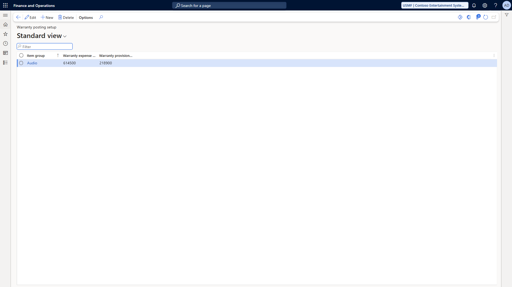

### b_released_product_warranty_eligible.png

Released product D0024, Sell tab: Warranty eligible is Yes and the system filled Warranty provision % with 3.50.

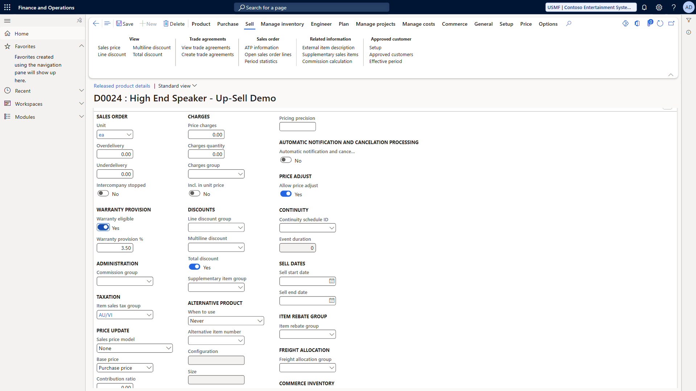

### c_T1_T2_invoice_voucher_transactions.png

Invoice CIV-00000721 for 40,000.00: its own voucher holds 614500 Warranty expense 1,400.00 debit and 218900 Warranty provision 1,400.00 credit, with the line's dimensions; it also shows a defect, the description "Warranty reserve" on standard lines.

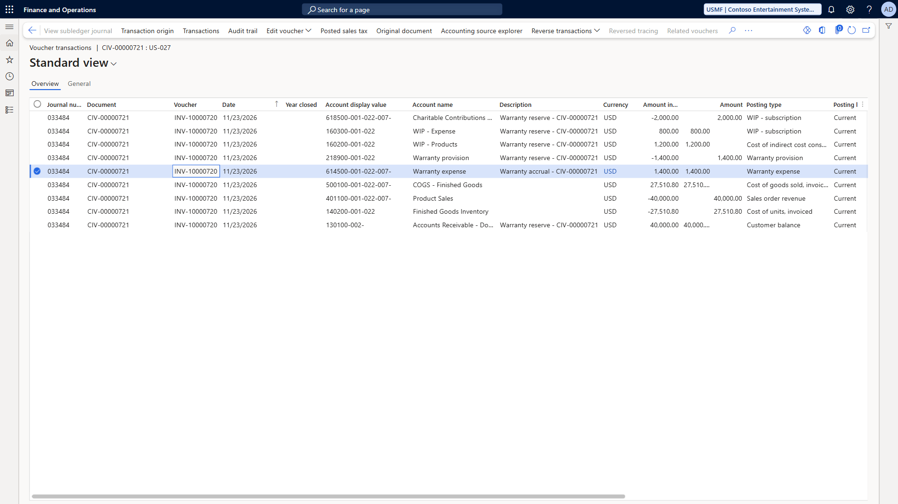

### d_T5_non_eligible_item_no_warranty_lines.png

Invoice for an item that is not warranty eligible: seven voucher lines, none for warranty, all descriptions empty.

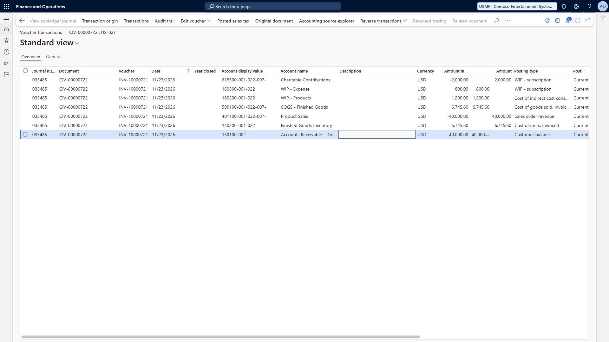

### e_T4_missing_setup_posting_stopped.png

Posting stopped for an eligible item whose item group has no setup, with the error that names the item group and where to set it up; the order stays open.

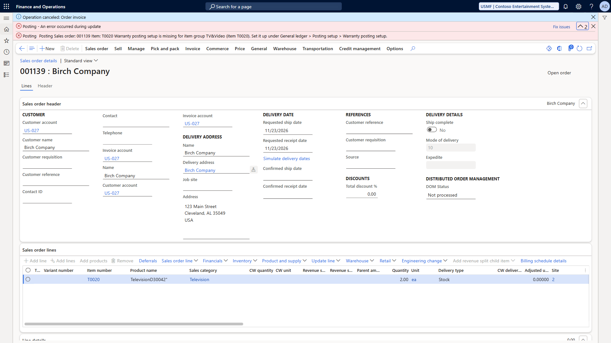

### g_T10_mixed_invoice_voucher_transactions.png

Mixed invoice of 22,000.00 with two eligible lines and one that is not: warranty 420.00 debit and credit in the one invoice voucher; the description defect is also visible.

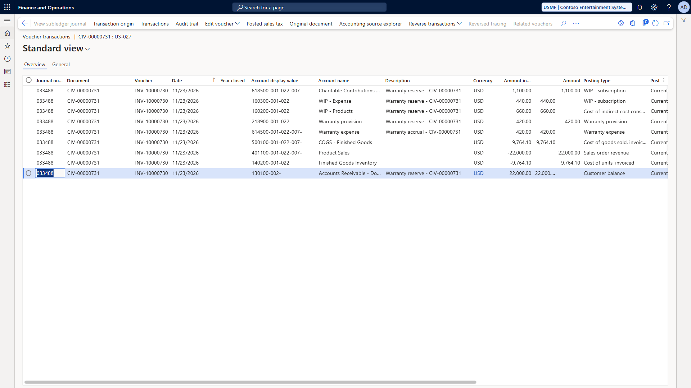

### h_T3_EUR_fixed_rate_voucher_transactions.png

EUR invoice at a fixed exchange rate: warranty EUR 350.00 equals USD 437.50 on both lines, at the same rate as the revenue line; the description defect shows on the customer balance line.

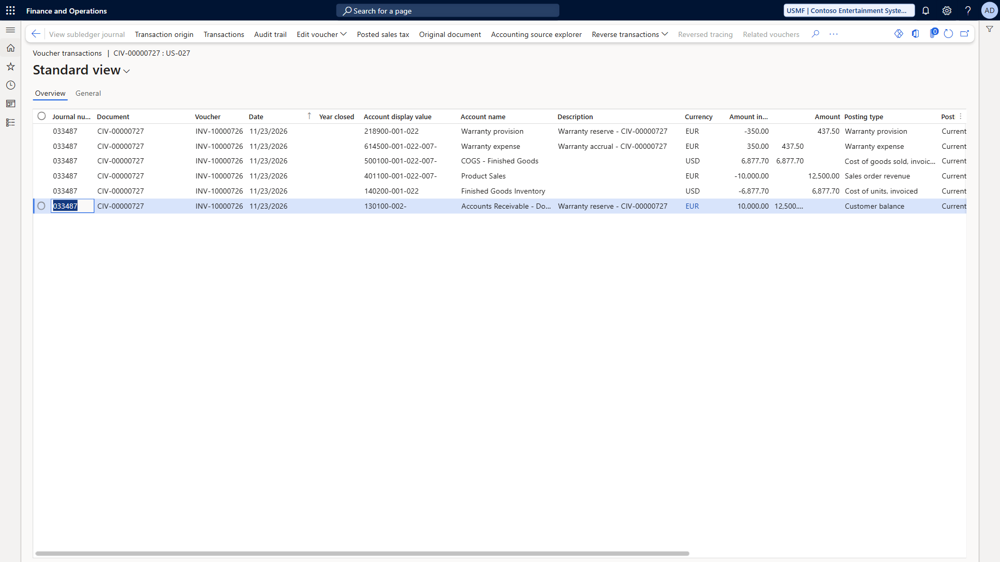

### i_released_product_pct_changed_to_5.png

Released product D0024 with Warranty provision % changed to 5.00 before the credit notes were posted.

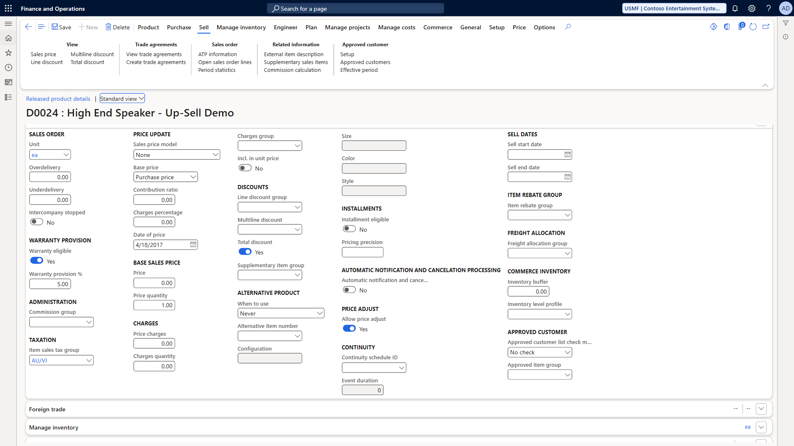

### j_T6_full_credit_note_reversal.png

Full credit note of the first invoice: 218900 debit 1,400.00 and 614500 credit 1,400.00, the original 3.50 % and not 5.00 %; the description defect is also visible.

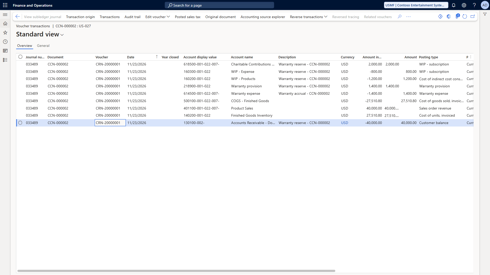

### k_T7_partial_credit_note_reversal.png

Partial credit note for half the quantity: warranty reversal of 175.00, half of the original 350.00; the description defect is also visible.

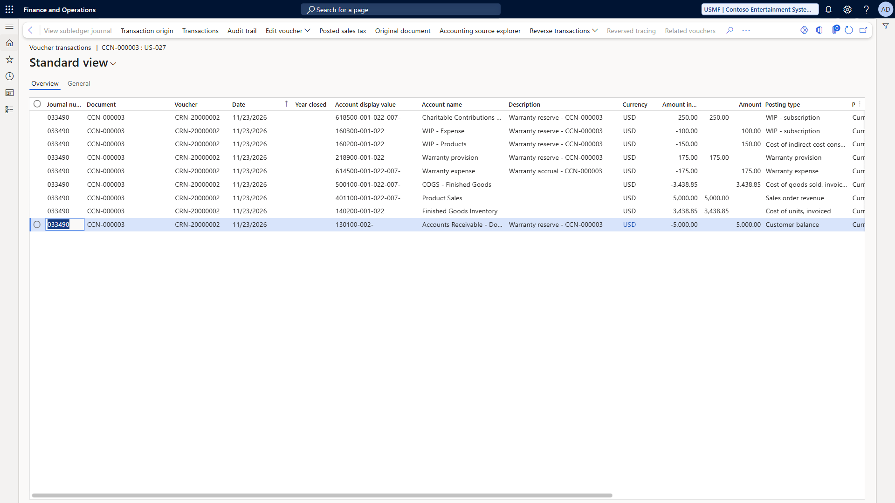

### l_T8_credit_note_of_invoice_without_provision.png

Credit note of an invoice that was posted before the item was eligible: no warranty lines.

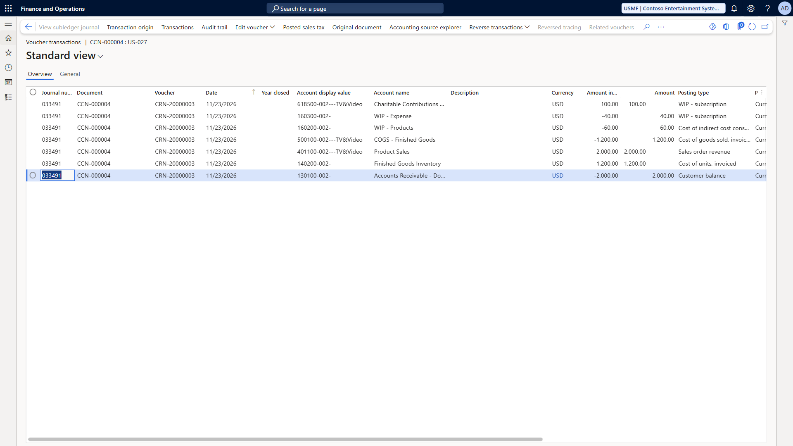

### m_T9_unlinked_credit_line_current_pct.png

Credit line of 2,000.00 with no link to an invoice: reversal of 100.00 at the item's current 5.00 %; the description defect is also visible.

### n_T12_pct_over_100_refused.png

Saving a Warranty provision % of 101.00 is refused: the % must be greater than 0 and no more than 100.

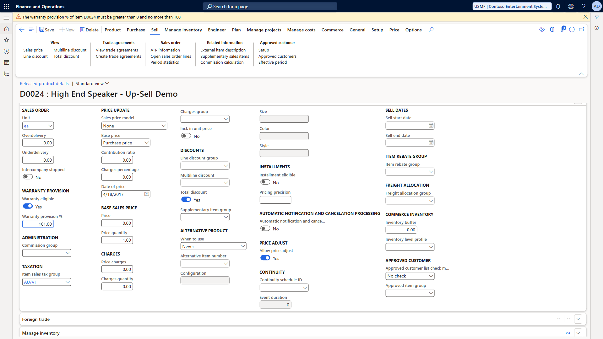

### o_T11_pro_forma_invoice.png

Pro forma invoice printed with no invoice number.

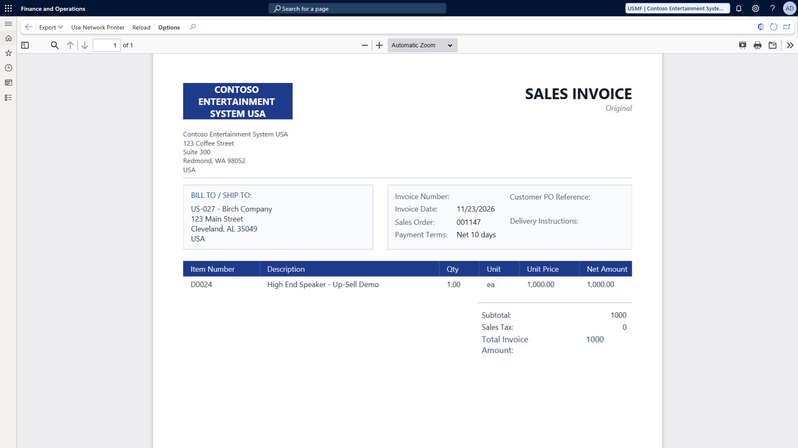

## Notes

Tested on the dev box with USMF demo data, on the model as delivered. 12 of the 13 scenarios of the design were run and passed.

**Not run**

- **T13, project sales order invoice:** no project sales order was prepared for the test.
- The delivered unit test class was not run.

**Defect found**

- **D1 - The warranty description is copied onto later standard voucher lines.** On a voucher with warranty lines, every standard line posted after the warranty provision line (the customer balance line and the indirect cost lines) carries the description "Warranty reserve - <invoice>". On an invoice without warranty these descriptions are empty. The accounts, amounts and posting types of those lines are correct; only the description is wrong. Seen on every invoice and credit note with warranty lines. The design gives the two texts to the two warranty lines only.

**Observations**

- The provision (liability) line carries business unit and department but not cost centre, because the USMF balance sheet account structure has no cost centre segment. This is standard behaviour; the design says both lines carry all three.
- Warranty lines with the same account and dimensions are summarised into one voucher line per side, like the standard revenue line.
- The refusal of an invalid % is shown as a warning (yellow bar), not an error; the save is refused either way.
- The setup form's two account column headers are cut at the default width.
- The posting log has no form, so log records were checked in the database.
