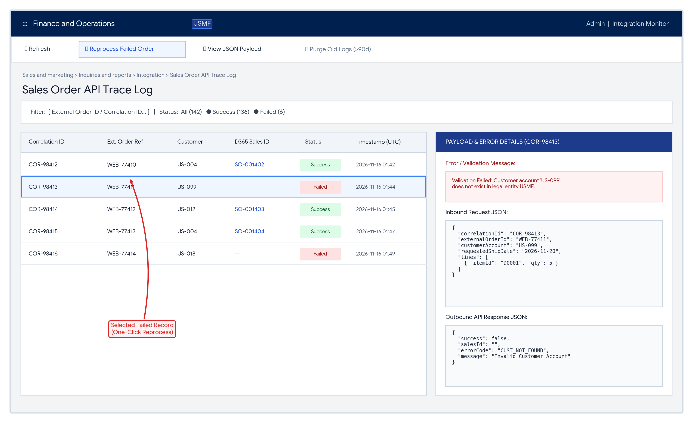

> Original document: [REQ-INT-508-FRD.docx](REQ-INT-508-FRD.docx). This page is a Markdown copy for reading on GitHub.

_MICROSOFT DYNAMICS 365 FINANCE & OPERATIONS  |  INTEGRATION SPECIFICATION_

# Functional Requirement Document — REQ-INT-508

| Requirement ID: | REQ-INT-508 |
|---|---|
| Title: | Inbound Sales Order Creation Custom Service API with Full Payload Tracing & Reprocessing Form |
| Module & Menu Path: | Sales and marketing > Inquiries and reports > Integration > Sales Order API Trace Log |
| Integration Type: | Custom REST JSON Service Endpoint + D365 F&O Monitoring & Replay Workspace Form |
| Target Users: | Integration Support Specialists, Sales Operations Coordinators, IT Administrators |

## 1. Business Context & Objective

External e-commerce portals, B2B ordering platforms, and CRM systems need to submit customer orders directly into Dynamics 365 Finance & Operations in real time. Currently, when an inbound order fails due to master data issues (such as an invalid customer ID, discontinued item, or blocked warehouse), operations teams lack visibility inside D365 F&O to inspect the raw JSON payload, diagnose the exact validation error, and replay the order once fixed. This requirement defines an inbound Sales Order creation API paired with a dedicated D365 F&O tracing and reprocessing inquiry form.

## 2. Inbound Sales Order Creation API Behavior

- **Real-Time Order Creation:** Accepts a structured JSON payload containing External Order Reference, Correlation ID, Customer Account, Currency, Requested Ship Date, Customer PO Reference, and one or more Order Lines (Item Number, Quantity, Unit of Measure, Site/Warehouse, and optional Unit Price override).
- **Idempotency & Duplicate Prevention:** Before creating a new Sales Order, the API checks whether the incoming External Order Reference has already been processed successfully. If a valid Sales Order already exists, the API returns the existing Sales Order ID without creating a duplicate.
- **Business Validation Rules:** Validates that the Customer Account is active and not blocked for invoicing, all Item Numbers exist and are released in the target legal entity, and requested quantities are greater than zero.
- **Structured JSON Response:** Returns an immediate synchronous response containing Status (Success/Failed), generated D365 Sales Order ID (if successful), Correlation ID, and clear business error descriptions (if validation fails).
- **Mandatory Trace Logging:** Every single API invocation—whether successful or failed—must persist a trace record containing the full inbound request JSON, outbound response JSON, execution timestamp, processing duration (ms), and user/client identity.

## 3. Sales Order API Trace Log Form (D365 F&O UI)

- **Summary Overview Grid (Left Pane):** Displays a chronological list of all inbound API calls with columns for Correlation ID, External Order Reference, Customer Account, Generated D365 Sales ID, Processing Status (Success / Failed / Reprocessed), Execution Timestamp, and Retry Count.
- **Payload & Error Inspector (Right Pane):** Selecting any record in the grid dynamically displays the formatted Inbound Request JSON, Outbound Response JSON, and exact Validation Error Message in readable text boxes.
- **One-Click Reprocess Action:** Provides an action button ('Reprocess Failed Order') enabled only for records in 'Failed' status. Clicking this button re-runs the stored JSON payload through the Sales Order creation logic after an administrator resolves the underlying master data issue, updating the status to 'Reprocessed' and linking the newly created Sales ID.
- **Log Retention & Purge Utility:** Includes a toolbar action allowing authorized administrators to purge successful trace records older than 90 days while retaining failed logs for audit.

## 4. API Tracing Form UI Design Mockup

The custom D365 F&O inquiry form must follow the split-pane workspace layout illustrated below, combining a searchable transaction log grid on the left with a live JSON payload and error inspector on the right:

Figure 1: Target D365 F&O UI Design — Sales Order API Trace Log & Reprocessing Form (REQ-INT-508)

## 5. Business Acceptance Criteria

| AC # | Test Scenario | Expected Result |
|---|---|---|
| AC-01 | Valid API Order Creation | Sending a valid JSON payload creates an open Sales Order with header and lines in D365 F&O, returns the Sales ID in the API response, and logs a 'Success' trace record. |
| AC-02 | Validation Failure Logging | Sending a payload with a non-existent Customer Account or Item ID rejects order creation, returns a descriptive error JSON, and logs a 'Failed' record with full request/response payloads. |
| AC-03 | Duplicate Order Protection | Resending an identical External Order Reference that already succeeded returns the original D365 Sales ID without creating a second Sales Order. |
| AC-04 | UI Reprocessing Workflow | After fixing the missing master data for a failed call, clicking 'Reprocess Failed Order' on the Trace Log form creates the Sales Order, increments Retry Count, and updates status to 'Reprocessed'. |
