# Test cases — REQ-INT-508

The scenarios below are the test plan from the approved TDD (section 6), unchanged. The **Result** column records only what is backed by evidence in this folder; a scenario without evidence is marked *Not yet recorded* rather than assumed to pass.

## Build verification

| Check | Result |
|---|---|
| Compile (X++ compiler, model DYLOExtensions) | ✅ 0 errors |
| Delivered | 2026-11-22 |

## Functional scenarios

Tested in Dynamics 365 Finance & Operations 10.0.48 on the Contoso demo data, legal entity USMF.

| # | Scenario | Expected | Result | Evidence |
|---|---|---|---|---|
| T1 (AC-01) | Valid payload, 2 lines | Open sales order with header and 2 lines. Response is Success with the Sales ID. Trace is Success with request, response, duration and user | ◐ Partly evidenced Passes when no requested ship date is sent, or the date is today. The same payload with a later ship date fails with CREATE_FAILED (defect 1). Duration and caller user were checked in the database; the form shows neither. | [a_T1_1_api_valid_2_lines_Success_001112.png](evidence/a_T1_1_api_valid_2_lines_Success_001112.png) · [a_T1_4_sales_order_001112_header_and_2_lines.png](evidence/a_T1_4_sales_order_001112_header_and_2_lines.png) · [a_T1_2_trace_form_Success_COR-98413.png](evidence/a_T1_2_trace_form_Success_COR-98413.png) |
| T2 (AC-02) | Unknown customer | No order. Response is Failed with CUST_NOT_FOUND and a descriptive message. Trace is Failed with both JSONs | ✅ Passed | [b_T2_2_trace_form_Failed_COR-98414.png](evidence/b_T2_2_trace_form_Failed_COR-98414.png) |
| T3 (AC-02) | Unknown item on line 2 of 2 | No order and no partial lines; ITEM_NOT_FOUND | ✅ Passed No order and no partial lines, checked in the database. | [c_T3_1_api_unknown_item_line2_ITEM_NOT_FOUND.png](evidence/c_T3_1_api_unknown_item_line2_ITEM_NOT_FOUND.png) |
| T4 | Customer blocked for Invoice | CUST_BLOCKED | ✅ Passed | [d_T4_1_api_customer_on_hold_CUST_BLOCKED.png](evidence/d_T4_1_api_customer_on_hold_CUST_BLOCKED.png) |
| T5 | Quantity 0 | QTY_INVALID | ✅ Passed | [e_T5_1_api_quantity_0_QTY_INVALID.png](evidence/e_T5_1_api_quantity_0_QTY_INVALID.png) |
| T6 | Several errors at once | All of them in `errors`; the first in errorCode | ✅ Passed Seven errors returned; the first code is in errorCode. | [f_T6_1_api_several_errors_all_returned.png](evidence/f_T6_1_api_several_errors_all_returned.png) |
| T7 (AC-03) | Resend the external reference from T1 | Same Sales ID, `duplicate: true`, no new order, a new Success trace | ✅ Passed Exactly one sales order exists for the reference, checked in the database. | [g_T7_1_api_duplicate_same_SalesId_001112.png](evidence/g_T7_1_api_duplicate_same_SalesId_001112.png) |
| T8 | Unit price override 12.50 | Line price 12.50, price unit 1, amount recalculated | ✅ Passed Price unit 1 was checked in the database. | [h_T8_4_sales_order_001113_lines_unit_price_12.50.png](evidence/h_T8_4_sales_order_001113_lines_unit_price_12.50.png) |
| T9 | Currency, site or warehouse missing | Customer and item defaults used | ✅ Passed Same call as T8: site 1 and warehouse 13 defaulted on screen; currency USD was checked in the database only. | [h_T8_4_sales_order_001113_lines_unit_price_12.50.png](evidence/h_T8_4_sales_order_001113_lines_unit_price_12.50.png) |
| T10 | `legalEntity` = another company | Order and trace in that company | — Not yet recorded |  |
| T11 (AC-04) | Create the customer from T2, then click Reprocess Failed Order | Order created. Status Reprocessed, Retry Count 1, Sales ID shown as a link | ✅ Passed The success message itself was not captured; the result is. | [i_T11_2_after_reprocess_Reprocessed_001135_retry_1.png](evidence/i_T11_2_after_reprocess_Reprocessed_001135_retry_1.png) |
| T12 | Reprocess with the data still wrong | Status stays Failed, Retry Count goes up by 1, the new error is shown | ✅ Passed | [j_T12_2_after_reprocess_still_Failed_retry_1_warning.png](evidence/j_T12_2_after_reprocess_still_Failed_retry_1_warning.png) |
| T13 | Select a Success record | Reprocess button disabled | ✅ Passed | [a_T1_2_trace_form_Success_COR-98413.png](evidence/a_T1_2_trace_form_Success_COR-98413.png) |
| T14 | Filter text "WEB-774", Status Failed | Only matching failed records; counts correct | ✅ Passed The counts are for the legal entity, not the filter, as the design says. | [l_T14_2_filter_text_WEB-774_status_Failed.png](evidence/l_T14_2_filter_text_WEB-774_status_Failed.png) |
| T15 | Purge with Success, Failed and Reprocessed records older than 90 days, and a Success record 10 days old | Only the old Success record is deleted | — Not yet recorded |  |
| T16 | User with the Support role only | Purge button not visible; form and reprocess work | — Not yet recorded |  |
| T17 | Malformed JSON or no lines | Failed response and trace (PAYLOAD_INVALID or UNEXPECTED) | ◐ Partly evidenced No lines: passed (PAYLOAD_INVALID, traced). Malformed JSON: failed against the design; the platform answers HTTP 400 before the service runs, so there is no service response and no trace record (defect 2). | [m_T17_1_api_no_lines_PAYLOAD_INVALID.png](evidence/m_T17_1_api_no_lines_PAYLOAD_INVALID.png) |
| T18 | Look of the form | Status cells green, red or amber; details pane, error box and JSON boxes in the standard D365 theme | ✅ Passed Passed for the status colours and the standard theme. The layout differs from the design (defect 3). | [j_T12_2_after_reprocess_still_Failed_retry_1_warning.png](evidence/j_T12_2_after_reprocess_still_Failed_retry_1_warning.png) |

### a_T1_1_api_valid_2_lines_Success_001112.png

A valid call for customer US-004 with two lines, sent without a requested ship date, is answered with HTTP 200, status Success and Sales ID 001112.

### a_T1_4_sales_order_001112_header_and_2_lines.png

Sales order 001112 is an open order for Cave Wholesales with customer requisition PO-5531 and two lines, D0001 5.00 ea and D0003 2.00 ea.

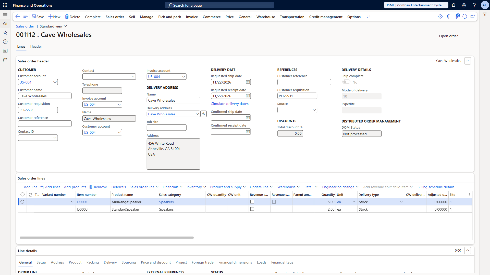

### a_T1_2_trace_form_Success_COR-98413.png

The trace log shows that call as Success with Sales ID 001112, its request and response JSON, and Reprocess Failed Order greyed out.

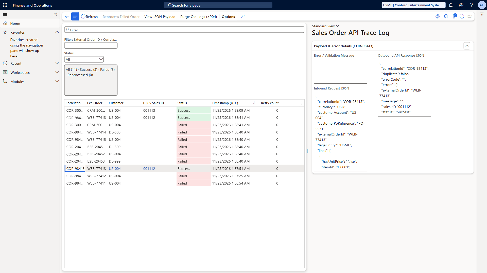

### b_T2_2_trace_form_Failed_COR-98414.png

A call for the unknown customer DL-508 is traced as Failed with no Sales ID, the validation message, and error code CUST_NOT_FOUND in the stored response.

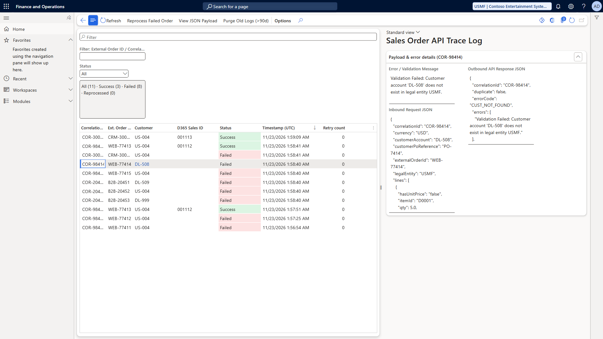

### c_T3_1_api_unknown_item_line2_ITEM_NOT_FOUND.png

An unknown item on the second of two lines is refused with ITEM_NOT_FOUND and an empty Sales ID.

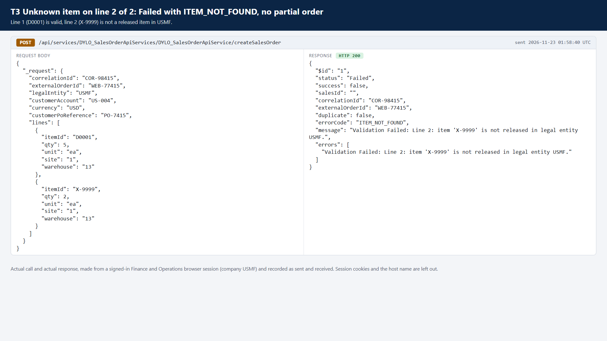

### d_T4_1_api_customer_on_hold_CUST_BLOCKED.png

A customer on hold for Invoice is refused with CUST_BLOCKED.

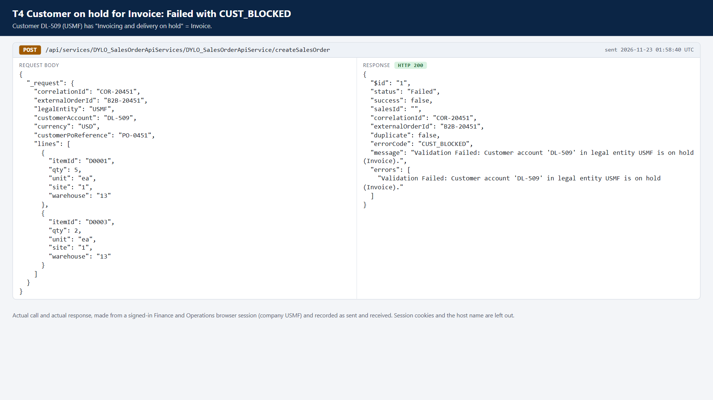

### e_T5_1_api_quantity_0_QTY_INVALID.png

A line with quantity 0 is refused with QTY_INVALID.

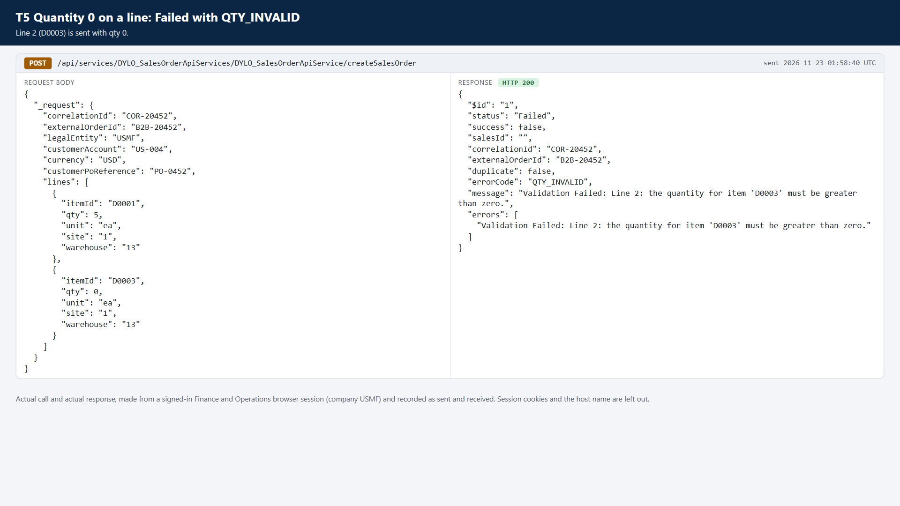

### f_T6_1_api_several_errors_all_returned.png

A call with several errors gets all seven messages in errors, and the first error code, CUST_NOT_FOUND, in errorCode.

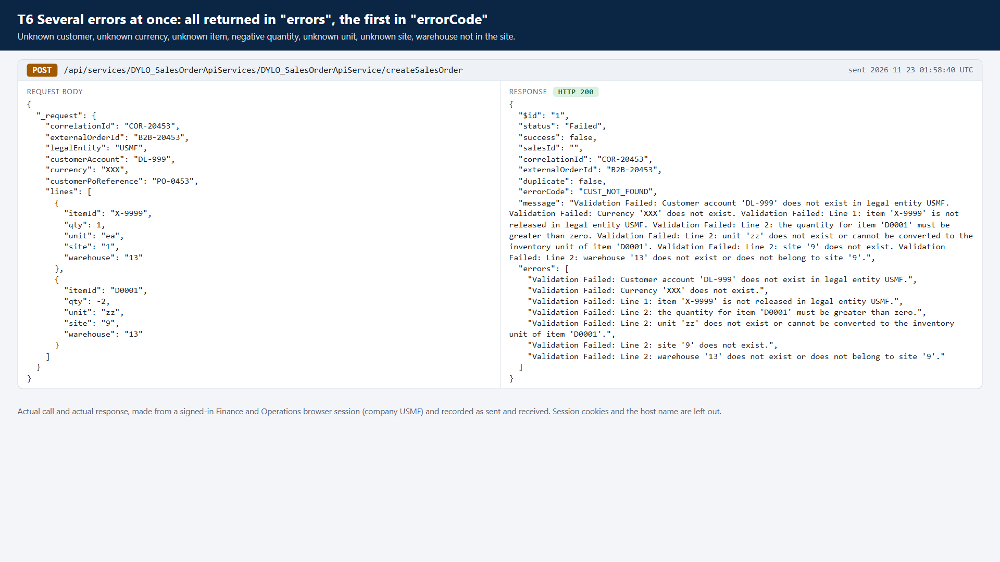

### g_T7_1_api_duplicate_same_SalesId_001112.png

The same external order reference WEB-77413 sent a second time returns the same Sales ID 001112 with duplicate true.

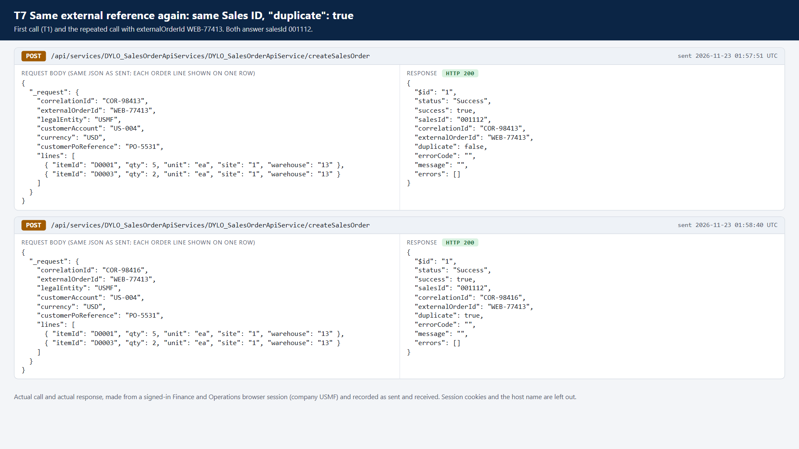

### h_T8_4_sales_order_001113_lines_unit_price_12.50.png

Sales order 001113: line 1 carries the unit price override 12.50 with net amount 50.00, and both lines defaulted to site 1 and warehouse 13.

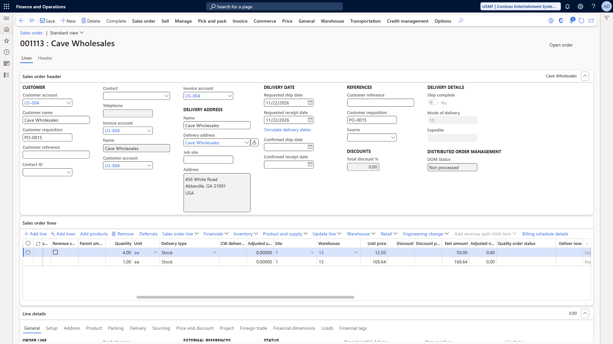

### i_T11_2_after_reprocess_Reprocessed_001135_retry_1.png

After the missing customer was created and Reprocess Failed Order was clicked, the same trace record is Reprocessed with Sales ID 001135 and retry count 1.

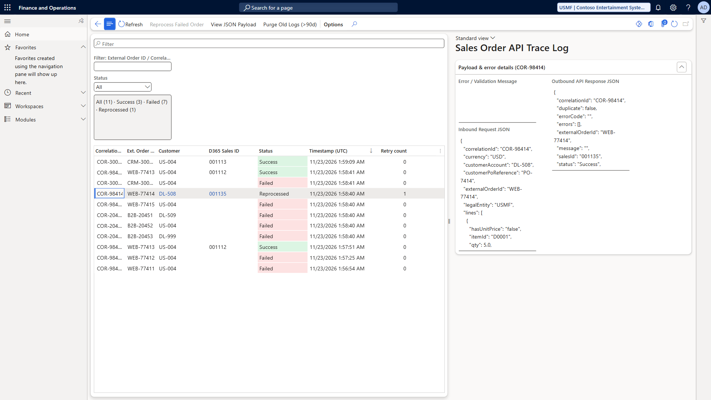

### j_T12_2_after_reprocess_still_Failed_retry_1_warning.png

Reprocessing a call whose item still does not exist shows a warning and leaves it Failed with retry count 1; the Status cells are green, red and amber.

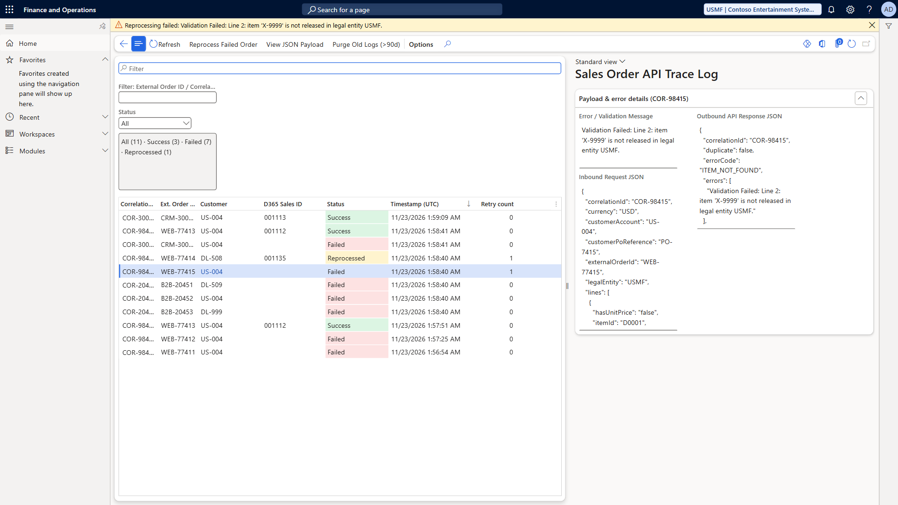

### l_T14_2_filter_text_WEB-774_status_Failed.png

Filter text WEB-774 with Status Failed lists only the three matching failed records.

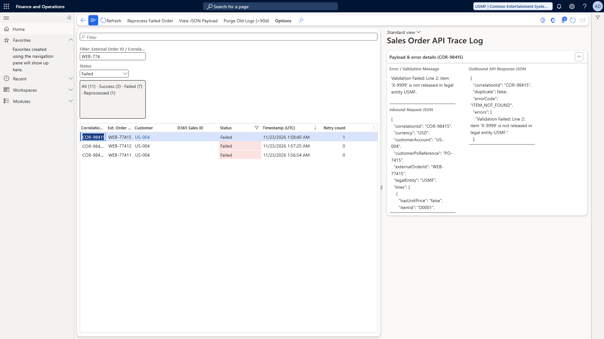

### m_T17_1_api_no_lines_PAYLOAD_INVALID.png

A request with no order lines is refused with PAYLOAD_INVALID.

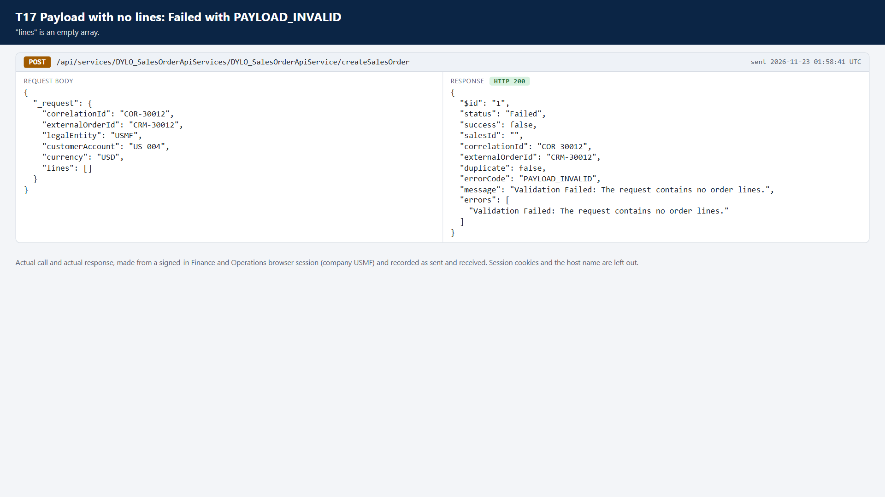

## Notes

Tested on the dev box with USMF demo data, on the model as delivered. 15 of the design's 18 scenarios were run: 13 passed and 2 passed in part.

**Not run**
- T10 (order in another legal entity): the test was limited to USMF.
- T15 (purge): it needs records older than 90 days, which cannot be made without writing to the database. Only the dialog was opened and cancelled.
- T16 (user with the Support role only): it needs a second user.

**Defects found**
1. **Major: a requested ship date in the future is still rejected.** A valid order whose requested ship date is later than today fails with CREATE_FAILED, "Receive date must be later than or equal to the ship date." The same payload without the date, or with today's date, creates the order. The design's own sample payload, with a future ship date, would fail. This is why T1 is marked Partly.
2. **Malformed JSON is not answered or traced by the service (T17).** The platform returns HTTP 400 before the service runs, so there is no Failed JSON response and no trace record. The design expects both.
3. **The trace form's layout differs from the design.** The list pane opens narrow, so Sales ID, Status, Timestamp and Retry count appear only after the splitter is dragged; every trace form screenshot here was taken after widening it. The filter bar is stacked instead of in one row, and the three detail boxes are narrow, so the JSON has to be scrolled or opened with View JSON Payload.
4. **Minor.** The purge dialog is titled "Purge Old Logs (>90d)" instead of "Purge old sales order API logs", and the Status colour of the selected row is hidden by the selection highlight.

**Observations**
- The stored request JSON is the request as D365 read it: keys in alphabetical order, and a date that was not sent is stored as a placeholder date value.
- The form shows neither the duration nor the caller user; both are stored and were checked in the database.
- The API screenshots are a plain page that renders the request body, HTTP status and response body of the real calls.
