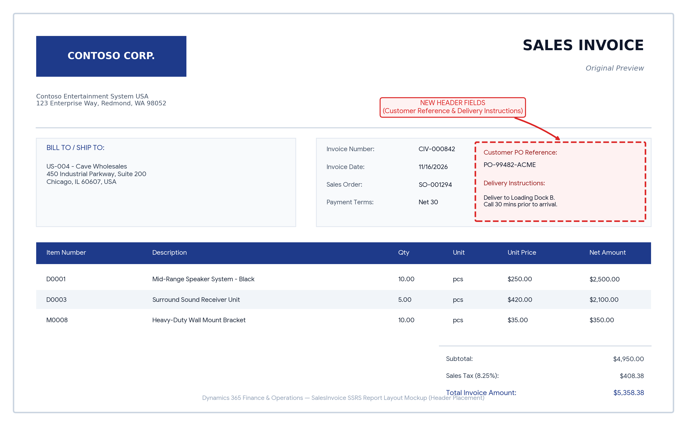

> Original document: [REQ-INV-105-FRD.docx](REQ-INV-105-FRD.docx). This page is a Markdown copy for reading on GitHub.

_MICROSOFT DYNAMICS 365 FINANCE & OPERATIONS_

# Functional Requirement Document — REQ-INV-105

| Requirement ID: | REQ-INV-105 |
|---|---|
| Title: | Display Customer PO Reference and Delivery Instructions on Posted Sales Invoices and Printouts |
| Module: | Accounts Receivable / Sales and Marketing |
| Document Type: | Functional Specification (FRD) |

## 1. Business Overview

Customers require their external Purchase Order reference (Customer PO Reference) and special shipping notes (Delivery Instructions) to be clearly visible both on the posted Sales Invoice inquiry screen and on the printed Sales Invoice document. Having these details readily available prevents receiving delays and invoice disputes at customer locations.

## 2. Functional Requirements

- **New Data Field:** Introduce a Delivery Instructions text field (up to 150 characters) on the Sales Order header and the Posted Sales Invoice header.
- **Sales Order Screen Placement:** Display the Delivery Instructions field under the Delivery tab on the Sales Order header so sales coordinators can enter or update shipping notes prior to invoicing.
- **Posted Sales Invoice Inquiry Screen Placement:** Display the Delivery Instructions field as read-only under the General tab on the Posted Sales Invoice header so finance and customer service teams can review it easily.
- **Automated Data Flow:** When a Sales Order is invoiced and posted, the system must automatically copy the Delivery Instructions from the Sales Order header to the Posted Sales Invoice header without requiring manual re-entry.
- **Printed Sales Invoice Document:** Update the Sales Invoice print layout to display both the Customer PO Reference (already captured on the order/invoice) and the new Delivery Instructions in the invoice header section alongside the order and invoice details.

## 3. Sales Invoice Report Layout Placement

The mockup below illustrates the exact target placement of the Customer PO Reference and Delivery Instructions fields within the header block of the printed Sales Invoice report:

Figure 1: Sales Invoice Printout Header — Highlighted Placement for Customer PO Reference & Delivery Instructions

## 4. Business Acceptance Criteria

| AC # | Scenario | Expected Result |
|---|---|---|
| AC-01 | Sales Order Entry | Sales users can enter and edit Delivery Instructions (up to 150 characters) under the Delivery tab on an open Sales Order before invoicing. |
| AC-02 | Invoice Posting & Inquiry | Upon posting the Sales Invoice, the exact Delivery Instructions text appears automatically in read-only mode under the General tab on the Posted Sales Invoice screen. |
| AC-03 | Sales Invoice Printout | When previewing or printing the Sales Invoice document, both Customer PO Reference and Delivery Instructions appear clearly in the header section as shown in Figure 1. |
