# Test cases — REQ-INV-105

The scenarios below are the test plan from the approved TDD (section 6), unchanged. The **Result** column records only what is backed by evidence in this folder; a scenario without evidence is marked *Not yet recorded* rather than assumed to pass.

## Build verification

| Check | Result |
|---|---|
| Compile (X++ compiler, model DYLOExtensions) | ✅ 0 errors |
| Delivered | 2026-11-22 |

## Functional scenarios

Tested in Dynamics 365 Finance & Operations 10.0.48 on the Contoso demo data, legal entity USMF.

| # | Scenario | Expected result | Result | Evidence |
|---|---|---|---|---|
| T1 | Open a sales order, header view, Delivery tab, and enter 150 characters in Delivery instructions; try a 151st character | Saved. The 151st character is refused (AC-01). | ✅ Passed The screenshot shows the field and the saved text. The refusal of a 151st character was checked in the test run (the field stayed at 150 characters) but is not visible in a screenshot. | [a_sales_order_delivery_instructions.png](evidence/a_sales_order_delivery_instructions.png) |
| T2 | Post the invoice for that order, then open the Invoice journal, General tab | Delivery instructions show the same text and cannot be edited (AC-02). | ✅ Passed The tab is captioned Invoice on screen. | [b_invoice_journal_delivery_instructions.png](evidence/b_invoice_journal_delivery_instructions.png) |
| T3 | Order with Customer reference "PO-99482-ACME" and two-line delivery instructions; print the invoice preview | The details panel shows Customer PO Reference and Delivery Instructions as in Figure 1. The instructions wrap and the panel grows (AC-03). | ✅ Passed The instructions wrap over five lines and the details panel grows. | [e_printed_invoice_original.png](evidence/e_printed_invoice_original.png) |
| T4 | Compare the preview to Figure 1 | Banner, title, Original, company block, rule, the two panels, blue table header, shaded even rows and the totals block are in the positions in 4.6. The removed items do not print. | ✅ Passed Passed with deviations: every element is present and none of the removed standard items print, but see the wrapping and totals defects in the notes. | [e_printed_invoice_original.png](evidence/e_printed_invoice_original.png) |
| T5 | Summary invoice of two orders with different instructions | The invoice shows the summary order's number and that order's instructions (assumption 1). | ✅ Passed | [k_printed_summary_invoice_two_orders.png](evidence/k_printed_summary_invoice_two_orders.png) |
| T6 | Order without Customer reference or instructions | The labels print with empty values. Nothing else moves. | ✅ Passed | [g_printed_invoice_no_reference_no_instructions.png](evidence/g_printed_invoice_no_reference_no_instructions.png) |
| T7 | Invoice with 40 lines | The table continues on page 2 with the header repeated. The totals print after the last line. No blank pages. | ✅ Passed Two pages: 27 lines on page 1, 13 on page 2, no blank page. | [h_printed_invoice_40_lines_page1.png](evidence/h_printed_invoice_40_lines_page1.png) · [i_printed_invoice_40_lines_page2.png](evidence/i_printed_invoice_40_lines_page2.png) |
| T8 | Reprint the invoice as Copy; post a credit note | The subtitle shows "Copy". The credit note title shows the standard credit-note title in capitals. | ✅ Passed | [f_printed_invoice_copy.png](evidence/f_printed_invoice_copy.png) · [j_printed_credit_note.png](evidence/j_printed_credit_note.png) |
| T9 | Print management setup | DYLO_SalesInvoice.Report is in the Report format list for Customer invoice and is the default on a company with no saved setting. | ◐ Partly evidenced The format is listed and can be selected and saved. The default on a company with no saved setting was not run. | [c_print_management_report_format_list.png](evidence/c_print_management_report_format_list.png) · [d_print_management_dylo_selected.png](evidence/d_print_management_dylo_selected.png) |
| T10 | Invoice with tax | Subtotal + Sales Tax = Total Invoice Amount, followed by the currency code. | ❌ Failed The amounts add up (731 + 53 = 784), but no currency code follows the total and the totals are not formatted as amounts. | [e_printed_invoice_original.png](evidence/e_printed_invoice_original.png) |

### a_sales_order_delivery_instructions.png

Sales order 001085, header view, Delivery tab: the new Delivery instructions field holding the entered text.

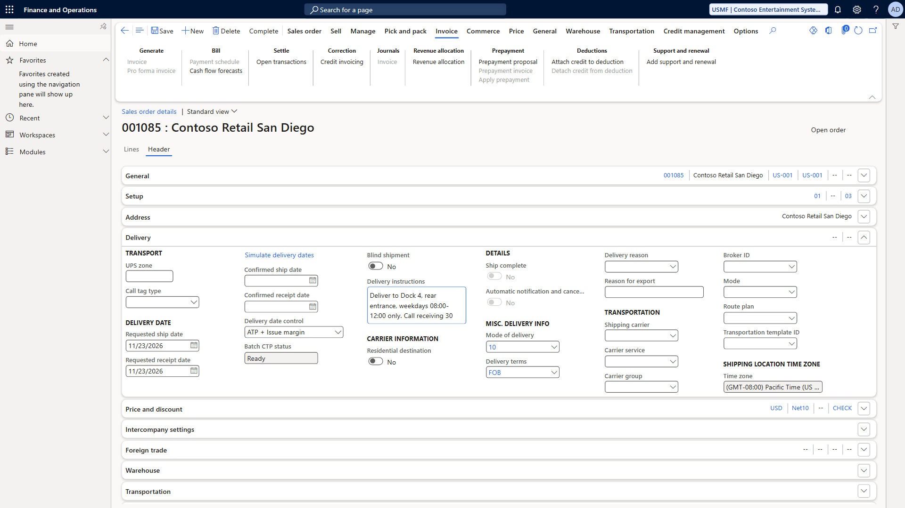

### b_invoice_journal_delivery_instructions.png

Invoice journal for invoice CIV-00000717: Delivery instructions shows the same text as the order, read-only.

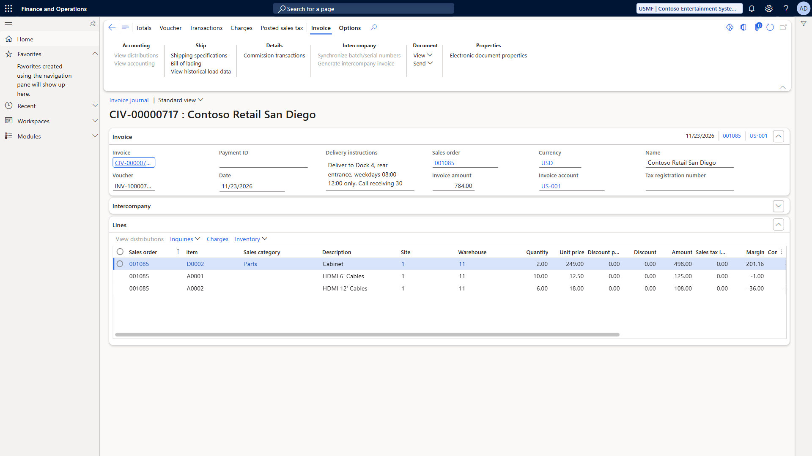

### c_print_management_report_format_list.png

Print management setup, Customer invoice, Original: the Report format list offers DYLO_SalesInvoice.Report next to the standard SalesInvoice.Report.

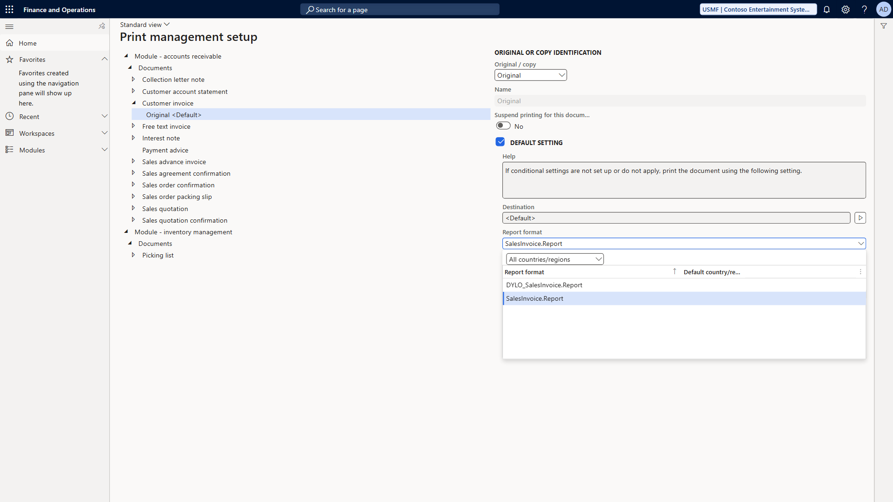

### d_print_management_dylo_selected.png

Print management setup with DYLO_SalesInvoice.Report selected as the report format for Customer invoice.

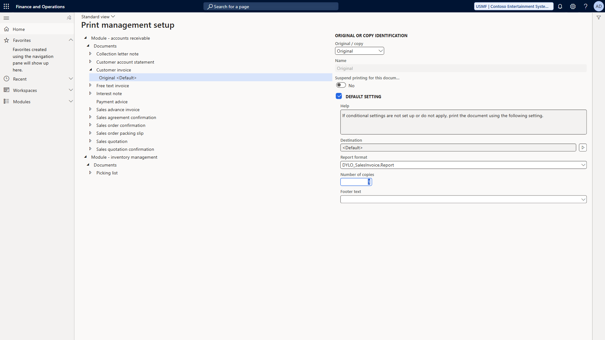

### e_printed_invoice_original.png

Preview of invoice CIV-00000717 in the new layout, with Customer PO Reference PO-99482-ACME and five lines of Delivery Instructions; it also shows a defect: the totals print as 731, 53 and 784 with no decimals and no currency code.

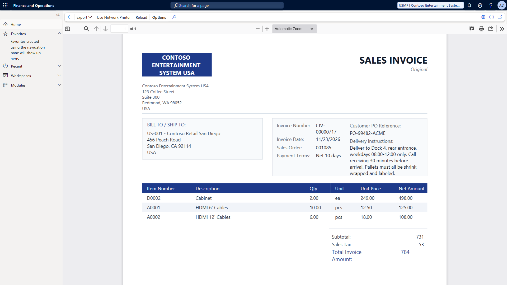

### f_printed_invoice_copy.png

The same invoice reprinted from Copy preview: the subtitle under SALES INVOICE reads Copy.

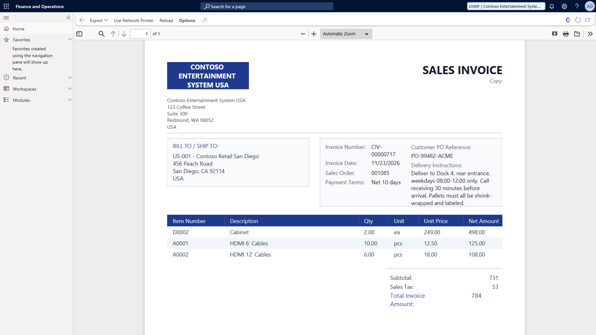

### g_printed_invoice_no_reference_no_instructions.png

Invoice CIV-00000718 for an order with no customer reference and no instructions: both labels print with empty values and the layout is unchanged.

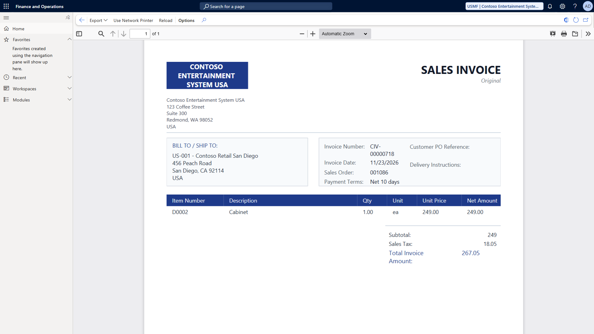

### h_printed_invoice_40_lines_page1.png

Invoice CIV-00000719 with 40 lines, page 1 of 2: the header block and the first 27 lines.

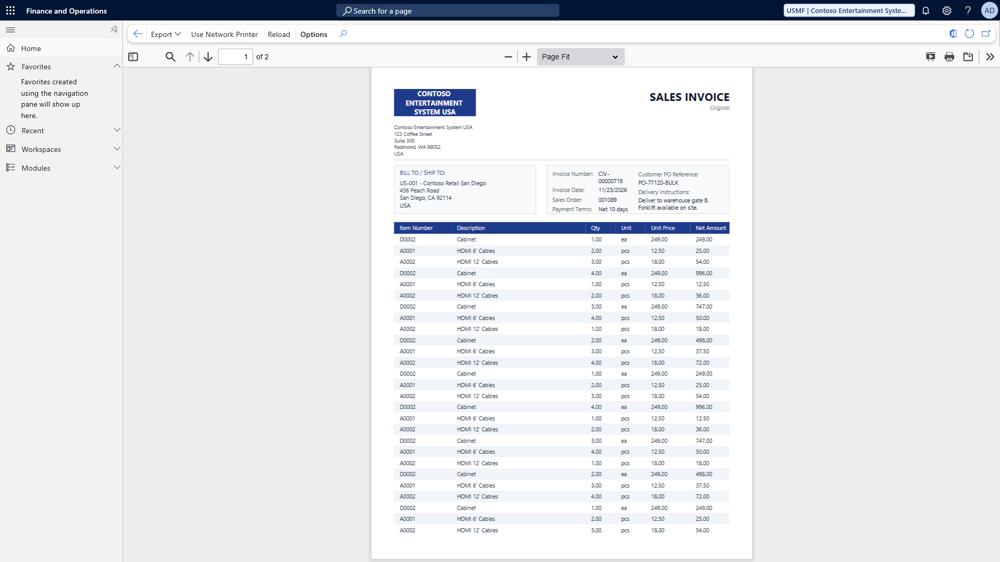

### i_printed_invoice_40_lines_page2.png

Page 2 of 2 of the 40-line invoice: the blue table header repeated, the last 13 lines, then the totals (which show the totals formatting defect: 9709, 703.9, 10412.9).

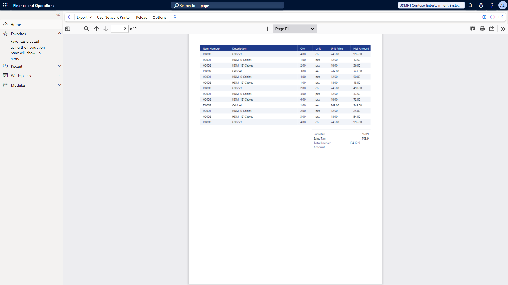

### k_printed_summary_invoice_two_orders.png

Summary invoice CIV-00000720 of sales orders 001092 and 001093: it prints sales order 001092 with that order's reference and instructions, and lines from both orders.

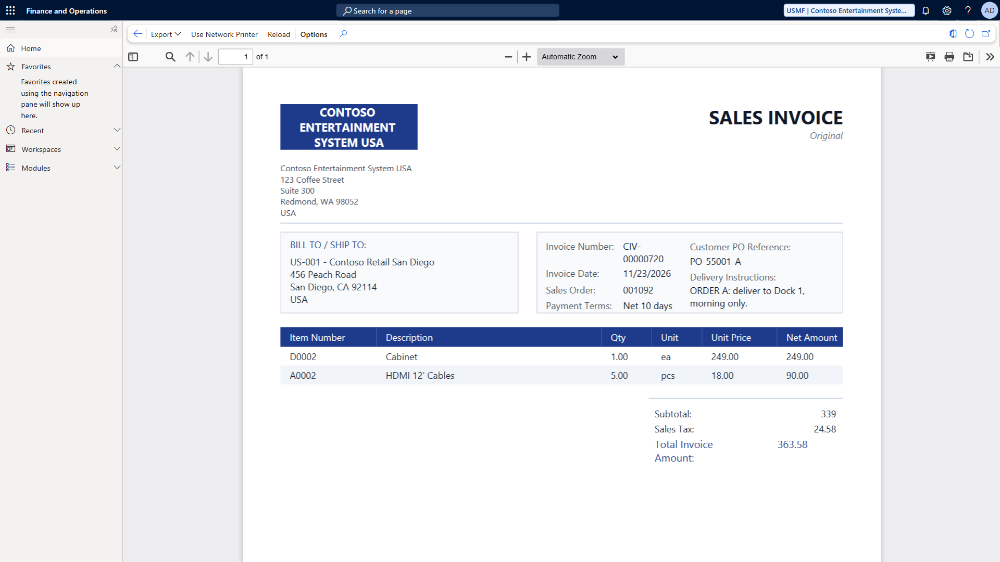

### j_printed_credit_note.png

Credit note CCN-000001 in the same layout, titled CREDIT NOTE, with the customer reference and delivery instructions.

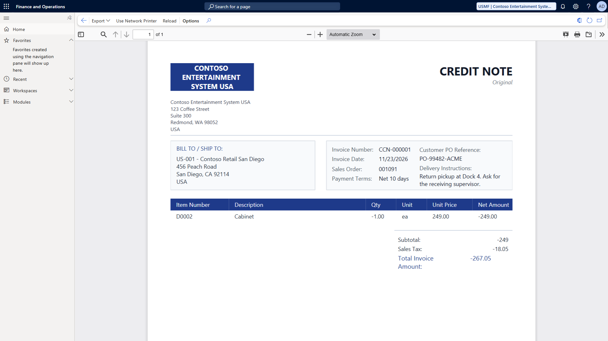

## Notes

Tested on the dev box with USMF demo data, with the model as delivered.

**Not run**

- T9, second half: the new format as the default on a company with no saved Print management setting. USMF already had a saved setting (the standard format) and testing was limited to USMF. The format was chosen in Print management for the test, as the design's setup step describes.

**Defects found (not fixed)**

- **Currency code missing on the total (T10).** Total Invoice Amount prints the number only on every invoice tested, for example 784 where 784.00 USD was expected.
- **Totals are not formatted as amounts.** Subtotal, Sales Tax and Total print as raw numbers (731, 53, 784; 9709, 703.9, 10412.9) with no fixed two decimals and no thousands separator. Line amounts are formatted correctly. The totals block still needs formatting; that is logged as a defect.
- **Layout wrapping (cosmetic).** The banner wraps the company name onto three lines and grows taller than designed; the invoice number wraps onto two lines; the label Total Invoice Amount wraps and its value sits left of the other two totals; with five lines of instructions the last line touches the bottom border of the details panel.
- **Field position on the sales order.** Delivery instructions is not placed after Delivery reason as designed; it appears in the third column under Blind shipment. The field works.

**Observation**

- Print management shows only an Original node under Customer invoice in USMF, so there was no Copy node to set. The Copy preview still used the new format.
