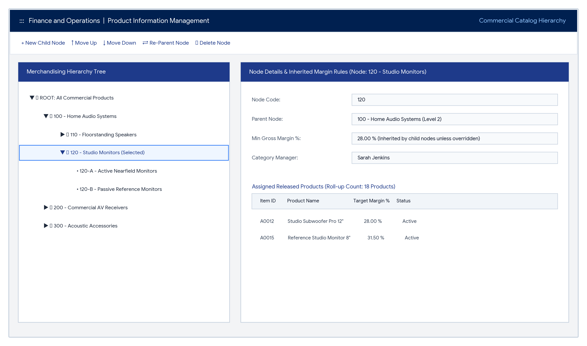

> Original document: [REQ-PIM-903-FRD.docx](REQ-PIM-903-FRD.docx). This page is a Markdown copy for reading on GitHub.

_MICROSOFT DYNAMICS 365 FINANCE & OPERATIONS  |  HIERARCHICAL MASTER DATA & TREE-VIEW SPECIFICATION_

# Functional Requirement Document — REQ-PIM-903

| Requirement ID: | REQ-PIM-903 |
|---|---|
| Title: | Multi-Level Commercial Merchandising Hierarchy & Margin Roll-Up Tree Form |
| Module & Menu Path: | Product information management > Setup > Categories and attributes > Merchandising hierarchy |
| Technical Pattern: | Self-Referencing Parent-Child Table + FormTreeControl + Recursive Validation & Roll-Up |
| Target Users: | Category Managers, Product Data Stewards, Commercial Pricing Analysts |

## 1. Business Overview

Commercial merchandising teams organize products into a multi-level parent-child hierarchy (Department > Category > Sub-Category > Product Line) to enforce minimum gross margin thresholds and reporting roll-ups. Standard flat grids do not provide visual hierarchy navigation or recursive attribute inheritance. This requirement introduces a self-referencing hierarchical table and an interactive D365 F&O Tree-View management form.

## 2. Functional & Tree-Control Requirements

- **Self-Referencing Hierarchy Table:** Store Node ID, Node Name, Parent Node RecId, Hierarchy Level (auto-calculated), Minimum Gross Margin %, and Active status.
- **Interactive Tree-View Workspace (Left Pane):** Render the entire hierarchy in a D365 F&O `FormTreeControl` supporting expand/collapse, dynamic child node creation, up/down sibling reordering, and node re-parenting.
- **Circular Reference Protection:** Prevent moving or re-parenting a parent node underneath any of its own descendant child nodes using recursive ancestor validation.
- **Margin Rule Inheritance:** If a child node leaves Minimum Gross Margin % blank, it automatically inherits the threshold defined on its nearest parent node.
- **Product Assignment & Delete Guard:** Allow assigning Released Products to leaf nodes and block deletion of any node that has active child nodes or assigned products.

## 3. Tree-View Form UI Design Mockup

## 4. Business Acceptance Criteria

| AC # | Test Scenario | Expected Result |
|---|---|---|
| AC-01 | Tree Expansion & Navigation | Opening the form loads the root node and expands child branches cleanly with accurate hierarchy level calculation. |
| AC-02 | Circular Loop Prevention | Attempting to set a parent node's parent to one of its own child nodes is blocked with a validation error. |
| AC-03 | Recursive Margin Inheritance | Updating Minimum Gross Margin % on a parent node automatically updates inherited thresholds for child nodes without overrides. |
| AC-04 | Deletion Integrity | Users cannot delete a parent node containing child nodes or assigned products until children are reassigned or removed. |
