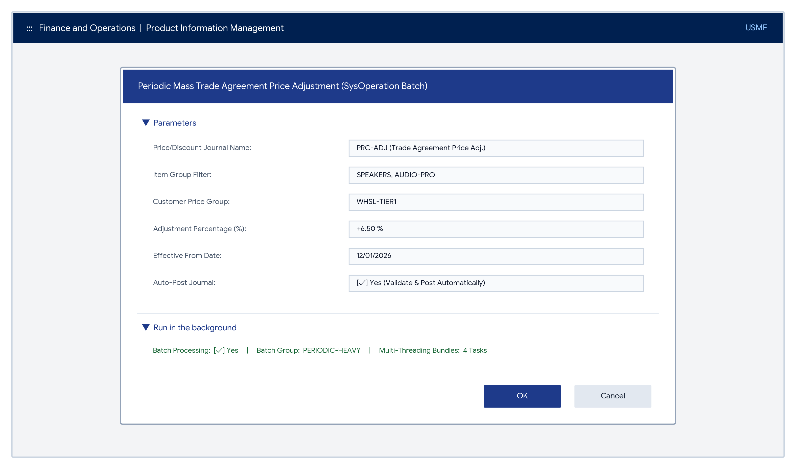

> Original document: [REQ-PRC-901-FRD.docx](REQ-PRC-901-FRD.docx). This page is a Markdown copy for reading on GitHub.

_MICROSOFT DYNAMICS 365 FINANCE & OPERATIONS  |  PERIODIC BATCH PROCESSING SPECIFICATION_

# Functional Requirement Document — REQ-PRC-901

| Requirement ID: | REQ-PRC-901 |
|---|---|
| Title: | Periodic Mass Trade Agreement Price Adjustment Batch Job (SysOperation) |
| Module & Menu Path: | Sales and marketing > Periodic tasks > Mass trade agreement price update |
| Technical Pattern: | SysOperation Framework (Contract, UI Builder, Multi-Threaded Batch Controller & Service) |
| Target Users: | Pricing Managers, Commercial Operations Leads, IT Batch Administrators |

## 1. Business Overview

During seasonal inflation adjustments or supplier cost changes, pricing teams must update thousands of active customer sales trade agreements across specific item groups and customer price groups. Updating records manually in Excel or journal lines is error-prone and risks AOS timeouts. This requirement defines a multi-threaded SysOperation batch job that calculates percentage price adjustments, expires old trade agreements cleanly, generates a new Price/Discount Agreement Journal, and optionally posts it in the background.

## 2. Functional & Batch Dialog Requirements

- **Dynamic UI Builder Dialog:** Provide dialog parameters for Journal Name, Item Group multi-select lookup, Customer Price Group lookup, Adjustment Percentage (+/-), Effective From Date, Rounding Rule (Nearest $0.05 / $0.10 / Exact), and Auto-Post checkbox.
- **Active Trade Agreement Selection:** Query active sales price lines (`PriceDiscTable`) matching the selected Item Group and Customer Price Group where To Date is blank or >= Effective From Date.
- **Clean Expiration & New Line Creation:** Set the To Date of existing active agreements to (Effective From Date - 1 day) and insert new journal lines (`PriceDiscAdmTrans`) starting on Effective From Date with the adjusted unit price.
- **Multi-Threaded Batch Bundling:** Split eligible items into configurable task bundles (e.g., 500 items per batch task) so large catalogs process in parallel without locking the AOS.
- **Execution Summary & Error Logging:** Write a completion InfoLog summarizing total lines processed, journal number generated, and any skipped items due to locked records.

## 3. SysOperation Batch Dialog UI Mockup

## 4. Business Acceptance Criteria

| AC # | Test Scenario | Expected Result |
|---|---|---|
| AC-01 | Parameter Validation | Running the dialog with 0% adjustment or an invalid Journal Name blocks execution with a clear validation warning. |
| AC-02 | Price Calculation & Rounding | A $100.00 item adjusted by +6.5% with $0.10 rounding creates a new journal line at $106.50 effective on the target date. |
| AC-03 | Prior Agreement Expiration | Existing trade agreements are automatically closed one day prior to the new Effective From Date to prevent overlapping active prices. |
| AC-04 | Batch Parallel Execution | Scheduling the job in batch mode splits workloads into parallel sub-tasks and completes cleanly in Batch Job History. |
