# Test cases — REQ-PRC-901

The scenarios below are the test plan from the approved TDD (section 6), unchanged. The **Result** column records only what is backed by evidence in this folder; a scenario without evidence is marked *Not yet recorded* rather than assumed to pass.

## Build verification

| Check | Result |
|---|---|
| Compile (X++ compiler, model DYLOExtensions) | ✅ 0 errors |
| Delivered | 2026-11-22 |

## Functional scenarios

Tested in Dynamics 365 Finance & Operations 10.0.48 on the Contoso demo data, legal entity USMF.

| # | Scenario | Expected result | Result | Evidence |
|---|---|---|---|---|
| T1 (AC-01) | Run with 0 % and with an unknown journal name | The dialog does not close; a warning names the field | ✅ Passed The unknown journal name is refused by the standard field check rather than the design's own message. | [n_e_T1_zero_percent_refused.png](evidence/n_e_T1_zero_percent_refused.png) · [n_f_T1_unknown_journal_name_refused.png](evidence/n_f_T1_unknown_journal_name_refused.png) |
| T2 (AC-02) | One agreement at 100.00 USD, +6.5 %, Nearest 0.10, effective 01-12-2026 | The journal has line A (To 30-11-2026, ref to the old agreement) and line B (From 01-12-2026, 106.50) | ✅ Passed Effective date 12/1/2030 on future-dated test data. | [n_i_T2_journal_PDJ-00109_closing_line_T0001_to_11-30-2030.png](evidence/n_i_T2_journal_PDJ-00109_closing_line_T0001_to_11-30-2030.png) · [n_j_T2_journal_PDJ-00109_new_line_T0001_106_50_from_12-01-2030.png](evidence/n_j_T2_journal_PDJ-00109_new_line_T0001_106_50_from_12-01-2030.png) |
| T3 (AC-03) | Post the journal from T2 | The old agreement ends 30-11-2026, the new one starts 01-12-2026, the overlap check passes, and a sales order on 01-12-2026 gets 106.50 | ◐ Partly evidenced Agreement dates and posting proven; a sales order picking up the new price was not exercised. | [n_m_T3_after_posting_old_ends_11-30-2030_new_starts_12-01-2030.png](evidence/n_m_T3_after_posting_old_ends_11-30-2030_new_starts_12-01-2030.png) |
| T4 (AC-04) | 1,200 items, 500 per task, in batch | 3 bundle tasks run in parallel, then the summary task; the job ends Ended in Batch job history; the Infolog shows totals and the journal number | ✅ Passed Small scale: 6 items, 2 per task, 3 bundle tasks plus the summary task. | [n_t_T4_batch_tasks_3_bundle_tasks_then_summary_task_all_ended.png](evidence/n_t_T4_batch_tasks_3_bundle_tasks_then_summary_task_all_ended.png) |
| T5 | Auto-post = Yes | The journal is posted by the job, the old agreements are closed and the new ones created, and the Infolog says "posted" | ✅ Passed | [n_u_T5_summary_task_log_totals_and_journal_posted.png](evidence/n_u_T5_summary_task_log_totals_and_journal_posted.png) · [n_v_T5_after_auto_post_PRCTEST_agreements_new_prices_from_06-01-2031.png](evidence/n_v_T5_after_auto_post_PRCTEST_agreements_new_prices_from_06-01-2031.png) |
| T6 | One agreement already on another unposted journal | That item is skipped and listed as locked; the others are processed | ✅ Passed | [n_w_T6_T7_T8_infolog_PDJ-00136_future_agreement_and_locked_item_skipped.png](evidence/n_w_T6_T7_T8_infolog_PDJ-00136_future_agreement_and_locked_item_skipped.png) |
| T7 | Item group filter left empty | A warning appears, and all item groups of the price group are processed | ✅ Passed | [n_w_T6_T7_T8_infolog_PDJ-00136_future_agreement_and_locked_item_skipped.png](evidence/n_w_T6_T7_T8_infolog_PDJ-00136_future_agreement_and_locked_item_skipped.png) · [n_v_T5_after_auto_post_PRCTEST_agreements_new_prices_from_06-01-2031.png](evidence/n_v_T5_after_auto_post_PRCTEST_agreements_new_prices_from_06-01-2031.png) |
| T8 | Agreement starting after the effective date | Skipped as "Future agreement" and not changed | ✅ Passed | [n_w_T6_T7_T8_infolog_PDJ-00136_future_agreement_and_locked_item_skipped.png](evidence/n_w_T6_T7_T8_infolog_PDJ-00136_future_agreement_and_locked_item_skipped.png) · [n_x_T8_T9_PRCTEST2_agreements_9_00_from_12-01-2030_future_T0002_unchanged.png](evidence/n_x_T8_T9_PRCTEST2_agreements_9_00_from_12-01-2030_future_T0002_unchanged.png) |
| T9 | −10 %, Nearest 0.05, 9.99 | New price 9.00 (8.991 rounded to the nearest 0.05) | ✅ Passed | [n_p_T9_journal_PDJ-00135_T0001_9_99_becomes_9_00.png](evidence/n_p_T9_journal_PDJ-00135_T0001_9_99_becomes_9_00.png) · [n_x_T8_T9_PRCTEST2_agreements_9_00_from_12-01-2030_future_T0002_unchanged.png](evidence/n_x_T8_T9_PRCTEST2_agreements_9_00_from_12-01-2030_future_T0002_unchanged.png) |
| T10 | Run without batch | Same result in one pass; the Infolog is shown on screen | ✅ Passed | [n_h_T10_run_without_batch_infolog_totals_journal_PDJ-00109.png](evidence/n_h_T10_run_without_batch_infolog_totals_journal_PDJ-00109.png) |
| T11 | User without the duty | The menu item is not visible | — Not yet recorded |  |
| T12 | Auto-post = No; check the trade agreement after the job and before posting | The old agreement still has its original To date and no new agreement exists; the Infolog says the journal waits for posting. After posting, T3's result follows | ✅ Passed | [n_h_T10_run_without_batch_infolog_totals_journal_PDJ-00109.png](evidence/n_h_T10_run_without_batch_infolog_totals_journal_PDJ-00109.png) · [n_k_T12_before_posting_PRCTEST_agreements_unchanged.png](evidence/n_k_T12_before_posting_PRCTEST_agreements_unchanged.png) · [n_m_T3_after_posting_old_ends_11-30-2030_new_starts_12-01-2030.png](evidence/n_m_T3_after_posting_old_ends_11-30-2030_new_starts_12-01-2030.png) |

### n_b_dialog_opens_clean_all_parameters.png

The job's dialog with its eight parameters and the Run in the background tab, as it opens.

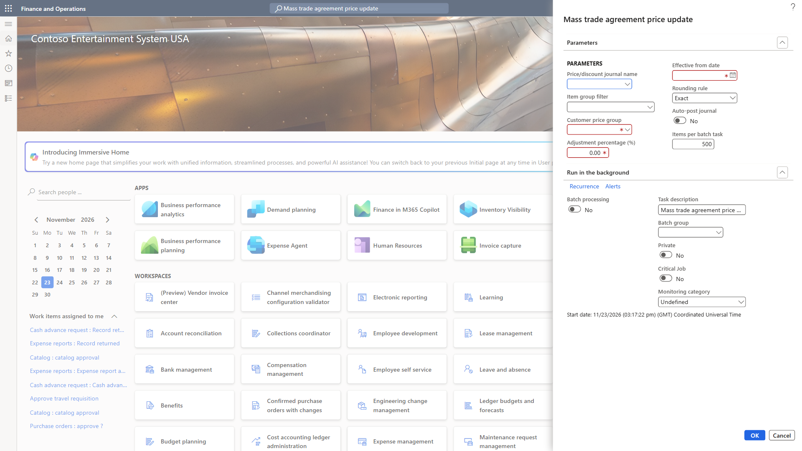

### n_e_T1_zero_percent_refused.png

T1: with 0 % the dialog stays open and warns "Adjustment percentage (%) must not be 0 and must be greater than -100."

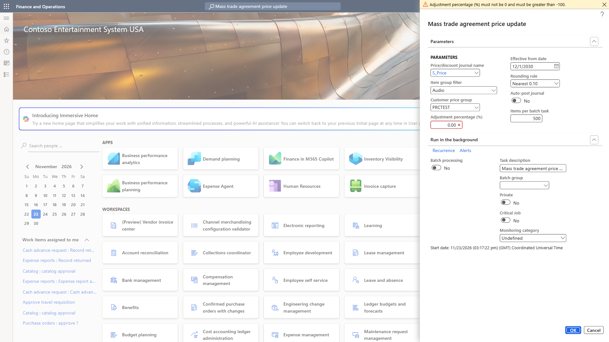

### n_f_T1_unknown_journal_name_refused.png

T1: an unknown journal name is refused and the dialog stays open.

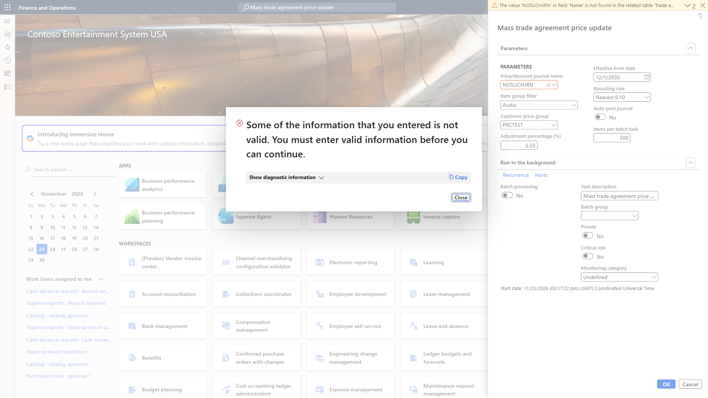

### n_i_T2_journal_PDJ-00109_closing_line_T0001_to_11-30-2030.png

T2: the closing journal line for item T0001 keeps 100.00 USD and ends the agreement on 11/30/2030, the day before the effective date.

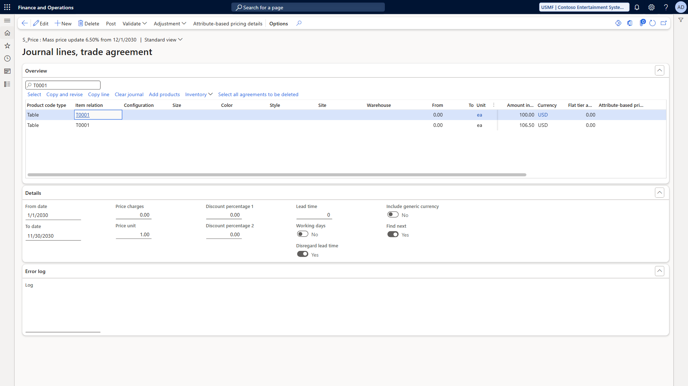

### n_j_T2_journal_PDJ-00109_new_line_T0001_106_50_from_12-01-2030.png

T2: the new journal line for T0001 starts 12/1/2030 at 106.50 USD (100.00 plus 6.5 %, rounded to the nearest 0.10).

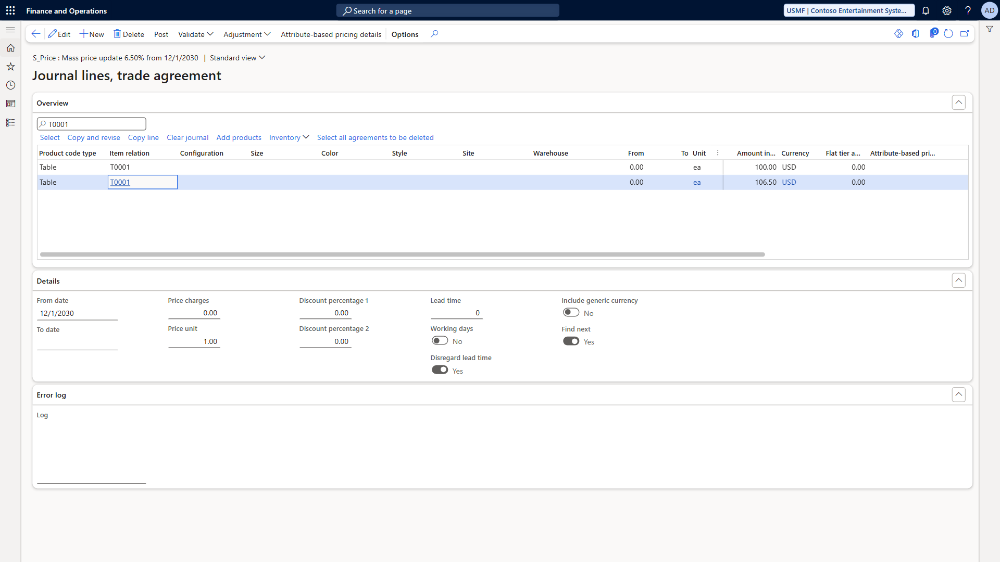

### n_h_T10_run_without_batch_infolog_totals_journal_PDJ-00109.png

T10 and T12: run without batch; the messages show 5 agreements processed, 10 journal lines, journal PDJ-00109, and that current prices stay in force until the journal is posted.

### n_k_T12_before_posting_PRCTEST_agreements_unchanged.png

T12: before the journal is posted, the trade agreements of the test price group are unchanged.

### n_m_T3_after_posting_old_ends_11-30-2030_new_starts_12-01-2030.png

T3: after posting, each old agreement ends 11/30/2030 and its new price starts 12/1/2030; the item outside the chosen item group is untouched.

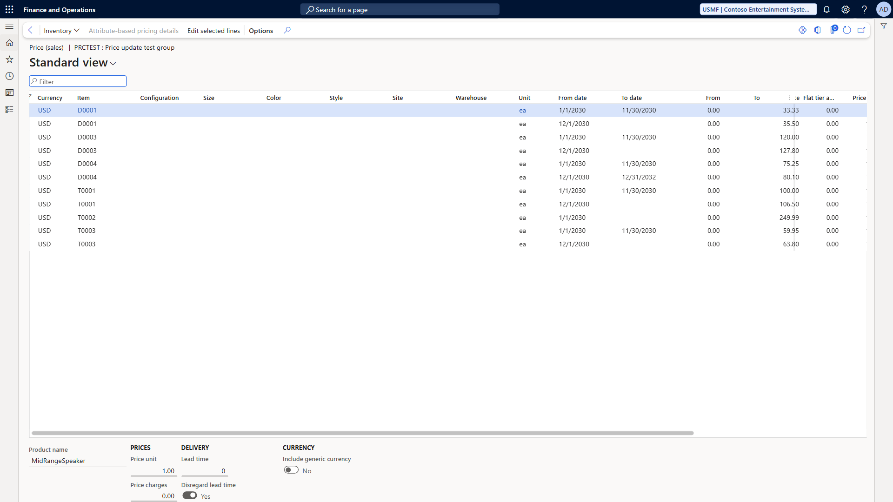

### n_p_T9_journal_PDJ-00135_T0001_9_99_becomes_9_00.png

T9: minus 10 % with rounding to the nearest 0.05 turns 9.99 into 9.00.

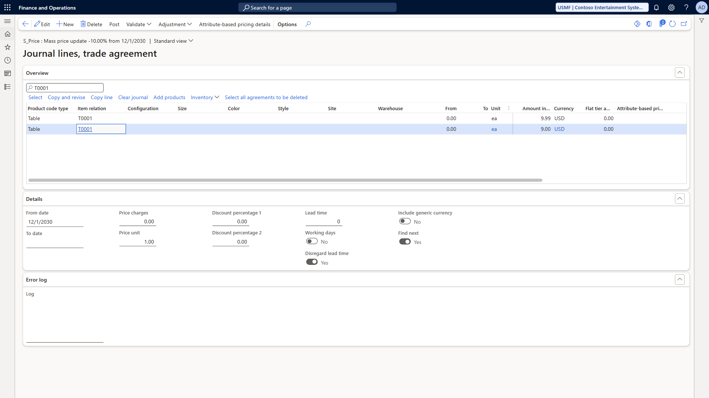

### n_t_T4_batch_tasks_3_bundle_tasks_then_summary_task_all_ended.png

T4: the batch run with 2 items per task produced three bundle tasks and a summary task, all Ended.

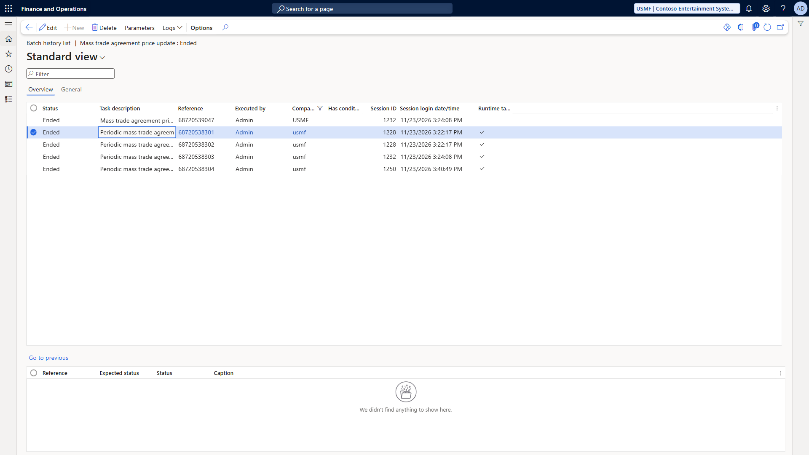

### n_u_T5_summary_task_log_totals_and_journal_posted.png

T5: the summary task's log shows 6 agreements, 12 journal lines, journal PDJ-00159, and that the journal was posted by the job.

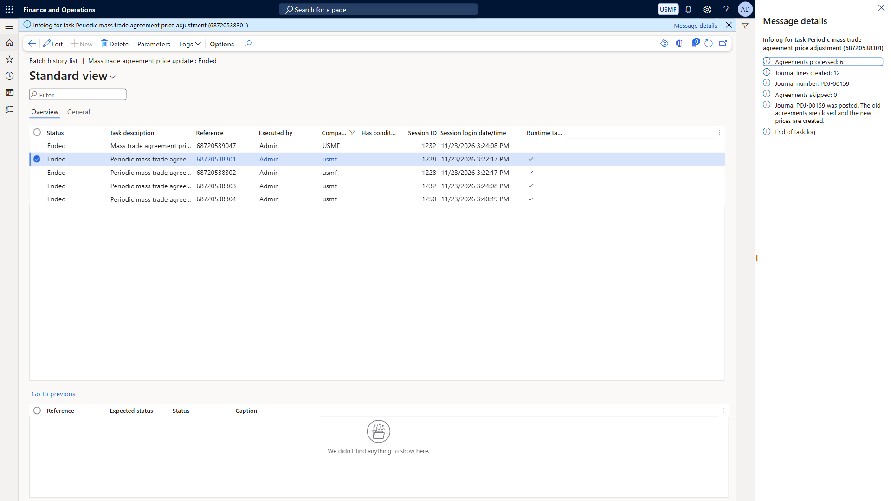

### n_v_T5_after_auto_post_PRCTEST_agreements_new_prices_from_06-01-2031.png

T5 and T7: after the auto-posted run every item of the price group, in both item groups, has its old price ending 5/31/2031 and a new price from 6/1/2031.

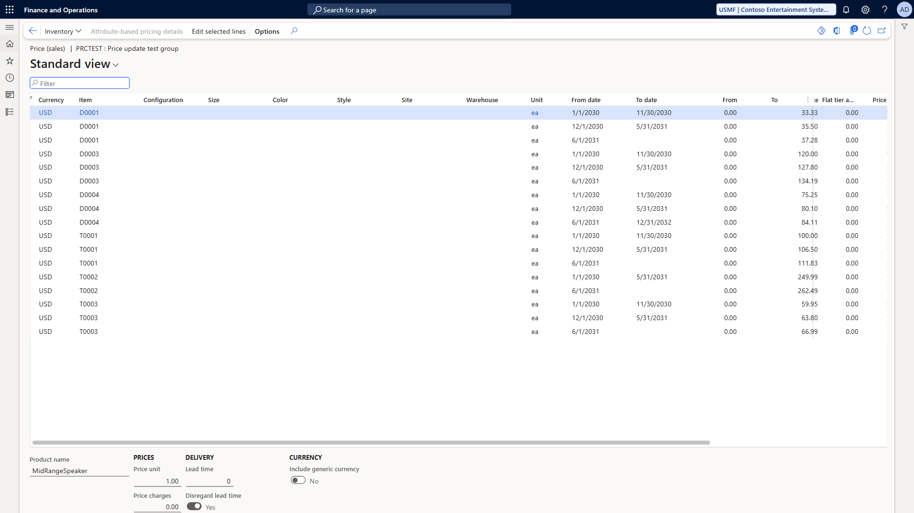

### n_w_T6_T7_T8_infolog_PDJ-00136_future_agreement_and_locked_item_skipped.png

T6, T7 and T8: the messages list an item skipped because it is on another unposted journal, an item skipped as a future agreement, and the warning that no item group was selected.

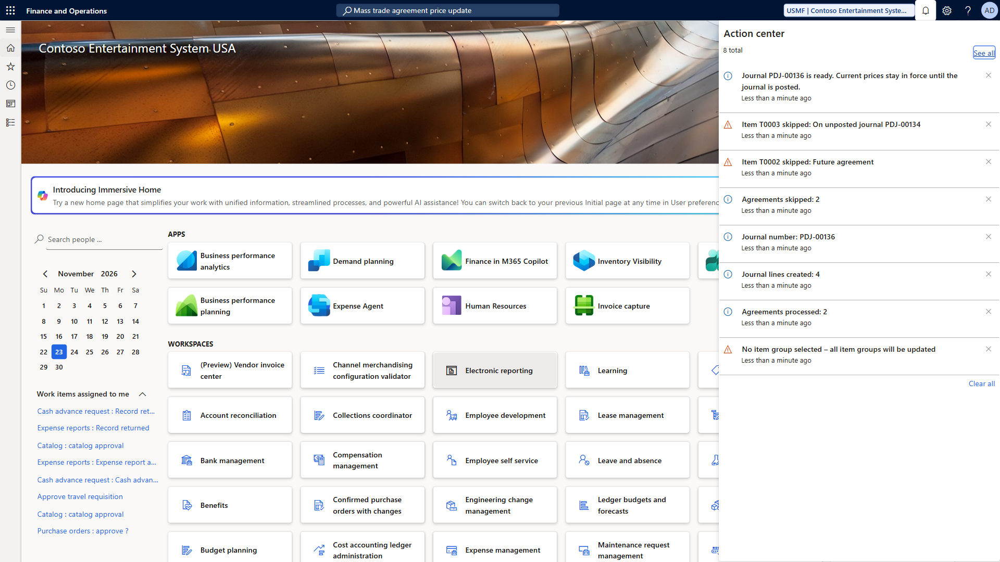

### n_x_T8_T9_PRCTEST2_agreements_9_00_from_12-01-2030_future_T0002_unchanged.png

T8 and T9: the posted result shows 9.00 from 12/1/2030, while the agreement that starts in 2032 is unchanged.

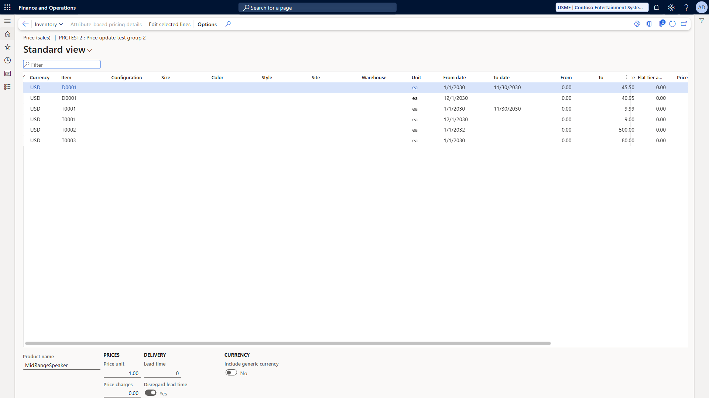

## Notes

**Warranty fix.** The first delivery could not be used: opening the menu item raised an error ("A control with the name 'Fld2_1_Ids' already exists on the form.") and the job never ran. The dialog class was fixed under warranty and the whole test was repeated on the fixed build; the results and screenshots here are from that retest.

**Not run:** T11 (a user without the duty) needs a second user; only an administrator session was available. In T3 the sales order price check was not exercised, and T4 was run at small scale (6 items, 2 per task) rather than 1,200 items.

**Minor points found:** the dialog caption reads "Mass trade agreement price update" where the design says "Periodic mass trade agreement price adjustment"; an unknown journal name is refused by the standard field check, so the design's own message is never shown; the bundle tasks and the summary task share one caption in batch history.

All test data is in USMF demo data: two test price groups with future-dated sales prices (2030 and later), so no current price changed.
