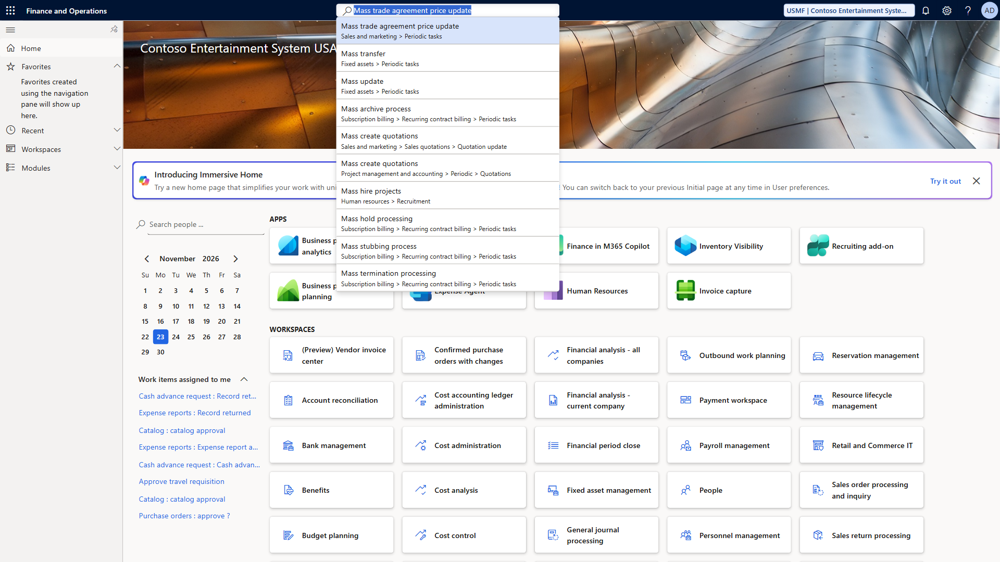
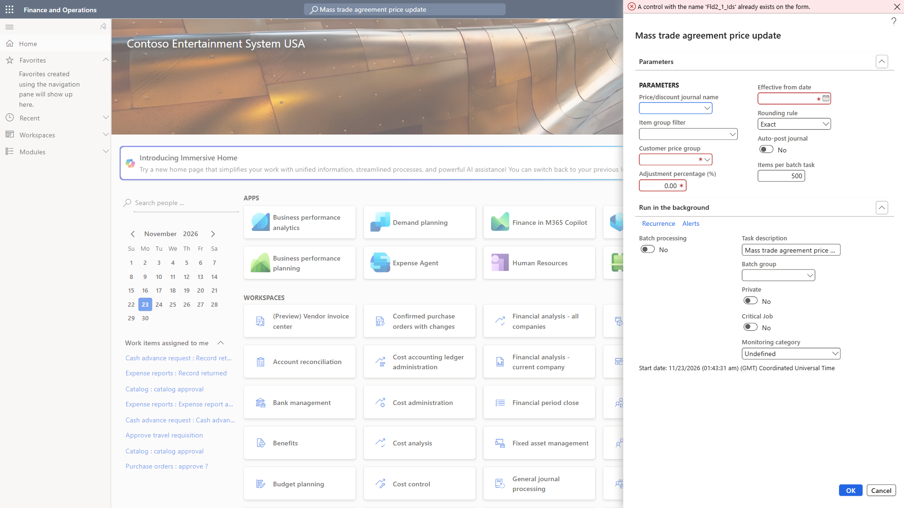
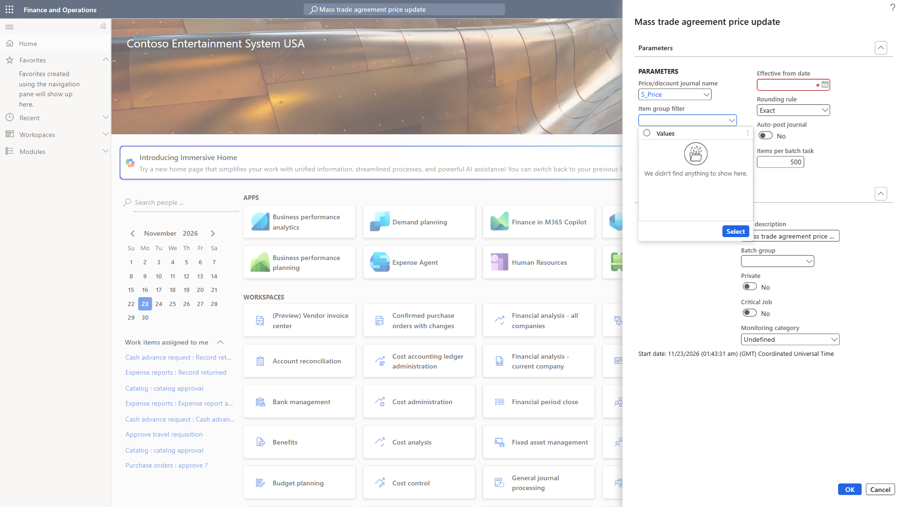
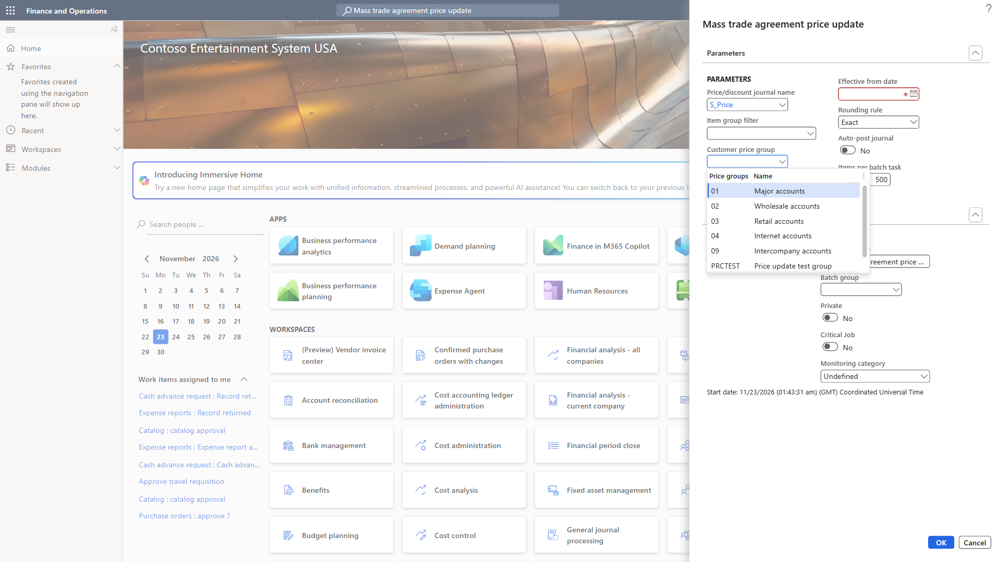
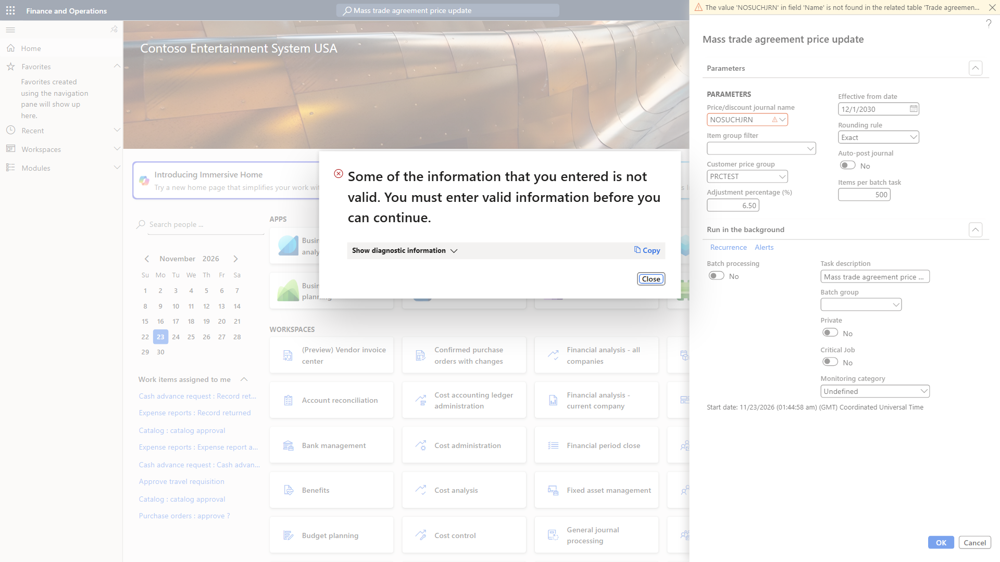
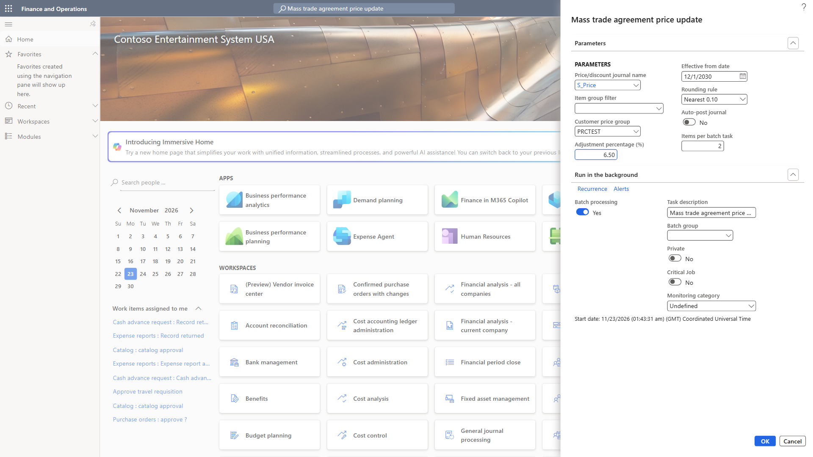
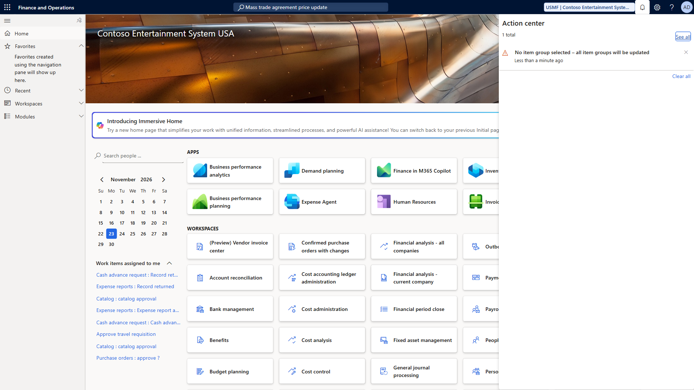
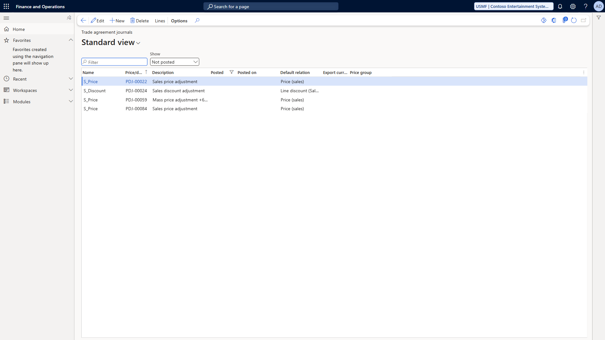

# Test cases — REQ-PRC-901

The scenarios below are the test plan from the approved TDD (section 6), unchanged. The **Result** column records only what is backed by evidence in this folder; a scenario without evidence is marked *Not yet recorded* rather than assumed to pass.

## Build verification

| Check | Result |
|---|---|
| Compile (X++ compiler, model DYLOExtensions) | ✅ 0 errors |
| Delivered | 2026-11-22 |

## Functional scenarios

Tested in Dynamics 365 Finance & Operations 10.0.48 on the Contoso demo data, legal entity USMF.

| # | Scenario | Expected result | Result | Evidence |
|---|---|---|---|---|
| T1 (AC-01) | Run with 0 % and with an unknown journal name | The dialog does not close; a warning names the field | ✅ Passed Both refusals work and the dialog stays open, but the two errors the dialog raises on opening (defect 1) had been dismissed first. The unknown journal name is stopped by the standard field check, which names the field as 'Name', not by the design's own message. | [g_T1_zero_percent_refused.png](evidence/g_T1_zero_percent_refused.png) · [h_T1_unknown_journal_name_refused.png](evidence/h_T1_unknown_journal_name_refused.png) |
| T2 (AC-02) | One agreement at 100.00 USD, +6.5 %, Nearest 0.10, effective 01-12-2026 | The journal has line A (To 30-11-2026, ref to the old agreement) and line B (From 01-12-2026, 106.50) | ❌ Failed Attempted with journal name S_Price, price group PRCTEST, 6.50 %, effective 12/1/2030, Nearest 0.10. OK closed the dialog and no journal was created (defect 1). | [i_DEFECT_after_OK_only_warning_job_does_not_run.png](evidence/i_DEFECT_after_OK_only_warning_job_does_not_run.png) · [j_DEFECT_no_journal_created_unposted_journals_list.png](evidence/j_DEFECT_no_journal_created_unposted_journals_list.png) |
| T3 (AC-03) | Post the journal from T2 | The old agreement ends 30-11-2026, the new one starts 01-12-2026, the overlap check passes, and a sales order on 01-12-2026 gets 106.50 | — Not yet recorded |  |
| T4 (AC-04) | 1,200 items, 500 per task, in batch | 3 bundle tasks run in parallel, then the summary task; the job ends Ended in Batch job history; the Infolog shows totals and the journal number | ❌ Failed Attempted with Batch processing = Yes and 2 items per batch task (6 items, so 3 tasks expected). No batch job and no journal were created (defect 1). The absence of a batch job was checked in the database, not by screenshot. | [d_dialog_all_parameters_filled.png](evidence/d_dialog_all_parameters_filled.png) · [j_DEFECT_no_journal_created_unposted_journals_list.png](evidence/j_DEFECT_no_journal_created_unposted_journals_list.png) |
| T5 | Auto-post = Yes | The journal is posted by the job, the old agreements are closed and the new ones created, and the Infolog says "posted" | — Not yet recorded |  |
| T6 | One agreement already on another unposted journal | That item is skipped and listed as locked; the others are processed | — Not yet recorded |  |
| T7 | Item group filter left empty | A warning appears, and all item groups of the price group are processed | ❌ Failed The warning "No item group selected – all item groups will be updated" does appear, but nothing is processed (defect 1). | [i_DEFECT_after_OK_only_warning_job_does_not_run.png](evidence/i_DEFECT_after_OK_only_warning_job_does_not_run.png) |
| T8 | Agreement starting after the effective date | Skipped as "Future agreement" and not changed | — Not yet recorded |  |
| T9 | −10 %, Nearest 0.05, 9.99 | New price 9.00 (8.991 rounded to the nearest 0.05) | — Not yet recorded |  |
| T10 | Run without batch | Same result in one pass; the Infolog is shown on screen | ❌ Failed Attempted 3 times without batch. No Infolog with totals or a journal number; only the item group warning (defect 1). | [i_DEFECT_after_OK_only_warning_job_does_not_run.png](evidence/i_DEFECT_after_OK_only_warning_job_does_not_run.png) |
| T11 | User without the duty | The menu item is not visible | — Not yet recorded |  |
| T12 | Auto-post = No; check the trade agreement after the job and before posting | The old agreement still has its original To date and no new agreement exists; the Infolog says the journal waits for posting. After posting, T3's result follows | ❌ Failed Same attempt as T2: no journal and no message that a journal waits for posting. The trade agreements are unchanged, but only because nothing ran. | [i_DEFECT_after_OK_only_warning_job_does_not_run.png](evidence/i_DEFECT_after_OK_only_warning_job_does_not_run.png) · [j_DEFECT_no_journal_created_unposted_journals_list.png](evidence/j_DEFECT_no_journal_created_unposted_journals_list.png) |

### a_menu_search_sales_and_marketing_periodic_tasks.png

Navigation search finds "Mass trade agreement price update" under Sales and marketing > Periodic tasks.

### b_DEFECT_dialog_opens_with_two_errors.png

Shows a defect. Right after opening the menu item, with nothing touched: the error "The menu item with name dylo_tradeagreementpriceadj could not be opened." and the red bar "A control with the name 'Fld2_1_Ids' already exists on the form."

### c_DEFECT_dialog_error_bar_control_already_exists.png

Shows a defect. After the error box is closed the dialog stays open with all eight parameters and the Run in the background tab, and the red bar "A control with the name 'Fld2_1_Ids' already exists on the form." is still shown.

### e_DEFECT_item_group_filter_lookup_empty.png

Shows a defect. The Item group filter lookup is empty ("We didn't find anything to show here."), so no item group can be selected.

### f_customer_price_group_lookup.png

The Customer price group lookup lists customer price groups only; the two errors raised when the dialog opened had been dismissed before this screenshot.

### g_T1_zero_percent_refused.png

OK with an adjustment of 0.00 % is refused with "Adjustment percentage (%) must not be 0 and must be greater than -100." and the dialog stays open; the two errors raised when the dialog opened had been dismissed before this screenshot.

### h_T1_unknown_journal_name_refused.png

OK with the unknown journal name NOSUCHJRN is refused by the standard field check and the dialog stays open; the two errors raised when the dialog opened had been dismissed before this screenshot.

### d_dialog_all_parameters_filled.png

The dialog filled in for the batch attempt (6.50 %, Nearest 0.10, 2 items per batch task, Batch processing Yes). The two errors raised when the dialog opened had been dismissed by hand before this screenshot; it is not proof that the dialog works.

### i_DEFECT_after_OK_only_warning_job_does_not_run.png

Shows a defect. After OK with valid values the dialog is gone and the Action center holds a single message, the warning "No item group selected – all item groups will be updated": no totals and no journal number.

### j_DEFECT_no_journal_created_unposted_journals_list.png

Shows a defect. The list of unposted trade agreement journals after all attempts: the job created no journal (PDJ-00059 is an older unposted journal that existed before this test).

## Notes

Tested on 23 November 2026 in USMF demo data on the dev box, against section 6 of the approved design, with the delivered code unchanged. Test data was prepared through the user interface: two customer price groups (PRCTEST, PRCTEST2) and ten sales price trade agreements for them, posted with a standard trade agreement journal.

**Summary: the job cannot be run.** Opening the menu item raises two errors, and after that OK with valid values closes the dialog without doing anything. Only the menu location, the dialog layout, the customer price group lookup and the two T1 validations could be shown. Nothing that depends on the job running (journal lines, posting, rounding, batch tasks, auto-post, Infolog totals) could be tested. The defects below are reported for a fix under warranty.

**Defects found:**
1. **Blocking: the job never runs.** Opening Sales and marketing > Periodic tasks > Mass trade agreement price update raises "A control with the name 'Fld2_1_Ids' already exists on the form." and "The menu item with name dylo_tradeagreementpriceadj could not be opened." The dialog stays on screen and still validates on OK (T1), but with valid values OK only closes it. This was the same on every attempt: 4 presses of OK with valid values, 3 without batch and 1 with Batch processing = Yes. Checked in the database after each attempt: no new trade agreement journal, no row in the job's own log table and no batch job. The control named in the first error belongs to the Item group filter field. The cause was not established; the code was not debugged or changed.
2. **The Item group filter lookup is empty** ("We didn't find anything to show here."), so no item group can be selected.
3. **Dialog caption (minor):** the dialog is titled "Mass trade agreement price update"; the design says "Periodic mass trade agreement price adjustment".
4. **Unknown journal name message (minor):** the value is refused by the standard field check ("The value '…' in field 'Name' is not found in the related table 'Trade agreement journal name'."), which names the field as 'Name'; the design's own message "Price/discount journal name %1 does not exist." is never reached from the dialog. The outcome (refused, dialog stays open) matches T1.

**Passed, with a caveat:** T1. Both validations refuse OK and keep the dialog open, but they were tested on a dialog whose opening errors (defect 1) had been dismissed first, and the unknown journal name is caught by the standard check (defect 4).

**Failed:** T2, T4, T7, T10 and T12, all because of defect 1. Each was attempted with valid values; no journal, batch job or result message was produced. For T7 the warning about the empty item group filter does appear, but no item group is processed.

**Not run:**
- T3 (post the T2 journal): blocked, there is no journal to post.
- T5 (auto-post), T6 (agreement locked on another unposted journal), T8 (future agreement skipped) and T9 (-10 %, Nearest 0.05, 9.99 to 9.00): blocked by defect 1. The test data for T6, T8 and T9 is prepared.
- T11 (a user without the duty): only an administrator session was available.

**Also checked, outside the numbered scenarios:** the menu item is under Sales and marketing > Periodic tasks; the dialog shows all eight parameters in the designed order plus the Run in the background tab, but opens with the errors of defect 1; the Customer price group lookup shows customer price groups only.

The trade agreements created for the test are still exactly as posted; the job wrote nothing.
